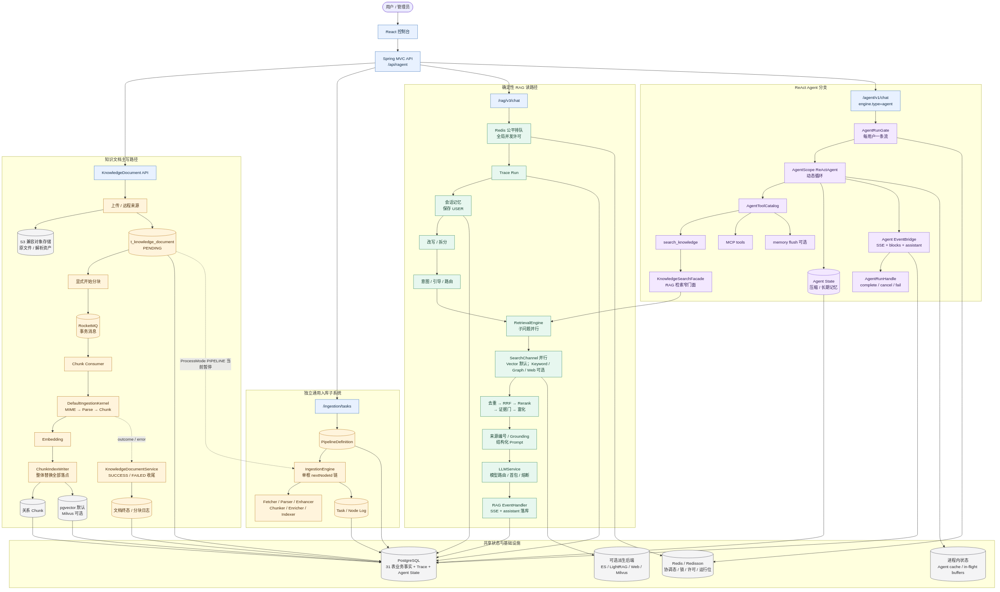

# AsterRAG 源码级面试教程

> 学习目标：不以部署复现为目标，而是能从总体架构、真实调用链、状态 owner、失败语义和设计权衡五个层次，准确解释 AsterRAG 如何工作。当前优先主线是 Agent 的工具决策与 RAG 的证据处理；后端组件作为必要支撑按需阅读。

## 学习问答：从登录到一轮 Agent 结束

[第 45 章：身份、运行槽、收尾、SSE 与启动装配](docs/45-agent-request-study-qa.md)整理了 2026-09-11 的五组学习问答与后续澄清：token 为什么仍要放入请求头、UserContext 的寿命、用户级 Redis 运行槽、CAS 为什么不保证写库成功、SSE 如何显示过程，以及 Spring Boot/Maven 的分工。

按“具体请求 → 责任与状态 → 代码顺序 → 失败边界”阅读，并可跳回第 36、38、39 章。正文保持原冻结源码；较新上游的工具确认、POST SSE、取消自动重试等变化单列[版本对照](docs/45-agent-request-study-qa.md#version-diff)。[源码核对记录](evidence/request-study-source-review.md)附固定提交链接。

## 本次增补：Agent / RAG 面试重点

第 21～25 章已按“原理 → 建库过程 → 查询过程 → 项目应用”重写，用林辰、星河项目和差旅审批这一组资料贯穿全篇。先讲明白数据怎样组织、查询怎样执行，再进入源码；配置与边缘细节集中到附录 D。原有 0～20 章保留，不重编号。

推荐主线：**1 → 14 → 15 → 7 → 21 → 22 → 23 → 24 → 16 → 25**。先理解 Agent 调什么工具，再理解工具内的检索如何工作；9、10、12、13 章用于进一步追问。Redis、RocketMQ、认证、前端和部署不再占据优先阅读路线，可按需回查第 2～6、8、17～19 章。

| 增补章 | 重点 |
|---|---|
| [21：HNSW——给向量修一张找路的地图](docs/21-hnsw-vector-index.md) | 为什么需要索引；怎样分层、插入和连边；查询怎样保留候选细找 |
| [22：BM25——用词语建立找资料的路](docs/22-es-bm25-retrieval.md) | 倒排表如何建立；词频、IDF、长度怎样共同打分；查询怎样执行 |
| [23：LightRAG——把散落的文字连成知识](docs/23-lightrag-graph-retrieval.md) | 实体关系抽取与合并；实体 / 关系向量索引；local/global/hybrid；回到原文回答 |
| [24：从三路候选到答案证据](docs/24-hybrid-retrieval-to-evidence.md) | 为什么要融合和精排；RRF 如何计算；材料怎样变成回答上下文 |
| [25：Agent 怎样使用 RAG](docs/25-agentic-rag-interview-focus.md) | 模型、执行循环、工具结果如何配合；知识能力怎样支持后续行动 |

默认仍是稠密向量检索；BM25 和 LightRAG 是已有但默认关闭的可选能力。阅读侧重变化不等于已开启功能、完成调优或取得评测结果。增补计划见 [RETRIEVAL_SUPPLEMENT_PLAN.md](RETRIEVAL_SUPPLEMENT_PLAN.md)。

## 新增评测篇：从系统表现到改进判断

沿 **26 → 27 → 28 → 29 → 30 → 31** 顺序阅读。用官方评估集中的手机参数问答贯穿：先出题与定义标准，再收集回答和材料，随后手算指标、理解模型裁判，最后分析报告与设计改进。无需真实运行评测。

| 章节 | 重点 |
|---|---|
| [26：评测全景](docs/26-evaluation-overview.md) | 总体架构；被评系统、录制器与裁判的分工 |
| [27：评估集](docs/27-evaluation-dataset.md) | 怎样定义好答案；must/nice；场景覆盖与参考质量 |
| [28：录制过程](docs/28-evaluation-recording.md) | SSE 回答、检索旁路、两次请求与记录；重评和重跑 |
| [29：确定性指标](docs/29-evaluation-deterministic-metrics.md) | Hit、Recall、MRR 手算；意图、行为、时间与分母 |
| [30：RAGAS 模型裁判](docs/30-evaluation-ragas-judge.md) | 事实拆分、证据支持、排序与语义比较；五项指标怎样算 |
| [31：诊断与面试](docs/31-evaluation-diagnosis-and-interview.md) | 人工复核、对比和消融；检索改进与 Agent 评测设计 |

这六章研究作者的 `nageoffer/ragenteval`，不是把评测器当成产品内模块。源码入口与版本细节统一收在[附录 E](appendices/evaluation-implementation-notes.md)，计划见 [EVALUATION_SUPPLEMENT_PLAN.md](EVALUATION_SUPPLEMENT_PLAN.md)。

## 评测进阶：Trace、日志与问题闭环

接着读 **32 → 33 → 34**。这三章参考面试题库中的追问主题，讲理想情况下怎样观察、排查和改进，不要求运行项目。用同一条手机参数问答串联调用树、证据变迁、耗时分析与案例回流；不把设计示例写成已有部署或实测成绩。

| 章节 | 重点 |
|---|---|
| [32：Trace、日志与指标](docs/32-trace-logs-and-evaluation.md) | 从零理解三者分工、Span 树、跨服务/会话关联、实际模型材料与 Agent 轨迹 |
| [33：定位问题与回放](docs/33-observability-diagnosis-and-replay.md) | 答错、变慢、重复调用的完整排查；结构化日志、证据与根因；回看、回放、重跑 |
| [34：监控与评测闭环](docs/34-monitoring-to-evaluation-loop.md) | 指标分母、告警、采样、隐私；线上记录怎样变成评估集；无真值与回归设计 |

写作范围见 [OBSERVABILITY_SUPPLEMENT_PLAN.md](OBSERVABILITY_SUPPLEMENT_PLAN.md)。题库仅用于选题归纳，不随教程复制原始数据库或题目集合。

## 后端面试篇：项目怎么用 → 基础怎么答

新增 **第 35～44 章**，严格分成两部分。用“提问 → 存储 → 检索 → 流式回答 → 停止/删除”串起 Java、Spring Boot、MyBatis-Plus、PostgreSQL、Redis 与 SSE，再沿面经真实主题展开基础追问。不是独立于项目的一套八股题库，也不要求运行系统。

### 第一部分：项目应用（35～39）

| 章节 | 讲透什么 |
|---|---|
| [35：一次问答的后端地图](docs/35-backend-request-map.md) | 总体架构、完整请求、身份/会话/任务与状态归宿 |
| [36：Spring Boot 怎样组装服务](docs/36-backend-spring-in-project.md) | Maven 与运行边界、Bean/Mapper、条件装配、单例与每轮对象、用户上下文 |
| [37：会话与知识怎样持久化](docs/37-backend-persistence-in-project.md) | 表结构、消息配对、JSONB、真实 SQL/索引、删会话事务、搜索副本同步 |
| [38：Redis 怎样协调运行](docs/38-backend-redis-in-project.md) | 用户运行闸门、TTL/owner、跨节点取消、先取消后注册的竞态 |
| [39：SSE 与并发收尾](docs/39-backend-streaming-in-project.md) | 事件桥、连接/业务终态、CAS/锁/volatile、线程池、超时与取消 |

### 第二部分：基础追问（40～44）

| 章节 | 重点追问 |
|---|---|
| [40：Java 基础](docs/40-backend-java-interview.md) | 集合、线程安全、可见性、锁、线程池异常、ThreadLocal、JVM |
| [41：Spring 与 MyBatis](docs/41-backend-spring-mybatis-interview.md) | DI/生命周期、AOP、事务自调用/传播、参数绑定、缓存/分页/逻辑删除 |
| [42：SQL、索引与事务](docs/42-backend-database-interview.md) | B+ 树、联合索引、慢 SQL、MVCC、锁、WAL、PostgreSQL/MySQL 差异 |
| [43：Redis 基础](docs/43-backend-redis-interview.md) | 数据类型/编码、过期/淘汰、持久化、缓存一致性、锁/Lua/消息、语义缓存设计 |
| [44：网络与模拟面试](docs/44-backend-network-and-mock-interview.md) | SSE/HTTP、重连/幂等、容量/重试、跨服务观测、三组完整追问 |

首次读按 **35 → 36 → 37 → 38 → 39 → 40 → 41 → 42 → 43 → 44**。专项准备可以成对阅读：**Redis 38+43；数据库 37+42；Spring 36+41；Java/SSE 39+40+44**。后端仍服务于 Agent/RAG 主线，不扩展 RocketMQ、秒杀或分库分表专项。

真实面经主题与源码定位见[后端对照附录](appendices/backend-source-and-interview-map.md)，写作安排见[增补计划](BACKEND_INTERVIEW_SUPPLEMENT_PLAN.md)。拟议优化与容量演算均标明为教学设计，不冒充现有实现或实验成果。

## 教程版本与资料基准

| 资料 | 冻结版本 | 作用 |
|---|---|---|
| AsterRAG | `98894c2c42c015a3c874c6b3c986ac863c85b731` | 唯一产品实现事实基准 |
| `nageoffer/ragent` 上游 | `1cb684ed5df03f241d90c836466465f6aab37800` | fork 来源与同源历史 |
| Ragent `1.0.0` | `5500546c4e4742752adaaebf51c9423bef5f3497` | 作者旧课程版本对照 |
| how-claude-code-works | `f4d6505ed9162a0ee6be089190f74c419ecacb19` | 只参考教学信息架构 |
| nageoffer/ragenteval | `9d69c63cdca0bf730d8900c3076e0480e541360c` | 第 26～31 章评测实现来源，通过授权页面阅读 |

完整资料锁见 [SOURCES.lock.md](evidence/SOURCES.lock.md)。

AsterRAG 基于 Apache-2.0 的 `nageoffer/ragent` 学习和二次开发。本教程保留上游归属，并在面试章中明确区分“上游能力、当前 fork 改动、个人理解和未来设计”。

## 一句话主线

> 一份文档怎样变成可检索证据，一次问题怎样经过理解、路由、检索、生成或工具调用，最终成为有来源、可追踪、可取消并能正确收尾的回答。



这张图的读法是：

```text
左侧写路径：Document → MIME/Parse → Chunk/Embedding → Index
                                      ↓
                              可检索证据合同
                                      ↑
中部 RAG： Question → Memory/Intent → Retrieval → Prompt/Model/SSE

右侧 Agent：Question → ReAct → Knowledge/MCP/Memory Tools
                                      ↓
                              State/Memory/Finalizer

底部 owner：PostgreSQL | Object Storage | Redis | Derived Index | Process/UI State
```

## 原有三条完整学习路线（按需回查）

### 30 分钟全景线

```text
0 → 1 → 3 → 20
```

目标：能画总体图，能说清三条主链、状态 owner、项目归属和当前边界。

### 核心 RAG 线

```text
0 → 1 → 3 → 4 → 5 → 6 → 7
          → 8 → 9 → 10 → 11 → 12 → 13
          → 17 → 19 → 20
```

目标：连通“原资料进入”和“有证据答案输出”，能解释每个中间状态和失败窗口。

### Agent 与工程深入线

```text
0 → 1 → 2 → 3 → 11 → 12
          → 14 → 15 → 16 → 17 → 18 → 19 → 20
```

目标：理解 ReAct 与固定 RAG 的边界，以及工具目录、AgentScope State、上下文压缩、长期记忆和三路收尾。

## 正文目录

### 第一部分：建立系统地图

| 章 | 问题 | 产物 |
|---|---|---|
| [第 0 章：怎么使用这份源码级教程](docs/00-reading-contract.md) | 一句话凭什么可信 | 冻结版本、证据等级、归属与阅读路线 |
| [第 1 章：总体架构与三条主调用链](docs/01-system-architecture.md) | 整个系统怎样流动 | 总体图、写/RAG/Agent 主链和失败收敛 |
| [第 2 章：模块边界、依赖与运行拓扑](docs/02-modules-and-runtime.md) | 代码和进程住在哪里 | 7 个 Maven 模块、2 个启动边界和四层配置证据 |
| [第 3 章：领域对象与状态所有权](docs/03-state-ownership.md) | 什么状态还在，谁能恢复 | 31 表领域地图、四类 owner 和关键生命周期 |

### 第二部分：沿知识写路径下钻

| 章 | 问题 | 产物 |
|---|---|---|
| [第 4 章：文档从哪里来](docs/04-document-entry.md) | 原文件/URL 怎样进系统 | 上传限流、对象/元数据、远程刷新和失败窗口 |
| [第 5 章：文档怎样变干净](docs/05-parsing.md) | 字节怎样变成结构化 Block | MIME/Profile 路由、Parser 注册、多格式与 provenance |
| [第 6 章：入库主循环](docs/06-ingestion.md) | 固定内核和通用 Pipeline 有什么边界 | RocketMQ、固定五步、单根链 Engine 和当前未接通点 |
| [第 7 章：从 Chunk 到可检索证据](docs/07-chunking-and-indexing.md) | 分块/Embedding/多落点怎样合作 | Chunk 不变式、展示/向量双文本、sink 一致性矩阵 |

### 第三部分：沿确定性 RAG 读路径下钻

| 章 | 问题 | 产物 |
|---|---|---|
| [第 8 章：请求、并发闸门与 SSE](docs/08-request-sse-lifecycle.md) | 请求怎样被接受/拒绝/取消 | Controller、limiter、task、emitter 和完整事件寿命 |
| [第 9 章：会话记忆、改写与拆分](docs/09-memory-and-rewrite.md) | 上下文怎样变成可检索问题 | USER 持久、摘要/历史、改写失败边界 |
| [第 10 章：意图、引导与检索范围](docs/10-intent-and-scope.md) | 哪些请求不该检索，又该查哪里 | guidance/system-only 短路与 KB scope |
| [第 11 章：多通道检索](docs/11-multi-channel-retrieval.md) | 子问题和通道怎样并行 | vector/keyword/graph/web 合同、超时和降级 |
| [第 12 章：检索后处理](docs/12-retrieval-postprocessing.md) | 异构候选怎样变成最终证据 | 去重、RRF、Rerank、证据门、富化和预算 |
| [第 13 章：回答生成、来源与 Trace](docs/13-answer-generation-and-trace.md) | 证据怎样变成回答并正确收尾 | grounding/prompt/model stream、sources、assistant 和 Trace |

### 第四部分：ReAct Agent 与工具

| 章 | 问题 | 产物 |
|---|---|---|
| [第 14 章：Agent 与 Workflow 的真实边界](docs/14-agent-vs-workflow.md) | 两种编排模型如何分工 | engine 选择、RunGate、Provider 与 ReAct 入口 |
| [第 15 章：Agent 工具系统](docs/15-agent-tools.md) | 知识、MCP 和记忆工具怎样进入目录 | Catalog、工具合同、MCP 交集和 Knowledge Facade |
| [第 16 章：Agent State、Memory 与统一收尾](docs/16-agent-state-memory-finalization.md) | 动态循环怎样恢复并在三种终局释放 | State Store、Compaction、LTM、EventBridge 和 RunHandle |

### 第五部分：工程边界、配置与面试

| 章 | 问题 | 产物 |
|---|---|---|
| [第 17 章：工程保护网](docs/17-engineering-guardrails.md) | 认证、幂等、限流、审计和敏感信息如何横切 | owner/token/TTL、审计 vs Trace、后端授权边界 |
| [第 18 章：前端状态与证据](docs/18-frontend-state-and-evidence.md) | UI 怎样投影两套 SSE 协议 | hooks/stores、sources、blocks、刷新与示例数据边界 |
| [第 19 章：配置组装与故障推演](docs/19-configuration-and-failure-reasoning.md) | 某能力到底是存在、装配还是运行 | POM/YAML/Bean/分支四层证据和默认拓扑故障树 |
| [第 20 章：把源码理解变成面试叙事](docs/20-interview-narrative.md) | 怎样在 30 秒、2 分钟和 5 分钟讲清项目 | 口述模板、技术难点、追问、权衡和诚实边界 |

### 第六部分：Agent / RAG 面试增补篇

第 21～25 章的入口位于本页最上方。它们不另起一套系统，而是把第 1 章的 Agent → Knowledge Tool → Retrieval 区域放大，补足原章节对检索原理的讲解。

### 第七部分：评测原理与面试篇

第 26～31 章在系统外部建立观察视角，与第 21～25 章构成“能力如何工作 → 效果如何解释”的闭环。章节入口见本页新增评测篇，第一张评测总体图位于第 26 章。

## 附录

| 附录 | 用法 |
|---|---|
| [附录 A：100 道分层面试追问](appendices/interview-question-bank.md) | 遮住答案口述，再核必答点和源码锚点 |
| [附录 B：术语表](appendices/glossary.md) | 快速区分名字相似但 owner/寿命不同的概念 |
| [附录 C：源码导航索引](appendices/source-index.md) | 从“想回答什么问题”反向找入口、主链和终局 |
| [附录 D：检索实现备查](appendices/retrieval-implementation-notes.md) | 原理读懂后再查配置、源码入口和具体实现分支 |
| [附录 E：评测实现备查](appendices/evaluation-implementation-notes.md) | 回查评测源码、指标口径与产品版本差异 |
| [后端源码与面经对照](appendices/backend-source-and-interview-map.md) | 第 35～44 章的题源、选题取舍、冻结源码和关键结论核查 |

## 图表索引

| 图 | 用途 | 源文件 |
|---|---|---|
| [总体架构](assets/architecture/system-overview.png) | 全书中央地图 | `assets/architecture/system-overview.mmd` |
| [知识入库时序](assets/diagrams/ingestion-sequence.png) | 上传/分块断点、MQ、五步内核和终态 | `assets/diagrams/ingestion-sequence.mmd` |
| [RAG 时序](assets/diagrams/rag-sequence.png) | 排队、短路、正常/取消/失败收尾 | `assets/diagrams/rag-sequence.mmd` |
| [Agent 时序](assets/diagrams/agent-sequence.png) | RunGate、工具、State 和三路 finalizer | `assets/diagrams/agent-sequence.mmd` |
| [状态所有权](assets/diagrams/state-ownership.png) | 持久事实、原对象、派生索引、协调态和进程态 | `assets/diagrams/state-ownership.mmd` |
| [评测总体架构](assets/diagrams/evaluation-overview.png) | 被评系统、录制、评分与报告的分工 | `assets/diagrams/evaluation-overview.mmd` |
| [评测录制时序](assets/diagrams/evaluation-recording.png) | 单题的聊天请求与检索旁路 | `assets/diagrams/evaluation-recording.mmd` |
| [评测诊断路线](assets/diagrams/evaluation-diagnosis.png) | 从记录、路由和证据分析到生成 | `assets/diagrams/evaluation-diagnosis.mmd` |

## 每章的学习方法

```text
第 1 遍：看本章在总体图的位置和核心结论
第 2 遍：关掉教程，口述 5～10 个关键调用节点
第 3 遍：对每个副作用问 owner、寿命、失败和恢复
第 4 遍：用附录 A 的对应问题进行追问压测
```

掌握一章的标准不是背下所有类名，而是能完整说出：

1. 本章的 owner 是谁；
2. 输入、主顺序和产物是什么；
3. 哪一步首次产生外部副作用；
4. 持久事实、派生索引、协调态和进程态各是什么；
5. 正常、短路/拒绝、取消和错误如何收尾；
6. 哪些结论是源码事实，哪些只是设计推断。

## 证据与写作过程

`evidence/` 是教程的事实底座，不是读者必须从头阅读的第二本手册：

| 文件 | 回答的问题 |
|---|---|
| [source-map.csv](evidence/source-map.csv) | 每个核心论断的 commit/path/symbol 是什么 |
| [source-census.md](evidence/source-census.md) | 模块、文件、Controller、配置、测试和表的静态普查 |
| [call-chains.md](evidence/call-chains.md) | 三条主链的类/方法调用骨架 |
| [architecture-node-map.md](evidence/architecture-node-map.md) | 总体图每个节点的 owner、输入、输出与失败边界 |
| [reference-drift.md](evidence/reference-drift.md) | 作者旧课程/页面与冻结源码的版本漂移 |
| [test-matrix.md](evidence/test-matrix.md) | 测试类存在、聚焦测试和 Live/集成边界 |
| [retrieval-supplement-source-map.md](evidence/retrieval-supplement-source-map.md) | 第 21～25 章的实现事实、算法背景与静态复核范围 |
| [evaluation-source-map.md](evidence/evaluation-source-map.md) | 第 26～31 章的流程、公式来源与教学演算边界 |
| [diagram-qa.md](evidence/diagram-qa.md) | 5 张图的源文件、渲染与视觉检查 |

详细写作计划见 [TUTORIAL_DEVELOPMENT_PLAN.md](TUTORIAL_DEVELOPMENT_PLAN.md)，实际执行记录见 [PROGRESS.md](PROGRESS.md)。

## 最后的诚实边界

这份教程的主产物是对冻结源码的系统理解。它不宣称：

- 你亲自从零实现了上游 RAG/Agent 核心；
- 所有可选后端默认同时运行；
- 文档 SUCCESS 就保证所有问题召回；
- 单元测试通过就等于集成环境、浏览器路径和生产质量全部通过；
- 源码中可以合理推断的设计考量，就是原作者明示说过的意图；
- 未来可改进点已经由当前 fork 完成。

这些边界不会削弱面试叙事，反而让你的回答更精确、更经得起追问。
