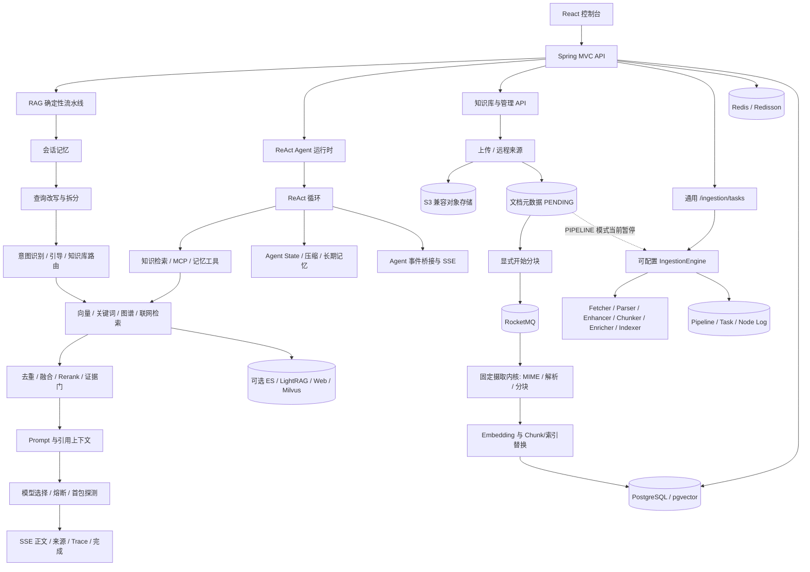

# AsterRAG 源码级教程开发计划

> 计划版本：v1.4（2026-09-08 增补评测原理与面试篇；旧阶段记录保留）
> 制定日期：2026-09-01  
> 教程工作区：私有远程教程工作区  
> 当前阶段：按源码导读与面试理解目标编写正文  
> 目标读者：具备 Java、Spring Boot 和基础数据库知识，希望真正读懂 Agentic RAG 工程并用于校招面试的开发者

## 本轮增补优先级

新增[评测教程计划](EVALUATION_SUPPLEMENT_PLAN.md)：第 26～31 章围绕同一条手机参数问答，讲清题目标准、双接口录制、确定性公式、RAGAS 裁判与诊断闭环；附录 E 集中精确实现。继续采用原理与流程优先的写法，不运行评测、不提供虚构成绩。

教学修订：第 21～25 章先讲原理、数据组织、建库与查询，再说明项目应用；通过统一案例串联。源码核验属于写作底座，不再充当正文主线。具体配置和边缘分支集中放在附录 D，详细修订见增补计划。

执行 [Agent / RAG 面试主线增补计划](RETRIEVAL_SUPPLEMENT_PLAN.md)：新增第 21～25 章，重点解释 HNSW、ES/BM25、LightRAG、融合与证据，以及它们如何服务 Agent 的知识工具。阅读路线以 Agent 与检索为中心；Redis、RocketMQ、前端和部署类细节降为按需参考，不删除旧内容。本轮只进行源码与教程静态检查，不运行项目，不将历史测试结果当作本轮结果。

## 1. 项目目标

本教程不是 AsterRAG 的 API 手册，也不是逐文件翻译源码。它要完成一件更难但更有价值的事：以冻结版本的源码为事实基础，把一个复杂的 Java Agentic RAG 系统组织成一条可以连续学习、回到源码定位、最终能够独立讲清楚并应对面试追问的主线。读者不需要实际部署或复现项目；教程的核心产品是准确、连贯、可口述的系统理解。

教程的中心叙事是：

> 一份文档怎样变成可检索的证据，一次问题怎样经过理解、路由、检索、生成或工具调用，最终成为带来源、可追踪、可取消、可恢复的回答。

所有章节围绕同一张总体架构图展开，不按 Maven 包名机械罗列功能。读者读完后应当能够：

1. 说清 AsterRAG 的模块边界、两条核心流水线和共享基础设施。
2. 沿真实源码调用链追踪“文档入库”和“知识问答”两个端到端流程。
3. 区分确定性 RAG Pipeline 与 ReAct Agent Runtime，理解二者共享什么、各自负责什么。
4. 解释状态存在哪里、何时改变，以及失败、取消、重试和恢复时会发生什么。
5. 能用源码责任、关键调用链、状态边界和设计权衡支持面试陈述，不把上游已有能力误说成个人原创。

## 2. 不可妥协的写作边界

### 2.1 事实权威顺序

发生冲突时，按以下优先级裁决：

1. **S0：冻结提交中的实际源码、数据库 Schema、配置绑定、测试代码。** 这是实现事实的最高权威。
2. **S1：冻结提交中的现有测试设计，以及已有、不为教程额外扩张的聚焦测试记录。** 只用来帮助理解边界和失败语义，不把“证明项目正确”作为教程任务。
3. **S2：AsterRAG 自带 README、UPSTREAM、Release Notes 和示例。** 用于理解项目声明，但精确实现仍回到源码。
4. **R1：Ragent 作者公开网站和作者专栏。** 用于理解设计动机、知识背景和讲解线索，不直接覆盖当前 AsterRAG 实现。
5. **R2：`how-claude-code-works`。** 只借鉴总体架构先行、围绕主循环组织专题、快速阅读路径和章节导航等教学设计；不能把 Claude Code 的机制移植成 AsterRAG 的事实。

任何无法在 S0/S1 中确认的精确实现，必须标为“待核验”“可选配置”或“作者材料中的设计说明”，不得写成当前源码已经实现。

### 2.2 已知版本差异必须显式处理

作者专栏在 2026-08-12 的更新说明中明确：课程资料以 `1.0.0` 分支为准，代码正在向 2.0 演进。作者公开站当前仍以 4 个后端模块和 Spring Boot 3.5.7 介绍 Ragent；AsterRAG 当前源码已经是 7 个 Maven 模块并使用 Spring Boot 4.1.0。

因此：

- 不能照搬作者教程中的模块数量、依赖版本、接口路径、类名或执行顺序。
- 作者文章提到的能力，只有在 AsterRAG 冻结提交中找到实现后，才能写入当前实现的主叙述。
- 如作者设计意图与 AsterRAG 二次开发后的实现不同，正文必须用“上游基线 / AsterRAG 当前实现”对照框说明差异。
- 教程代码链接一律指向冻结提交，不指向会漂移的 `main` 行号。

### 2.3 版权、归属与面试边界

- 保留 Apache License 2.0、NOTICE、上游作者与仓库归属。
- 不复制知识星球受限文章正文、图片或评论；只记录公开目录、主题线索和必要的版本说明。
- 不把上游已有的 RAG、检索、入库、模型路由等实现描述成个人原创。
- 面试材料明确区分三层：上游已有能力、AsterRAG 二次开发、本人实际理解和验证。
- 不以“企业级”“生产级”作为无条件结论；只描述源码已实现的机制，并明确默认配置直接上线仍缺少的密钥托管、隔离、容量、监控、备份和灾备工作。

## 3. 冻结资料清单

正式写作前必须把下表写入 `evidence/SOURCES.lock.md`，并在后续更新时走变更流程。

| 资料 | 用途 | 冻结版本或访问点 | 权限 |
|---|---|---|---|
| [AsterRAG](https://github.com/zz1403489227-crypto/AsterRAG) | 教程唯一产品源码目标 | `98894c2c42c015a3c874c6b3c986ac863c85b731` | 只读分析 |
| [nageoffer/ragent](https://github.com/nageoffer/ragent) | 上游历史与归属核对 | 当前导入基线 `1cb684ed5df03f241d90c836466465f6aab37800` | 只读参考 |
| Ragent `1.0.0` tag | 对照作者课程版本 | `5500546c4e4742752adaaebf51c9423bef5f3497` | 只读参考 |
| [作者公开教程](https://nageoffer.com/ragent/) | 设计动机、概念背景、作者公开课程结构 | 2026-09-01 访问快照 | 只读参考 |
| 作者知识星球专栏 | 课程目录与作者版本说明 | `column_id=281884884411`，2026-09-01 访问 | 仅限当前授权阅读，不复制正文 |
| [how-claude-code-works](https://github.com/Windy3f3f3f3f/how-claude-code-works) | 教学信息架构参考 | `f4d6505ed9162a0ee6be089190f74c419ecacb19` | 只读参考 |

补充规则：AsterRAG 中仍保留的 `com.nageoffer.ai.ragent` 包名、`/api/ragent` 路径和 `ragent.*` 配置键属于兼容协议，教程必须解释“品牌名”和“运行时兼容名”为什么没有全局替换，不能把它误判为改名不完整。

## 4. 教程的逻辑主干

### 4.1 一个系统，两个主流程，一个 Agent 分支

整套教程以“证据如何进入、问题如何出去”为主干：

1. **知识生产线（写路径）**：上传/远程来源 → 对象存储与文档元数据 → 显式开始分块 → RocketMQ 消费 → 固定五步摄取内核（MIME、解析、分块、Embedding、索引）→ 可检索证据。另有 `/ingestion/tasks` 通用可配置 Pipeline，必须作为独立子系统说明，不能替代当前知识文档主链。
2. **RAG 回答线（读路径）**：请求接入 → 记忆 → 改写拆分 → 意图与引导 → 多通道检索 → 后处理 → Prompt → 模型路由 → SSE、来源和落库。
3. **Agent 执行分支**：ReAct 循环 → 工具目录 → 知识检索/MCP/记忆工具 → 状态存储与上下文压缩 → Agent SSE 事件。
4. **共享基础设施**：认证、幂等、并发闸门、Redis、PostgreSQL/pgvector、对象存储、可选索引、MQ、Trace、审计和前端控制面。

### 4.2 第一章总体架构图的绘制合同

第一章必须先给出一张经过源码核验的总体架构图，至少包含下列真实边界。下面只是计划阶段的骨架，正式图中的每个节点都必须绑定源码锚点：



第一章正文必须完成以下解释，而不是“放一张图就结束”：

- 每个区域解决什么问题、不解决什么问题。
- 写路径和读路径在哪里交汇，什么时候“上传成功”仍不等于“已经可检索”。
- RAG Pipeline 与 ReAct Agent 是两条不同入口和执行模型，不能把 Agent 当成 RAG Pipeline 的别名。
- PostgreSQL、pgvector、Redis、对象存储和可选检索后端分别持有什么状态；谁是事实存储，谁是缓存、协调或索引。
- 正常路径之外，取消、超时、空召回、单通道失败、模型故障、固定摄取内核失败和通用入库节点失败从哪里收敛。
- 当前知识文档主链与通用可配置 Ingestion 子系统为什么不能合并：前者使用固定五步内核；后者需要显式 Pipeline 定义；知识文档 `ProcessMode.PIPELINE` 在冻结源码中明确暂停。
- 后续每一章在总体图中的位置和它与前后章的交接点。

## 5. 章节规划

教程采用“先建立全局模型，再沿写路径，再沿读路径，再进入 Agent 与工程保障，最后运行和面试”的顺序。`第 0 章`是阅读契约，用户要求的“第一章”就是总体架构章。

### 第 0 章：怎么使用这份源码级教程

目的：建立版本、归属、阅读方式和证据等级，防止读者把教程当成永远正确的静态说明。

必须覆盖：

- AsterRAG 与 nageoffer/ragent 的关系，以及哪些名称为了协议兼容仍保留。
- 冻结提交、源码永久链接、验证日志和“已实现 / 已测试 / 已实跑”的区别。
- 三条阅读路线：30 分钟全景、核心 RAG 主线、Agent/工程深入线。
- 环境不足时如何阅读：概念事实不替代运行事实，Live Test 不默认执行。

主要源码锚点：`README.md`、`NOTICE`、`docs/UPSTREAM.md`、`docs/releases/`、根 `pom.xml`。

### 第 1 章：先看全局——AsterRAG 总体架构与三条主调用链

目的：让读者在看任何类之前先拥有一张不会迷路的地图。

必须覆盖：

- 总体架构图及逐区解释。
- 前端、API、固定摄取内核、通用可配置 Ingestion 子系统、确定性 RAG、ReAct Agent、AI 基础设施和存储边界。
- 一次知识文档入库、一次确定性知识问答和一次 Agent 执行的端到端时序概览。
- 系统的关键短路点、失败点和可观测点。
- 后续章节到架构区域的索引表。

验收标准：图中每个节点至少有一个源码或配置锚点；任何可选组件都明确标为可选。

### 第 2 章：项目怎样启动——模块边界、依赖方向与运行拓扑

目的：从总体图落到仓库结构，回答“代码为什么分成这些模块”。

必须覆盖：

- `framework`、`infra-ai`、`system`、`rag`、`agent`、`bootstrap`、`mcp-server` 的职责和依赖方向。
- `RagentApplication` 与独立 `McpServerApplication` 的启动边界。
- Spring Boot 4.1.0、Java 版本、配置装配和前端构建入口。
- 当前 AsterRAG 与作者旧版 4 模块叙述的差异。
- 模块化单体与外部基础设施的边界，避免把“模块”误说成“微服务”。

### 第 3 章：先认清数据——领域对象、状态所有权与生命周期

目的：在进入调用链前先回答“哪些对象存在、谁拥有、存在哪里”。

必须覆盖：

- 用户、会话、消息、摘要、知识库、文档、Chunk、向量、意图、Trace、Agent 会话/消息/State/Memory、入库任务和节点日志。
- PostgreSQL 业务表与 pgvector 向量列的关系；对象存储中的原文件不等于数据库元数据。
- 业务事实、派生索引、运行中状态和进程内缓存的区别。
- 创建、处理中、成功、失败、删除/清理等状态转移和所有权检查。
- “文件上传完成”“解析完成”“索引写入完成”“当前可召回”四者不可等同。

主要锚点：`resources/database/schema_pg.sql`、各模块 `dao/entity`、状态枚举和 Service。

### 第 4 章：文档从哪里来——上传、远程来源、定时刷新与并发保护

目的：从写路径入口开始，解释原始资料怎样安全进入系统。

必须覆盖：

- `KnowledgeDocumentController` 的上传、分块、预览和文件读取入口。
- 文件大小限制、用户/知识库归属校验、对象存储键和元数据写入。
- `DocumentFetcher` 策略、远程文件获取、定时刷新和分布式锁。
- 同步/异步边界、幂等与失败窗口。
- 真实错误场景：上传中断、对象已存但元数据失败、远程内容未变化、刷新冲突。

### 第 5 章：文档怎样变干净——解析器、结构化结果与质量边界

目的：解释 RAG 质量为什么从解析开始，而不是从向量数据库开始。

必须覆盖：

- Apache Tika、MinerU 等解析路径在当前源码中的真实启用条件和职责。
- PDF/Office/扫描件、多模态或结构化块的输入输出边界。
- 解析任务状态、轮询/失败、临时资源和结果保存。
- 文本位置、页码、图片/表格等元数据如何影响后续引用。
- 明确系统当前做到的解析能力和没有自动解决的数据清洗问题。

### 第 6 章：入库主循环——固定摄取内核与可配置 Pipeline 的真实边界

目的：先沿当前知识文档真实使用的 `DefaultIngestionKernel` 讲清固定五步主链，再解释独立 `IngestionEngine` 子系统；避免把“源码里存在 Pipeline”误写成“知识文档默认走 Pipeline”。

必须覆盖：

- `KnowledgeDocumentServiceImpl.startChunk` 的事务消息、本地状态切换、Consumer 与 `runChunkTask`。
- `DefaultIngestionKernel` 的 MIME 识别、Parser 路由、结构化分块、Embedding 和 `ChunkIndexWriter.replaceDocument` 五步不变式。
- 内核为什么不拥有任务状态/日志，`KnowledgeDocumentServiceImpl` 怎样回填成功、失败、耗时和 Chunk 数。
- `PipelineDefinition`、`NodeConfig`、`IngestionContext`、`IngestionNode` 的关系。
- 起点发现、环检测、条件执行、输出传递、节点日志和任务状态。
- Fetcher / Parser / Enhancer / Chunker / Enricher / Indexer 节点的真实注册与参数 Schema；顺序来自定义，不能声称有源码种子默认顺序。
- 一个节点失败时已产生的副作用、日志、重试和清理责任。
- 配置驱动的扩展方式，以及“数据库可配置”不等于任意 DAG 能力。
- `KnowledgeDocumentServiceImpl.runChunkTask` 对 `ProcessMode.PIPELINE` 的显式暂停错误，以及它对当前可用能力的限制。

### 第 7 章：从 Chunk 到可检索证据——分块、Embedding 与索引一致性

目的：讲清写路径的最后一公里和多个存储副本之间的一致性边界。

必须覆盖：

- 分块策略、Chunk 元数据、Embedding Client 和 Indexer 的调用关系。
- PostgreSQL + pgvector 默认路径；Milvus、Elasticsearch、LightRAG 等只按源码和配置说明其可选边界。
- 向量集合、Chunk 记录、关键词/图谱派生索引和删除清理。
- MQ、事务消息或回查仅在实际使用点讲解：知识文档分块主链当前明确经过 RocketMQ；其他链路逐处核验，不泛化为所有入库动作。
- 如何验证一个文档已经真正能被检索，而不是只检查文件或数据库行存在。

### 第 8 章：一次问题从哪里开始——HTTP、并发闸门、任务与 SSE 生命周期

目的：从读路径入口解释请求接受、排队、取消和流式通道，而不是直接跳到模型。

必须覆盖：

- `/rag/v3/chat`、`/rag/v3/stop` 与 `RAGChatServiceImpl` 的入口调用链。
- `SseEmitter`、`StreamTaskManager`、事件类型和线程安全发送。
- `ChatQueueLimiter` / 分布式并发控制的申请、等待、拒绝、释放和取消。
- HTTP 连接断开、超时、用户停止与上游模型取消之间的关系。
- “收到 HTTP 200”不等于流完整，“开始流式输出”不等于消息和 Trace 已正确收尾。

### 第 9 章：用户说的话不等于该搜的词——会话记忆、改写与拆分

目的：解释上下文怎样影响本轮问题，以及为什么先改写再检索。

必须覆盖：

- `ConversationMemoryService` 的最近消息、持久化摘要和消息追加顺序。
- Token/轮次数阈值、摘要生成和失败时的降级边界。
- `QueryRewriteService.rewriteWithSplit` 的输入输出，原问题、改写问题和子问题的关系。
- 历史对话污染、摘要丢信息、改写失败和空子问题等失败场景。
- 用可复现示例比较“不改写 / 只改写 / 改写并拆分”的检索输入。

### 第 10 章：该查哪个库——意图树、歧义引导与多知识库路由

目的：解释“查什么”和“到哪里查”如何从一个分类问题变成树形路由问题。

必须覆盖：

- 意图树的节点、层级、评分和知识库关联。
- `IntentResolver`、分类器、`IntentGuidanceService` 和系统回答短路。
- 多子问题、多意图与多个知识库的合并规则。
- 置信度不足为何引导用户，而不是硬选一个库。
- 配置、模型输出与数据库关系之间的校验和失败路径。

### 第 11 章：多路召回怎样协作——检索范围、预算与并行通道

目的：沿真实 `RetrievalEngine` 讲清多通道检索，而不是把四种搜索各讲成孤立百科。

必须覆盖：

- `SearchChannel` 及向量、关键词、图谱、联网通道的共同输入输出。
- `RetrievalScopeResolver`、知识库范围、配额和多 Collection 并行检索。
- 通道并发、超时、单通道失败与主链降级。
- 向量相似度、精确关键词、图谱和联网结果各自适合与不适合的查询。
- 默认启用路径与可选依赖，不能把存在实现类误写成默认运行。

### 第 12 章：三十条结果为什么只留下几条——去重、融合、精排与证据门

目的：把检索后处理讲成一条有预算约束的漏斗。

必须覆盖：

- ID/内容摘要去重、RRF 融合、候选池截断、Rerank、元数据富化和 Evidence Gate 的真实顺序。
- 召回预算、Rerank 候选数、最终 Top-K 之间的不变式及启动校验。
- 重复、跨库冲突、Rerank 失败、低质量证据和空召回的处理。
- `SourcesAssembler`、`GroundingChunksAssembler` 与行内引用编号的关系。
- 来源面板、Grounding Chunk、Prompt 上下文和数据库消息来源不可混为一个对象。

### 第 13 章：证据怎样变成回答——Prompt、模型路由、熔断与流式落库

目的：完成确定性 RAG 主线，解释检索结果怎样被模型消费并形成可追踪输出。

必须覆盖：

- `PromptContext`、`RAGPromptService`、系统提示、历史、子问题、知识库和 MCP 上下文的装配。
- `LLMService`、模型档位、候选选择、首包探测和三态熔断。
- 思考模式、温度等请求参数如何由当前源码决定。
- SSE 正文、来源、推荐问题、完成/错误事件与消息落库的顺序。
- 空响应、首包超时、供应商故障、客户端断开和回退后的可见结果。

### 第 14 章：为什么还需要 Agent——确定性 Pipeline 与 ReAct Runtime

目的：在已经理解 RAG 主线后，再解释 Agent，避免把所有 LLM 调用都叫 Agent。

必须覆盖：

- `/agent/v1/chat` 与 RAG 入口的差异。
- `ReActAgentProvider` 如何解析人设、工具目录、模型和状态存储。
- ReAct 的 reasoning → tool call → observation → next reasoning 循环和迭代上限。
- 哪类问题适合固定 RAG Pipeline，哪类任务需要动态工具选择。
- Agent 调用知识检索时怎样复用 RAG 检索门面，而不是复制一套检索引擎。

### 第 15 章：Agent 拿什么行动——工具目录、知识检索、MCP 与参数校验

目的：解释工具不仅是一个 Java 方法，还包括发现、Schema、参数、调用、结果和错误协议。

必须覆盖：

- `AgentTool`、`AgentToolCatalog`、Toolkit 指纹与热更新边界。
- `KnowledgeSearchTool`、`McpToolBridge`、`MemoryFlushTool` 的职责边界。
- MCP Server 与客户端桥接、工具发现、三态参数校验和远程错误处理。
- 内置示例工具只按源码描述，不把示例业务包装成真实生产系统。
- 工具重复、Schema 漂移、远端不可达、结果过大和权限边界。

### 第 16 章：Agent 如何不失忆也不失控——State、压缩、长期记忆与收尾

目的：把容易混淆的会话历史、Agent State、上下文压缩和长期记忆分开。

必须覆盖：

- `PgAgentStateStore`、`AgentConversationDO`、`AgentMessageDO`、`AgentContextCompactionDO`、`AgentMemoryDO` 的职责。
- `AgentUserMemoryMiddleware` 与 `AgentContextCompactionMiddleware` 的执行位置。
- 上下文裁剪/压缩、长期记忆判断/抽取/合并和 `MemoryFlushTool`。
- `AgentRunGate`、`AgentRunHandle`、`AgentStreamEventBridge` 的正常、失败、取消三条收尾路。
- 进程内 Agent 缓存与 PostgreSQL 持久状态的区别，多节点缓存边界必须明确。

### 第 17 章：业务主线之外的护栏——认证、幂等、并发、MQ、Trace 与审计

目的：解释为什么工程保障不是散落的“工具类”，而是围绕主流程建立的横切约束。

必须覆盖：

- Sa-Token 认证、用户上下文、资源归属和参数校验。
- 幂等切面、分布式 ID、线程上下文传播和专用线程池。
- Redis/Redisson 在缓存、锁、队列、信号量、任务取消等不同场景中的责任边界。
- RocketMQ 适配、事务消息和消费者幂等，只按真实使用点展开。
- Rag Trace Run/Node、业务变更日志的输入输出、持久化和查询面。

### 第 18 章：控制台不是截图——前端状态、证据展示与管理闭环

目的：把 React 控制台与后端状态机对齐，避免只展示漂亮页面。

必须覆盖：

- 聊天页如何消费 SSE 事件、显示正文、来源、推荐问题、停止状态和反馈。
- 知识库、文档、Chunk、Pipeline、意图树、Agent 配置、Trace 和系统设置页面对应的真实 API。
- 前端临时状态、服务端持久状态和刷新后重建状态的区别。
- 关键错误、空态和权限态的可见表现。
- 桌面与移动端只在真实浏览器验证后描述，不以静态截图代替交互验证。

### 第 19 章：配置如何改变系统——组装条件、默认选择与故障推演

目的：让读者看懂“代码里有某实现”与“默认运行时会选它”之间的差别，并能根据配置和 Bean 条件推演系统拓扑。

必须覆盖：

- JDK、Maven、Node 版本要求在 `pom.xml` 和前端工程中如何体现，只做阅读背景。
- PostgreSQL/pgvector、Redis、对象存储、RocketMQ 和模型供应商的默认依赖边界。
- Milvus、Elasticsearch、LightRAG、MCP Server 等可选实现的配置开关、Bean 条件和选择顺序。
- 从“启动时组装”角度读懂 Schema、环境变量、配置绑定和缺失依赖的影响，不要求读者实际部署。
- 故障推演树：如果数据库、MQ、对象存储、检索通道、模型或 SSE 断开，错误会在哪一层变得可见。

### 第 20 章：如何把源码理解讲出来——设计推演与面试叙述

目的：把“看过代码”转化为能画图、能顺着调用链讲解、能回答追问并诚实表达边界的能力。

必须覆盖：

- 用一张空白纸重画总体架构，并说出每条箭头代表的调用或数据流。
- 从 Controller 出发，分别口述文档入库、确定性 RAG 和 ReAct Agent 三条调用链。
- 用“如果去掉这一层会怎样”的方式理解 MQ、查询改写、后处理、状态存储和工具边界的设计价值。
- 面试叙述：项目背景、架构总览、三条核心链路、关键技术难点、设计权衡、失败语义和已知局限。
- 单独附录：分层高频追问、参考回答和源码锚点；不要求虚构个人改造、运行数据或生产经验。

## 6. 每章统一写作模板

每一章必须使用相同的认知结构，避免零散：

1. **你现在位于总体图的哪里。** 显示总体图的高亮切片，并说明上一章交给本章的对象。
2. **本章要解决的一个核心问题。** 不以类名作为标题问题。
3. **责任与非责任。** 谁负责、谁不负责，避免相似概念混淆。
4. **关键对象。** 给出对象之间的关系，不堆 DTO/DO 列表。
5. **正常调用链。** 从真实入口到真实出口，写出类、方法、输入、输出和顺序。
6. **状态变化。** 哪些数据入库、哪些只是派生索引、缓存或进程内状态。
7. **失败与恢复。** 至少覆盖一个常见失败窗口、可见错误、重试/清理责任。
8. **为什么这样设计。** 设计模式只在它解决真实工程问题时出现。
9. **源码卡片。** 冻结提交、路径、符号、测试锚点和必要的配置键。
10. **面试追问。** 从“是什么”递进到“为什么”、“如果失败”和“如何扩展”，回答必须回到源码。
11. **常见误解与反例。** 用“不能完全等同”的方式拆开相似概念。
12. **自我检查与下一章桥梁。** 用几个口述问题检查是否真正理解，并明确本章输出怎样成为下一章输入。

细节取舍规则：

- 深讲会改变系统行为、数据一致性、召回质量、并发安全、恢复能力或面试解释力的细节。
- 概述普通 CRUD、机械字段映射、样板 Getter/Setter、无分支的 Mapper 调用和与主线无关的 UI 微调。
- 即使省略细节，也要提供源码入口，让读者需要时能继续下钻。

## 7. 证据与源码对齐机制

### 7.1 Source Map

建立 `evidence/source-map.csv`，每个重要论断一行，字段至少包括：

```text
claim_id,chapter,claim,source_commit,path,symbol,test_anchor,runtime_evidence,status
```

状态仅允许：

- `verified-source`：已由冻结源码确认。
- `verified-test`：已有并实际执行的确定性测试证据。
- `verified-runtime`：已通过真实服务链路确认。
- `reference-only`：只来自作者/外部参考，不进入实现事实。
- `pending`：尚未确认，正文不得确定性陈述。

### 7.2 源码永久链接

- 所有 GitHub 代码链接使用完整 commit SHA。
- Java 锚点优先指向类/方法，数据库锚点指向建表或迁移语句，配置锚点指向绑定类和默认 YAML。
- 行号变化时由校验脚本报告，不静默指向错误代码。
- 上游和 AsterRAG 链接必须带清晰标签，不能让读者误以为是同一仓库。

### 7.3 理解证据分级

1. **直接实现证据**：方法体、类责任、配置条件和 Schema，支持“当前代码怎样做”。
2. **契约证据**：接口、DTO、枚举、注释与测试用例，帮助解释输入输出和边界。
3. **组装证据**：Spring 条件、默认 YAML、工厂/注册表和模块依赖，支持“默认会选谁”。
4. **参考解释**：作者材料和外部教程，只用来补设计背景或改善讲解结构，不覆盖当前实现。

已经产生的聚焦测试日志可作辅助材料，但后续不再以搭环境、跑集成链或证明项目正确为交付目标。

## 8. 计划中的工作区结构

执行阶段按下列结构建立，源代码目录只读使用：

```text
AsterRAG-Tutorial/
├── TUTORIAL_DEVELOPMENT_PLAN.md
├── PROGRESS.md
├── sources/
│   ├── AsterRAG/                 # 冻结到 98894c2...，只读分析
│   ├── ragent-upstream/          # 上游基线与 1.0.0 对照
│   └── how-claude-code-works/    # 只研究教学组织
├── evidence/
│   ├── SOURCES.lock.md
│   ├── source-map.csv
│   ├── architecture-source-map.md
│   ├── test-matrix.md
│   ├── runtime/
│   └── reviews/
├── docs/
│   ├── README.md
│   ├── 00-reading-contract.md
│   ├── 01-architecture.md
│   ├── ...
│   ├── 20-evaluation-labs-interview.md
│   ├── glossary.md
│   └── source-index.md
├── assets/
│   ├── architecture/
│   └── diagrams/
└── scripts/
    ├── verify-source-anchors.sh
    ├── verify-links.sh
    ├── verify-mermaid.sh
    └── build-site.sh
```

`sources/` 不接受教程开发产生的修改；所有教程、图、脚本和证据只写在本工作区其他目录。若后续需要给产品源码修 Bug，必须单独提出，不在教程任务中顺手修改。

## 9. 执行阶段与状态

### P0：建立计划与冻结边界

- [x] 核对 AsterRAG 当前提交、上游基线和参考教程提交。
- [x] 读取作者公开教程总览与知识星球课程目录/版本说明。
- [x] 生成本计划文件。
- [x] 克隆三份只读源到 `sources/`，写入 `SOURCES.lock.md` 并校验 SHA。
- [x] 建立 `PROGRESS.md`，以后每完成一个证据或章节立即更新。

退出条件：所有资料身份、提交和用途边界可复核；无“教程仓库”和“产品仓库”混用。

### P1：源码普查与事实地图

- [x] 生成 Maven 模块、主要包、Spring Bean、Controller、数据库表、配置键和测试清单。
- [x] 分别画出入库、RAG 问答、Agent 三条真实调用链草图。
- [x] 为每个架构节点找到 owner、输入、输出、持久化对象、正常路径和失败路径。
- [x] 建立 `source-map.csv` 与待核验问题清单。
- [x] 对照作者教程，登记版本一致、部分一致和已漂移内容。

退出条件：第 1 章总体图中的每个节点都有源锚点；章节目录不包含仅凭营销文案推断的能力。

### P2：总体架构章与全书骨架

- [x] 完成第 0、1、2、3 章详细提纲。
- [x] 在全文收口前将第 0～3 章提纲扩写为正式正文，并将第 1 章建成全书中央导航。
- [x] 生成总体架构图、三条主流程时序图和状态所有权图。
- [x] 为第 4～20 章生成“总体图位置 + 上下游交接 + 核心问题 + 源码入口”卡片。
- [x] 让第一章的章节映射表覆盖全书，检查是否有孤立章节。

退出条件：读者只看第 1 章就能复述系统全貌，并知道后续每章为何出现。

### P3：完成知识写路径

- [x] 编写第 4～7 章。
- [x] 沿 Controller → Service → MQ/Consumer → Kernel → Sink 完成方法级调用链讲解。
- [x] 基于异常分支、状态枚举和现有测试代码解释失败与恢复，不额外注入故障。
- [x] 审核“文件、元数据、Chunk、向量、可检索性”的边界是否清楚。

退出条件：读者能脱离源码复述写路径，所有关键陈述有源码锚点，核心成功与失败语义都能回到实现分支。

### P4：完成确定性 RAG 读路径

- [x] 编写第 8～13 章。
- [x] 画出 SSE 事件顺序、消息来源、Trace 和落库收尾的源码时序。
- [x] 解释改写、意图、多库检索、后处理、引用和模型故障各自改变了什么。
- [x] 从源码分支完整讲清空召回、取消和单通道失败三种异常路径。

退出条件：读者可以从 Controller 一直跟到模型回调和持久化收尾，不存在调用链跳步。

### P5：完成 Agent 与工程保障

- [x] 编写第 14～18 章。
- [x] 沿 Agent 调用链讲清一次工具调用和一次停止/失败收尾。
- [x] 核对 Agent State、上下文压缩、长期记忆的表、缓存与生命周期。
- [x] 将认证、幂等、Redis、MQ、Trace、审计和前端状态放回主流程解释。

退出条件：RAG Pipeline、ReAct Agent、MCP、记忆和 SSE 的责任不会互相混淆。

### P6：配置组装、设计推演与面试材料

- [x] 编写第 19、20 章和术语表、源码索引。
- [x] 建立配置选择表与故障推演树。
- [x] 生成架构口述模板、三条主链口述模板和分层追问题库。
- [x] 面试回答逐条区分“上游能力 / AsterRAG 当前实现 / 只是设计推演”，不虚构个人改造。

退出条件：任何面试陈述都能回到源码、配置或 Schema；源码事实、设计解释和个人经历不被混为一谈。

### P7：全书连贯性与发布前审计

- [x] 逐章检查总体图位置、前后章桥梁、输入输出、状态、失败路径和常见误解。
- [x] 执行源码锚点、链接、Mermaid、命令和术语一致性校验。
- [x] 检查 Markdown、Mermaid、导航、章节锚点和代码链接。
- [x] 进行版权、归属、隐私和面试真实性审计。
- [x] 让全书的自我检查题覆盖架构、调用链、状态、失败和扩展五类理解。

退出条件：满足第 10 节全部验收门槛。是否发布到 GitHub 或部署站点，需要另行明确授权。

## 10. 最终验收门槛

### 10.1 源码一致性

- 总体图每个节点、每条箭头都有真实 owner 或调用证据。
- 每章的关键结论都有冻结源码锚点；`pending` 不得伪装成事实。
- 模块、版本、API、配置和数据库对象使用 AsterRAG 当前值，而非照搬作者旧教程。
- 默认能力、可选能力、示例能力和计划能力明确区分。

### 10.2 逻辑连贯性

- 第一章给出全局地图，后续每章都标注自己在图中的位置。
- 每章有上一章输入和下一章输出，不出现孤立知识点堆砌。
- 文档入库、RAG 问答、Agent 三条链各自完整，并在共享边界处汇合。
- 责任、状态、失败和恢复贯穿全书，不只讲成功路径。

### 10.3 深度与取舍

- 核心链路详细到类、方法、对象和状态变化，但不逐行复述代码。
- 普通 CRUD 和样板代码被压缩为导航表。
- 每个复杂概念至少给出一个例子、一个边界/反例和一个可验证入口。
- 术语首次出现时解释，后续保持一致，不用不同名词指同一个对象。

### 10.4 理解深度与面试可用性

- 读者能在不启动项目的前提下，口述三条主链的入口、核心处理、状态变化和收尾。
- 每章至少提供一组从基础到追问的面试题，参考回答必须有源码支撑。
- 对“为什么这样设计”的解释与“源码明确做了什么”分开表述，推理不冒充作者原意。
- 既有测试代码和已产生的少量测试结果只是理解边界的辅助证据，不设置部署、集成复现或正确性证明门槛。

### 10.5 归属与公开安全

- LICENSE、NOTICE、上游链接和二次开发说明完整。
- 不复制知识星球受限正文、图片、评论或会员资料。
- 面试问题只保留通用意图，不暴露任何私人来源或身份。
- 不夸大个人贡献、运行结果、性能、覆盖率或生产可用性。

## 11. 风险清单与应对

| 风险 | 影响 | 应对 |
|---|---|---|
| AsterRAG 继续演进 | 类名、模块和行为漂移 | 冻结 `98894c2...`；新版本只通过独立升级计划进入 |
| 作者课程基于 1.0.0 | 文档与当前源码冲突 | 建版本差异表；当前源码胜出 |
| 不实际部署项目 | 无法用现场现象辅助理解 | 用时序图、状态表、异常分支和现有测试代码补齐，不把复现作为门槛 |
| 章节过多导致零散 | 读者抓不住主线 | 所有章节绑定同一总图和两条流水线；设置前后章交接 |
| 细节过多变成源码堆砌 | 阅读负担过重 | 只深讲改变行为、状态、质量、可靠性和面试价值的细节 |
| 漂亮图与代码不一致 | 形成错误心智模型 | 为图建立 `evidence/architecture-node-map.md`，箭头逐条审核 |
| 将存在的实现类当作默认启用 | 误导系统拓扑和能力判断 | 同时核对 Bean 条件、配置默认值、工厂选择和调用入口 |
| 把阈值或测试夹具写成结果 | 产生虚假评测结论 | 指标必须绑定原始日志、数据集、模型和版本 |
| 受限作者材料被复制 | 版权与公开风险 | 只提炼目录/设计线索，正文独立依据源码重写 |
| 面试中错误宣称原创 | 诚信风险 | 每项能力标注上游、二次开发和个人验证范围 |

## 12. 计划变更规则

1. 冻结提交不在写作中途静默更新。
2. 如果源码普查发现章节主题不存在、实现与预期不同或存在更合理边界，先更新本计划的章节说明和 `PROGRESS.md`，再写正文。
3. 新增章节必须说明它在总体架构图的位置、与相邻章节的交接以及为什么不能并入现有章节。
4. 删除章节必须保证其核心责任、状态和失败语义已被其他章节完整接收。
5. 参考资料只能增加讲解方法或待核验问题，不能直接增加产品能力。

## 13. 当前收口入口

P0～P6 已完成，当前只执行 P7：

1. 核对 0～20 章、根导航和 3 份附录的链接/结构。
2. 将教程中的精确文件路径与冻结源码逐项对齐，抽查核心调用顺序。
3. 审计默认/可选/示例/未来能力和上游/个人贡献语言。
4. 记录审计结果，更新 `PROGRESS.md`，最后确认三份冻结源工作树仍干净。
