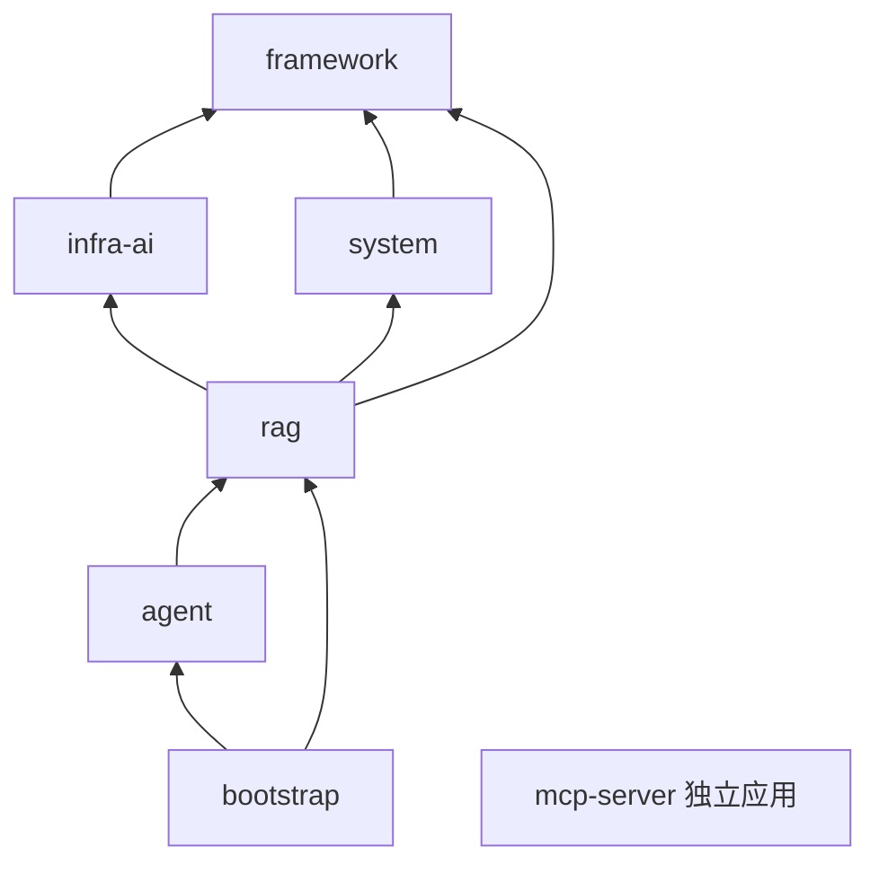

# 第 0～3 章详细提纲

> 阶段：P2 全书骨架  
> 目标源码：AsterRAG `98894c2c42c015a3c874c6b3c986ac863c85b731`  
> 使用方式：这是正文写作合同，不是已经完成的章节。写正文时保留叙事顺序，事实变化先改 Source Map，再改提纲和正文。

## 四章共同叙事

```text
第 0 章：我凭什么相信这份教程？
        ↓ 交付版本与证据契约
第 1 章：整个系统怎样把资料变成有依据的回答？
        ↓ 交付总体架构和三条主链
第 2 章：这些责任为什么落在七个模块和两个启动边界里？
        ↓ 交付代码导航与运行拓扑
第 3 章：每条链到底改变了哪些状态，谁能恢复它？
        ↓ 交付领域对象与状态所有权
第 4 章开始：拿着地图，沿知识写路径逐段下钻
```

四章不提前展开 Parser、Rerank、AgentScope 等内部算法；只建立后续理解所需的最小但完整模型。第 1 章可以说明“发生了什么”，第 2 章说明“代码住在哪里”，第 3 章说明“状态归谁”，第 4 章以后再说明“具体怎样实现”。

---

## 第 0 章：怎么使用这份源码级教程

### 0.1 总体图位置和本章唯一问题

- 位置：总体架构图之外的“阅读与证据边界”。
- 核心问题：**当产品源码、作者课程、公开主页、README 和运行结果可能不一致时，读者怎样判断一句话有多可信？**
- 本章输出：冻结版本、事实优先级、证据状态、阅读路线和归属声明。
- 本章不负责：解释业务链内部实现，也不提供未经执行的“一键启动成功”承诺。

### 0.2 开场场景

用一个真实冲突建立问题：

```text
作者公开主页：4 个 Maven 模块、Spring Boot 3.5.7、22 张业务表
AsterRAG 冻结源码：7 个 Maven 模块、Spring Boot 4.1.0、31 个 CREATE TABLE
```

结论写法：两者描述的是不同时间/版本和可能不同计数口径；本教程实现事实服从冻结 AsterRAG，旧教程用来解释演进背景。不能简单说“作者教程错了”，也不能为了保持一致而忽略当前源码。

### 0.3 正文章节顺序

#### 0.3.1 先认清三个仓库和两个网页

| 资料 | 身份 | 可以证明 | 不能证明 |
|---|---|---|---|
| AsterRAG `98894c2` | 本教程目标源码 | 当前类、配置、Schema、测试定义 | 未执行测试通过、外部依赖可用、真实效果 |
| nageoffer/ragent `1cb684e` | 当前上游祖先 | 改名前最近上游实现 | AsterRAG 后续身份/CI 改动 |
| nageoffer/ragent `1.0.0` | 作者课程稳定基线 | 旧课程相对稳定的代码版本 | 当前 2.0 演进能力 |
| 作者公开主页/知识星球 | 设计解释、课程顺序、版本声明 | 作者如何组织主题、当时的定位 | 当前冻结实现的最终裁决 |
| how-claude-code-works | 教学设计参考 | 架构先行、主循环、专题和阅读路线的组织方法 | AsterRAG 的任何组件或能力 |

必须写明 AsterRAG 当前提交是上游 `1cb684e` 的后代，产品逻辑高度同源；但教程链接仍使用 AsterRAG SHA，归属页引用 `NOTICE` 和 `docs/UPSTREAM.md`。

#### 0.3.2 五种证据状态

用同一句话演示状态升级：

```text
pending
  “似乎有多通道检索”
verified-source
  “源码存在四类通道；随仓库 YAML 只启用 vector”
verified-test
  “聚焦测试已在冻结提交执行并通过”
verified-runtime
  “真实服务 Trace 记录这次请求运行了 vector + keyword”
reference-only
  “作者课程解释为什么要混合检索”
```

解释 `verified-source` 只证明实现/配置，不自动升级为 `verified-test` 或 `verified-runtime`。测试文件存在也不等于测试已执行。

#### 0.3.3 永久链接和 Source Map

- 每个重要论断使用 `claim_id`。
- 源链接使用完整 commit SHA，不指向漂移的 `main`。
- `test_anchor` 可以先登记测试位置，但只有真实运行日志才能把状态升级为 `verified-test`。
- `runtime_evidence` 指向工作区证据，不把截图或 HTTP 200 单独当完成。
- 示例展示 `SM-005`、`SM-027`、`SM-038` 三条从写路径、检索、Agent 收尾抽取的记录。

#### 0.3.4 三条阅读路线

1. **30 分钟全景线**：0 → 1 → 3 → 20。目标是能画图、说状态边界和局限。
2. **核心 RAG 线**：0 → 1 → 3 → 4～13 → 17 → 19。目标是跟完写路径和确定性读路径。
3. **Agent/工程深入线**：0 → 1 → 2 → 11～17 → 19～20。目标是理解工具复用、State/Memory 和统一收尾。

每条路线说明“跳过章节会失去什么”，避免路线变成随意目录。

#### 0.3.5 环境不足时怎样学习

- 没有模型 Key：仍可读源码、跑 Hermetic 测试；不能验证答案质量和真实流。
- 没有 RocketMQ：仍可跟静态分块链；不能宣称文档开始分块可运行。
- 没有可选 ES/LightRAG/Web/Milvus：不影响理解共同接口；不能演示这些通道。
- 没有浏览器：可以验证后端事件契约；不能声称控制台状态和响应式布局已闭环。

#### 0.3.6 归属与面试表达

- 原作者、上游仓库和许可证在开头显式保留。
- 可以说“我基于允许学习/二次开发的开源项目建立自己的版本并完成了哪些可验证改造”。
- 不说“整个 RAG 引擎从零由我原创”；不把上游能力包装成个人产出。
- 面试时将“读懂的源码事实”“亲自做的改造”“亲自跑出的数据”分三栏。

### 0.4 图表与示例

- 图 0-1：资料权威阶梯（源码/测试/运行 > README/作者资料 > 外部教学参考）。
- 表 0-1：五种证据状态。
- 表 0-2：三条阅读路线。
- 源码卡片示例：`SM-005` 的固定摄取内核。

### 0.5 Source Map 分配

- 主论断：`SM-001`、`SM-040`、`SM-041`。
- 辅助文件：`evidence/SOURCES.lock.md`、`reference-drift.md`、`source-map.csv`。
- 运行证据：`source-lock-2026-09-01.txt`、`p1-static-2026-09-01.txt`。

### 0.6 动手验证

命令级别：Hermetic/元数据检查。

1. 运行 `scripts/verify-source-lock.sh`。
2. 运行 `scripts/verify-p1-evidence.sh`。
3. 随机抽一条 Source Map，验证 commit、path 和 symbol。
4. 故意把读者脑中的“代码存在”改写成“代码已运行”，说明为什么证据不足。

预期：三份 source lock 干净，41 条 Source Map 路径存在；不输出“测试通过”或“服务可用”。

### 0.7 常见误解

- “作者写的教程”基本可信，但不能完全等同于当前冻结源码。
- “分支最新”基本表示时间更晚，但不能完全等同于课程更适合的版本。
- “有测试类”基本说明作者考虑过行为，但不能完全等同于当前环境测试通过。
- “开源允许校招生学习”不等同于可以抹去作者和许可证。

### 0.8 小结与下一章桥梁

本章交付“如何判断事实”。下一章用这套规则画一张总体图：任何节点若没有 Source Map 锚点，就不能进入正式架构。

### 0.9 验收标准

- 读者能说出 AsterRAG、当前上游和 `1.0.0` 的不同用途。
- 能把一条论断正确归入五种证据状态。
- 能选择一条阅读路线并解释取舍。
- 不出现无归属的“我从零实现”表述。

---

## 第 1 章：先看全局——AsterRAG 总体架构与三条主调用链

### 1.1 总体图位置和本章唯一问题

- 位置：全书中央导航图。
- 核心问题：**一份原始资料怎样变成可检索证据，一个问题怎样变成有来源的回答，Agent 又怎样在需要时调用这些能力？**
- 本章输出：总体架构图、三条主链概览、状态交汇点、失败收敛点和章节导航。
- 本章不负责：逐类解释算法；不把可选组件画成默认必经路径。

### 1.2 开场：先找三个入口，不从包名开始

用三个真实 HTTP 入口把全书固定下来：

```text
知识写路径：POST /knowledge-base/{kb-id}/docs/upload
             POST /knowledge-base/docs/{doc-id}/chunk
确定性读路径：GET /rag/v3/chat
Agent 分支： GET /agent/v1/chat（仅 engine.type=agent）
```

解释“两个聊天入口 + 两种入库子系统”为什么不是重复代码：它们的编排模型、状态、收尾和使用场景不同。

### 1.3 正文章节顺序

#### 1.3.1 先展示正式总体图

嵌入 `assets/architecture/system-overview.svg`，下方提供 Mermaid 源 `system-overview.mmd`。读图顺序固定为：

1. 顶部接入面；
2. 左侧知识文档主写路径；
3. 中部确定性 RAG；
4. 右侧 ReAct Agent；
5. 底部持久事实、协调态、可选索引和进程态。

图上必须保留虚线：`Document ProcessMode.PIPELINE 当前暂停 -> IngestionEngine`。这条线不是正常调用，而是一个版本边界警告。

#### 1.3.2 区域 A：知识文档主写路径

只讲七个状态转换，不提前讲具体 Parser：

```text
原文件
→ 对象存储 + PENDING 文档
→ 显式开始分块
→ 事务消息 + RUNNING
→ 固定 MIME/Parse/Chunk/Embedding/Index
→ SUCCESS/FAILED + Chunk Log
→ 真实检索验证
```

必须停下来区分四句话：

| 观察 | 能证明 | 不能证明 |
|---|---|---|
| upload 返回文档 ID | 原文件/元数据步骤成功到某个边界 | 已分块 |
| 文档 `SUCCESS` | Service 完成内核并写终态 | 某次 query 一定召回 |
| 向量行存在 | 至少一个派生落点有数据 | 作用域/阈值/文档 enabled 满足 |
| 真实 query Trace 有 chunk | 该次请求实际召回 | 所有问题效果都好 |

然后用一段侧栏介绍独立 `/ingestion/tasks`：它有 Pipeline/Task/Node Log，但知识文档 `PIPELINE` 当前暂停。第 6 章会解释两者。

#### 1.3.3 区域 B：确定性 RAG

按固定漏斗讲概览：

```text
SSE 接入/排队
→ 保存 USER/加载记忆
→ 改写拆分
→ 意图/引导/知识库范围
→ 子问题与通道并行
→ 去重/RRF/Rerank/证据门/富化
→ 来源编号/Grounding/Prompt
→ 模型流
→ assistant + Trace + FINISH/DONE
```

把三类短路直接画在主线上：歧义引导、system-only、空检索。强调空检索不会静默退化成“无证据裸 LLM”。

#### 1.3.4 区域 C：ReAct Agent

先说与确定性 RAG 的共同点，再说不同点：

- 共同：AI Infra、知识检索引擎、MCP executor、PostgreSQL/Redis。
- 不同：AgentScope 决定何时调用工具；有 Agent State/压缩/长期记忆；使用独立 Agent SSE Bridge 和业务消息表。
- 汇合点：`KnowledgeSearchTool -> KnowledgeSearchFacade -> RetrievalEngine`。
- 非汇合点：Agent 不进入 `RAGChatController`、`StreamChatPipeline` 或 `StreamChatEventHandler`。

#### 1.3.5 区域 D：状态和基础设施

嵌入 `state-ownership.svg`，按“能否恢复和谁负责”而非按技术热度解释：

- PostgreSQL：31 表的业务事实、Trace、Agent State 和默认 pgvector。
- 对象存储：原文件/资产，不是文档元数据。
- Redis：队列、许可、锁、运行位和取消等协调态，不是长期会话事实。
- ES/LightRAG/Milvus/Web：可选派生/外部能力，不是默认全启。
- 进程内：Agent cache、SSE buffer、Context；进程退出后不能指望它们恢复。

#### 1.3.6 三张时序图只做概览

- 图 1-2：`ingestion-sequence.svg`，重点在上传与开始分块的断点。
- 图 1-3：`rag-sequence.svg`，重点在排队拒绝、三类短路、正常/取消/失败。
- 图 1-4：`agent-sequence.svg`，重点在副作用前 gate、动态工具、RunHandle 统一释放。

每张图只解释 5～7 个关键箭头，其余在对应章节下钻，避免第一章变成源码倾倒。

#### 1.3.7 一张失败收敛表

| 失败 | 谁先发现 | 用户可见 | 持久化/释放 | 后续章节 |
|---|---|---|---|---|
| MIME 不支持 | upload Service | ClientException | 删除刚存对象，不插文档 | 4～5 |
| 摄取任一步骤失败 | runChunkTask | 文档 FAILED/日志 | 文档 + chunk log；副作用按落点查 | 6～7 |
| RAG 排队拒绝 | ChatQueueLimiter | REJECT + DONE | REJECTED assistant | 8 |
| 空检索 | StreamChatPipeline | 固定无结果回答 | NORMAL assistant + Trace | 11～13 |
| RAG 流错误 | EventHandler/Trace | emitter error | 无 assistant 错误消息；Trace ERROR | 13 |
| Agent 取消 | task manager/RunHandle | CANCEL + DONE | INTERRUPTED（有内容时）+ 全释放 hook | 16 |
| Agent 流错误 | EventBridge/RunHandle | emitter error | 无 assistant 错误消息；仍跑释放 hook | 16 |

#### 1.3.8 全书章节映射

在总体图下放一张 21 章映射表，最小列：章、总体图节点、输入、交付给下一章的对象。第 4～20 章内容从 `04-20-chapter-cards.md` 生成，不能出现没有图位置的孤立专题。

### 1.4 Source Map 分配

- 总体：`SM-002`～`SM-008`。
- 写路径：`SM-003`～`SM-007`、`SM-013`～`SM-020`。
- RAG：`SM-022`～`SM-031`。
- Agent：`SM-032`～`SM-038`。
- 状态/前端：`SM-012`、`SM-021`、`SM-026`、`SM-039`。

### 1.5 动手验证

本章只做静态可复核验证：

1. 从三个 HTTP 入口各点进一个 Controller。
2. 沿箭头跳到 Service/Engine/Handler，验证每个图节点至少有源码 owner。
3. 运行 `verify-p1-evidence.sh`。
4. 选一个可选节点（如 keyword），用 YAML 证明它默认关闭。

不要在本章把未启动服务的预期响应写成实跑截图。

### 1.6 常见误解

- “RAG Pipeline 和 ReAct Agent”基本都能回答问题，但不能完全等同：一个固定编排，一个动态工具循环。
- “知识文档入库和 Ingestion Pipeline”都有摄取概念，但不能完全等同：当前主链走固定内核，通用 Pipeline 独立存在。
- “PostgreSQL 和 pgvector”在同一服务里，但不能完全等同：前者还拥有大量业务表，后者是向量扩展/表。
- “支持四通道”不等于“默认四通道都运行”。
- “SSE 已连接”不等于“消息、Trace、资源都已收尾”。

### 1.7 小结与下一章桥梁

本章交付“系统地图”。下一章把图中每个 owner 落到七个 Maven 模块、两个启动入口和运行依赖上，回答“从哪个目录开始读”。

### 1.8 验收标准

- 不看代码也能复述三条主链和两个入库边界。
- 能指出写/读在 Chunk/索引处交汇，Agent/RAG 在 RetrievalEngine 处共享。
- 能说出 PostgreSQL、对象存储、Redis、可选索引和进程态各持什么。
- 图中每个节点有 `architecture-node-map.md` / Source Map 锚点。

---

## 第 2 章：项目怎样启动——模块边界、依赖方向与运行拓扑

### 2.1 总体图位置和本章唯一问题

- 位置：总体图中每个 owner 的代码容器与启动边界。
- 核心问题：**为什么这些能力被分到七个 Maven 模块，它们怎样在一个主应用和一个独立 MCP Server 中装配？**
- 上一章输入：总体图节点。
- 本章输出：依赖方向、包导航、条件装配和最小/完整运行拓扑。

### 2.2 开场：七个模块不是七个微服务

先展示从根 POM计算的依赖图：



解释“编译依赖方向”“运行进程边界”“业务责任”是三件事：Maven 模块多并不自动产生网络边界。

### 2.3 正文章节顺序

#### 2.3.1 根构建身份

- Java 17。
- Spring Boot 4.1.0。
- Wrapper/CI 命令和前端独立 npm 构建。
- 作者 `1.0.0` 的 Boot 3.5.7 / 四模块作为版本侧栏，不混入当前命令。

#### 2.3.2 七模块责任表

对每模块只回答四项：拥有、依赖、对外输出、不拥有。

1. `framework`：响应/异常、认证上下文、幂等、MQ、Trace 上下文、SSE/Task 等横切契约；不编排业务。
2. `infra-ai`：Chat/Embedding/Rerank/VLM、候选、路由、首包和健康；不决定查哪个库。
3. `system`：用户、示例问题、业务审计；不执行 RAG/Agent。
4. `rag`：知识、摄取、确定性 RAG、MCP client、Trace、管理；本书最大业务域。
5. `agent`：ReAct 运行、工具、State/压缩/长期记忆、Agent SSE；通过 rag 窄门面复用检索。
6. `bootstrap`：`RagentApplication` 和最终装配；POM 注释要求不放业务代码。
7. `mcp-server`：独立 `McpServerApplication` 和示例工具；不是主应用内嵌 Controller。

#### 2.3.3 `rag` 模块内部导航

围绕主链列包，不按字母表：

```text
knowledge → 文档生命周期和 MQ/调度
core.ingest / core.parser / core.chunk → 固定摄取内核
ingestion → 通用可配置 Pipeline
rag.core → 改写、意图、检索、Prompt、MCP
rag.service.pipeline → 确定性 StreamChatPipeline
rag.trace / rag.aop → Trace
controller / admin → 控制面
```

给读者一条 15 分钟跳转路径：`RagentApplication -> application.yaml -> KnowledgeDocumentController -> RAGChatController -> AgentChatController`。

#### 2.3.4 两个启动边界

| 进程 | 入口 | 载入能力 | 默认端口/URL | 边界 |
|---|---|---|---|---|
| 主应用 | `RagentApplication` | framework + infra + system + rag + agent | 9090，context `/api/ragent` | UI/API/RAG/Agent/管理 |
| 示例 MCP Server | `McpServerApplication` | 独立 MCP 工具服务 | `mcp-server/application.yml` | 主应用通过配置 URL 连接，不是同 JVM Controller |

避免把 mcp-server 的“示例天气/票务/销售”等数据说成真实生产系统。

#### 2.3.5 条件装配：类默认和 YAML 默认分开

用两组反例解释 Spring 配置阅读：

- `OrchestrationProperties.type` Java 兜底 `workflow`；仓库 YAML 显式 `agent`，所以正常使用该 YAML 是 Agent 档。
- Milvus 条件 Bean 可 `matchIfMissing=true`；仓库 YAML 显式 `rag.vector.type=pg`，所以当前默认是 PG。

再列条件矩阵：storage S3/OSS、vector PG/Milvus、keyword none/ES、graph none/LightRAG、Agent Controller、Eval Controller。

#### 2.3.6 三层运行拓扑

1. **静态阅读/单元测试层**：JDK、Maven、Node；不需要外部中间件即可执行一部分 Hermetic 测试。
2. **默认主链层**：PostgreSQL/pgvector、Redis、S3 兼容对象存储、RocketMQ、模型供应商；需要按实际入口确认必需性。
3. **扩展层**：ES、LightRAG/Web、Milvus、外部 MCP Server、真实评测供应商。

注意：P2 只画拓扑，P5/P6 才根据真实启动结果收敛最小依赖；Q-005 仍开放，不能在此宣称 RocketMQ 对整个应用启动绝对必需或可省。

#### 2.3.7 测试拓扑

- 77 个测试文件、367 个 `@Test` 是静态计数。
- CI 后端命令排除 `**/*Tests.java`；解释这是一条特定测试选择规则，不是“全量测试”。
- 11 个 `@SpringBootTest`、2 个 `*LiveTest` 是依赖风险信号。
- 前端 CI 运行 `npm ci`、lint、build。

本章只给读者识别层级，真正的命令和结果放第 19 章。

### 2.4 Source Map 分配

- `SM-002`、`SM-009`、`SM-010`、`SM-011`、`SM-040`。
- 辅助证据：`source-census.md`、`test-matrix.md`、`reference-drift.md`。

### 2.5 动手验证

1. 根 POM列模块并核对依赖方向。
2. 读取两个 Application 入口。
3. 用 `application.yaml` 证明端口/context/engine/vector/storage 默认值。
4. 找一个 `@ConditionalOn...` 实现，分别写“类兜底”和“YAML 实际选择”。
5. 不启动服务，只保存静态普查输出为 `verified-source`。

### 2.6 常见误解

- “模块化单体”不是“没有边界”，也不是“微服务”。
- “bootstrap 依赖 rag/agent”不等于业务应该写进 bootstrap。
- “mcp-server 在同一仓库”不等于主应用启动时一定同进程运行。
- “Spring 条件 matchIfMissing”不等于仓库 YAML 没有显式覆盖。
- “CI 绿”不等于集成/Live/浏览器路径全部通过。

### 2.7 小结与下一章桥梁

本章交付“代码和进程住在哪里”。下一章不再谈目录，而是把三条链中的对象按持久事实、派生索引、协调态和进程态分类，解决恢复与一致性问题。

### 2.8 验收标准

- 能画七模块依赖图并说出两个启动边界。
- 能从总体图节点找到 owner 模块/包。
- 能用源码解释 Agent/PG 默认值，不被类兜底误导。
- 不对未实跑外部依赖作启动承诺。

---

## 第 3 章：先认清数据——领域对象、状态所有权与生命周期

### 3.1 总体图位置和本章唯一问题

- 位置：总体图底部所有状态节点，以及三条主链穿过它们的写入点。
- 核心问题：**当请求中断、进程重启或索引失败时，哪些状态仍然存在，哪个组件负责把它恢复到可理解的终态？**
- 上一章输入：模块和运行边界。
- 本章输出：领域分组、四类状态、关键生命周期、可恢复性和一致性边界。

### 3.2 开场：同一个“对话历史”至少有四种形态

用 Agent 场景拆开：

| 对象 | 用途 | 存储 | 谁读取 |
|---|---|---|---|
| Agent 业务消息 | 页面展示/回放 | `t_agent_message` | Conversation Service / 前端 |
| AgentScope State | 框架循环恢复 | `t_agent_state` opaque JSON | ReActAgent/StateStore |
| Context Compaction | 长上下文压缩控制 | `t_agent_context_compaction` | Middleware |
| Long-term Memory | 跨会话/长期记忆 | memory/control/extraction 表 | Memory Pipeline/Middleware |

先建立“名字相似不能合并”的思维，再扩展到 RAG 和知识库。

### 3.3 正文章节顺序

#### 3.3.1 31 张表不是字段清单，而是所有权地图

按九个领域分组：

1. 用户/示例/审计；
2. RAG 会话/摘要/消息/反馈；
3. 知识库/文档/Chunk/分块日志；
4. 远程刷新 Schedule/Exec；
5. 意图/查询映射；
6. RAG Trace Run/Node；
7. Agent 配置/会话/消息/State/压缩/长期记忆；
8. Ingestion Pipeline/Node/Task/TaskNode；
9. pgvector。

正文不复制所有列；每组只挑身份键、所有者键、状态字段、关联键、删除字段和恢复相关时间字段。

#### 3.3.2 四类状态

嵌入 `state-ownership.svg` 并给判定规则：

| 类型 | 例子 | 进程重启 | 能否从别处重建 | owner |
|---|---|---|---|---|
| 持久业务事实 | document、message、Trace、Agent State | 保留 | 通常不应随意重建 | PostgreSQL Service/Mapper |
| 持久对象 | 原文件、图片资产 | 保留 | 取决于源资料 | Object Storage Service |
| 派生索引 | pgvector/ES/LightRAG/Milvus | 保留但可漂移 | 理论上从文档/Chunk 重建 | ChunkIndexWriter/后端 |
| 协调/进程态 | Redis许可、Agent cache、SSE buffer、Context | TTL/丢失 | 需要持久事实或重试恢复 | limiter/gate/runtime |

指出 pgvector 虽在 PostgreSQL 中，语义上仍是派生检索落点；物理同库不改变所有权分类。

#### 3.3.3 文档生命周期

```text
对象保存 + PENDING
→ startChunk 事务回调 RUNNING
→ chunk_log RUNNING
→ 内核成功：SUCCESS + chunkCount + mime + timings
→ 内核失败：FAILED + error
→ 删除/清理：逻辑元数据与派生索引按真实链处理
```

配套列出失败窗口：对象已存 DB 未插、MQ 已提交 Consumer 未执行、索引部分写入、终态回填失败。对每个窗口标 `known source` 或 `runtime pending`，不假设分布式事务覆盖所有存储。

#### 3.3.4 RAG 会话生命周期

- `StreamChatPipeline.loadMemory` 加载旧历史并保存 USER。
- 正常 assistant `NORMAL`；取消有正文才 `INTERRUPTED`；排队拒绝 `REJECTED`；流错误当前无 assistant 错误行。
- sources 和 grounding chunks 随 assistant 保存，供来源面板/推荐追问；两者与 Prompt 上下文用途不同。
- Trace Run/Node 是可观测记录，不是会话事实的替代品。

展示一个不对称表：USER 已保存而 assistant 失败行不存在是允许出现的真实状态，前端恢复不能假设严格成对。

#### 3.3.5 Agent 生命周期

- gate 在副作用前抢占。
- touch conversation / baseline / USER message。
- AgentScope State 独立保存。
- EventBridge 保存 NORMAL/INTERRUPTED 业务消息，错误无 assistant 行。
- RunHandle 三路统一注销、释放 gate、驱逐本节点 cache、安排长期记忆抽取。
- 长期记忆抽取是后台任务；失败只记录日志，不回滚用户已经得到的回答。

明确 `evictStateCache` 只清当前节点；PostgreSQL State 是跨进程恢复基础，但多节点 cache 一致性没有在此自动解决。

#### 3.3.6 通用 Ingestion 任务生命周期

```text
PipelineDefinition（持久配置）
→ Task RUNNING
→ IngestionContext（进程暂态）
→ NodeLog（先在 Context 累积）
→ TaskNode + Task COMPLETED/FAILED（持久）
```

解释 Service 方法有数据库事务不等于所有 Node 的外部副作用能一起回滚。

#### 3.3.7 身份与关联键

围绕三条链只讲重要键：

- `kbId`、`docId`、collection/vector target；
- `conversationId`、`messageId`、`replyToMessageId`；
- `taskId`、`traceId`、`nodeId`；
- Agent `userId + sessionId(conversationId) + state key`；
- Ingestion `pipelineId + taskId + nodeId`。

说明相同名字的 `conversationId/taskId` 在 RAG/Agent 表和事件协议中属于不同业务域，不能跨表随意 join。

#### 3.3.8 “完成”的四级证明

以文档为例建立后续运行验收模板：

1. 原文件可读；
2. 业务元数据终态正确；
3. Chunk/向量/可选索引一致；
4. 真实 query 在正确 scope/阈值下召回并进入答案来源。

以聊天为例：

1. SSE META；
2. 有增量；
3. 有正确终态事件；
4. 服务端消息/Trace/资源释放与刷新后页面一致。

### 3.4 Source Map 分配

- 数据总览：`SM-012`、`SM-019`～`SM-021`。
- RAG 状态：`SM-022`～`SM-024`、`SM-030`、`SM-031`。
- Agent 状态：`SM-032`、`SM-033`、`SM-036`～`SM-038`。
- Ingestion：`SM-003`～`SM-007`、`SM-016`～`SM-018`。

### 3.5 动手验证

1. 对 `schema_pg.sql` 做精确 `CREATE TABLE` 计数并按领域分组。
2. 从三个 Handler/Service 找 NORMAL、INTERRUPTED、REJECTED、FAILED/ERROR 状态写入点。
3. 对一条状态画“owner / writer / reader / cleanup / recovery”五格卡。
4. 本章不伪造 DB 行；真实状态截图放 P3/P4/P5 运行证据。

### 3.6 常见误解

- “业务消息”和“Agent State”都能保留上下文，但不能完全等同。
- “Redis 有状态”不等于 Redis 是长期事实存储。
- “向量在 PostgreSQL”不等于向量与业务 Chunk 永远天然一致。
- “事务方法成功”不等于跨对象存储、MQ、外部索引的全局原子提交。
- “文档 SUCCESS”不等于任意问题必定召回。
- “SSE DONE”不等于所有后台长期记忆抽取已经完成。

### 3.7 小结与下一章桥梁

本章交付“状态所有权和生命周期”。第 4 章从最早的写入边界开始：原文件从上传/远程来源进入对象存储和 `PENDING` 文档时，怎样校验、限流并避免孤儿状态。

### 3.8 验收标准

- 能把 31 张表按领域而非按字母分组。
- 能区分业务事实、对象、派生索引、协调态和进程态。
- 能解释 RAG/Agent 正常、取消、拒绝、失败为什么出现不对称消息记录。
- 能指出至少三个跨存储失败窗口，不声称分布式全局事务。

---

## 写正文前的 P2 检查

- [ ] 四章的核心问题各不相同，且按“证据→系统→代码→状态”递进。
- [ ] 第 1 章所有图节点能回链 `architecture-node-map.md`。
- [ ] 第 0～3 章合计覆盖 `SM-001`～`SM-041` 中与基础架构相关的论断；参考论断只作漂移侧栏。
- [ ] 不把 Mermaid 源存在当作正式图可用；必须渲染 SVG 并视觉检查。
- [ ] 不把现有测试 anchor 写成已执行通过。
- [ ] P2 只完成详细提纲和图，不提前把第 0～3 章标为正文完成。

