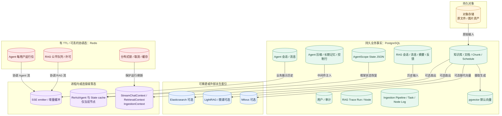
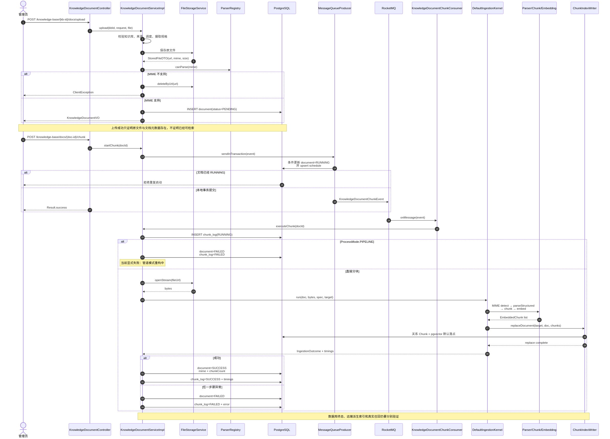
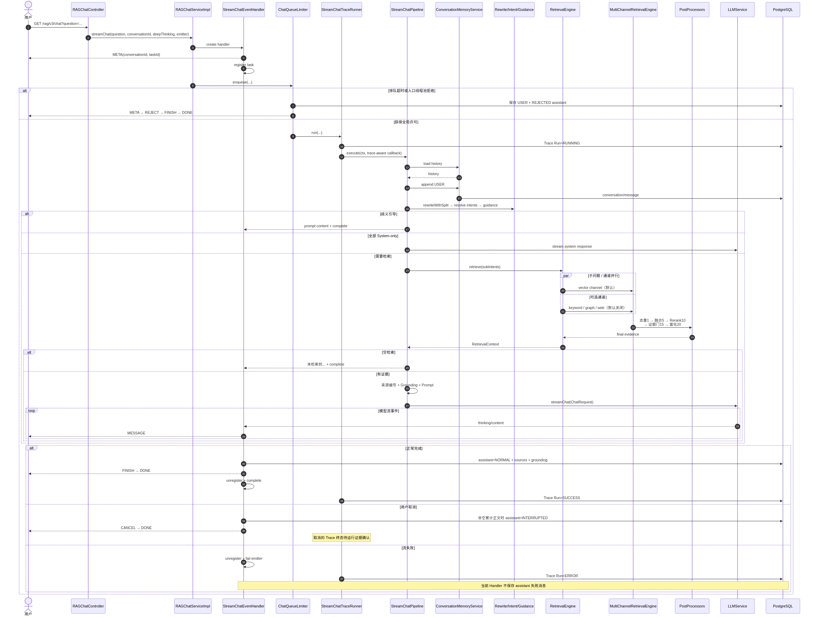
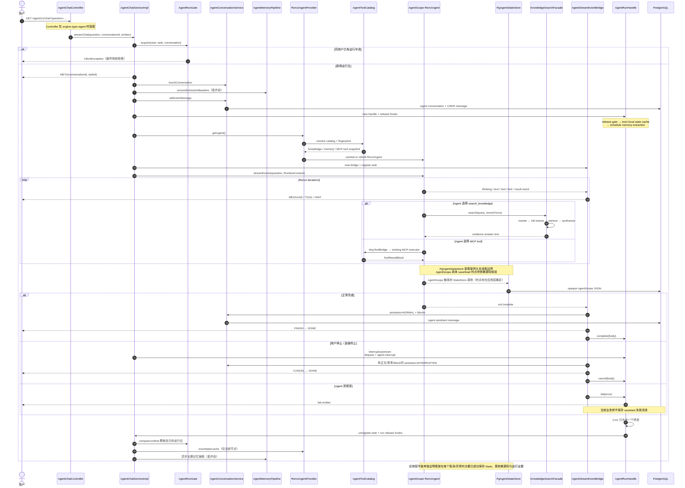

# 第 1 章：先看全局——AsterRAG 总体架构与三条主调用链

> 这一章是全书的地图。先不钻进 Parser、Rerank 或 AgentScope 的内部，只回答一个问题：一份资料怎样变成可检索证据，一次问题又怎样变成有来源的回答？

## Agent / RAG 优先读法：先把工具与证据连起来

2026-09-08 增补篇将本章主图中的两个区域放大：外层 Agent 的工具决策，以及内层 RAG 的知识处理。可以先记住这张职责地图，再读下方完整系统架构：

```text
用户问题 → AgentScope ReAct（动态选择工具 / 参数）
                ├─ MCP / 记忆等工具
                └─ search_knowledge(query)
                      → 改写、KB 意图与 scope
                      → 已启用通道并行检索
                          ├─ 稠密向量：pgvector + HNSW（默认路径）
                          ├─ 关键词：ES / BM25（可选，默认关闭）
                          └─ 图谱：LightRAG（可选，默认关闭）
                      → 去重、RRF、Rerank、证据门
                      → KB 答案合成 → 工具文本返回 Agent
```

这张图从上往下回答三个问题：下一步做什么，怎样完成一次知识查询，资料怎样组织和找回。Agent 选择工具和问题，RAG 管线准备证据，底层索引与图谱提供查找方式。工具结果回到 Agent 后，又成为它决定下一步的信息。

第 21～25 章用同一组人物、项目和制度资料把三层串起来：先给向量建立导航图，再给词语建立倒排表，再把实体关系连接起来，最后解释候选怎样成为 Agent 可使用的知识结果。配置和实现细节另见 [附录 D](../appendices/retrieval-implementation-notes.md)。

沿图深入：[HNSW](21-hnsw-vector-index.md) → [BM25](22-es-bm25-retrieval.md) → [LightRAG](23-lightrag-graph-retrieval.md) → [证据决策链](24-hybrid-retrieval-to-evidence.md) → [Agent 与面试表达](25-agentic-rag-interview-focus.md)。Redis、RocketMQ 等仍在下方完整架构里，但本次推荐路线把它们作为支撑，而不是开场重点。

## 1.1 不要从包名开始，先找三个入口

如果一上来就顺着 664 个主 Java 文件阅读，你很快会被同名的 Pipeline、Message、State、Tool 和 Config 淹没。更好的入口是三类真实 HTTP 请求：

```text
知识写路径
POST /knowledge-base/{kb-id}/docs/upload
POST /knowledge-base/docs/{doc-id}/chunk

确定性 RAG 读路径
GET  /rag/v3/chat

ReAct Agent 分支
GET  /agent/v1/chat   （engine.type=agent 时装配）
```

这三类入口对应三个核心问题：

1. 证据怎样进入系统？
2. 在编排步骤已知时，系统怎样执行一次可控的 RAG 问答？
3. 在解决方式需要动态选择时，Agent 怎样决定是否调用知识、记忆或外部工具？

后续所有技术细节，都必须能回到这三个问题之一。

## 1.2 总体架构图


图的 Mermaid 源文件是 `assets/architecture/system-overview.mmd`。请按下列顺序读，而不是从一个你熟悉的中间件随意开始：

```text
① 顶部：用户和 HTTP/SSE 接入
            ↓
② 左边：知识文档写路径
            ↓
③ 中间：确定性 RAG 读路径
            ↓
④ 右边：ReAct Agent 动态分支
            ↓
⑤ 底部：持久事实、原对象、派生索引和协调态
```

这张图有三个必须先知道的绘图规则：

- 实线表示冻结源码中的当前正常调用/数据流；
- 虚线表示可选边界或明确尚未接通的能力；
- “同一个框”表示共享概念或责任区，不自动表示同一进程、同一事务或默认全部启用。

## 1.3 区域 A：知识生产线把原资料变成证据

知识写路径的最小完整模型是：

```text
本地文件 / 远程 URL
        ↓
对象存储 + PENDING 文档元数据
        ↓ 用户显式开始分块
事务消息 + RUNNING
        ↓ RocketMQ Consumer
固定五步：MIME → Parse → Chunk → Embedding → Index Replace
        ↓
SUCCESS / FAILED + Chunk Log
        ↓
只有满足文档状态、scope、通道和阈值时，某轮查询才能召回
```

### 1.3.1 为什么 upload 和 chunk 是两个接口

`KnowledgeDocumentController` 没有在上传后立即同步执行解析和 Embedding。`KnowledgeDocumentServiceImpl.upload` 先保存原文件/远程快照和一条 `PENDING` 元数据；用户另外调用开始分块后，才进入异步摄取。

所以第一个必背边界是：

> “上传成功”基本说明原文件和文档元数据已经进入系统，但不能完全等同于已解析、已分块、已建索引或可召回。

### 1.3.2 固定五步的 owner

`DefaultIngestionKernel.run` 是当前知识文档主链的核心：

1. 用实际字节探测 MIME；
2. 用 MIME + profile 从 `ParserRegistry` 选 Parser；
3. 将结构化 Block 变成 Chunk；
4. 批量生成 Embedding；
5. 用 `ChunkIndexWriter.replaceDocument` 将整份文档扇出到关系 Chunk 和向量落点。

内核不拥有文档业务状态。调用它的 `KnowledgeDocumentServiceImpl.runChunkTask` 负责把成功/失败、耗时和 Chunk 数写回文档与日志。

### 1.3.3 另一套入库子系统不能偷换主链

仓库还有独立的 `/ingestion/tasks` 子系统：

```text
PipelineDefinition
        ↓
IngestionEngine
        ↓ 按 nextNodeId 执行单根链
Fetcher / Parser / Enhancer / Chunker / Enricher / Indexer
        ↓
Task + TaskNode Log
```

它是真实实现，却不是当前知识文档主链。冻结源码中，文档选择 `ProcessMode.PIPELINE` 后进入 `runChunkTask` 会明确抛出“暂停”错误。

因此当前的真实边界是：

| 概念 | 当前能力 |
|---|---|
| 知识文档 FIXED | 已接通固定五步内核 |
| 通用 `/ingestion/tasks` | 已实现显式 Pipeline 定义的独立执行 |
| 知识文档 PIPELINE | 存在模式/配置入口，但主链当前显式暂停 |

这条虚线非常重要：它展示一个“源码里的组件已存在，但产品主路尚未闭环”的典型版本边界。

## 1.4 区域 B：确定性 RAG 是一个有短路的固定漏斗

确定性 RAG 的主骨架不是“检索一下然后问 LLM”，而是：

```text
HTTP/SSE 接入
  → 全局许可/排队
  → Trace Run
  → 保存 USER + 加载记忆
  → 查询改写与拆分
  → 意图/引导/知识库范围
  → 子问题 × 已启用通道并行检索
  → 去重 → RRF 融合 → Rerank → 证据门 → 富化
  → 来源编号 + Grounding Context + Prompt
  → 模型流
  → assistant / sources / Trace 收尾
  → FINISH / DONE
```

称它为“确定性”，指的是编排骨架的顺序在 `StreamChatPipeline` 中是固定的，不是说 LLM 文本每次完全一样。

### 1.4.1 排队在 Pipeline 之前

`RAGChatServiceImpl.streamChat` 先向 `ChatQueueLimiter` 获得全局许可，再进入 Trace 和 Pipeline。如果拒绝，limiter 自己尝试保存 USER 和 `REJECTED` assistant，并发送 `META / REJECT / FINISH / DONE`。

这说明“请求进了 Controller”不等于“请求进了 RAG Pipeline”。排队拒绝是一个完整的业务终局，不是粗暴关掉 HTTP 连接。

### 1.4.2 三种主要短路

Pipeline 不保证所有请求都走到 LLM：

| 短路 | 位置 | 含义 |
|---|---|---|
| 歧义引导 | 检索前 | 意图需要用户澄清，直接返回引导 |
| system-only | 检索前 | 当前意图可以用系统内置答案处理 |
| 空检索 | LLM 前 | 后处理后没有足够证据，回固定无结果答案 |

最后一条是 RAG 可信边界：

> 空检索不会静默退化成“没有证据的裸 LLM 猜测”，却仍把输出包装成知识库答案。

### 1.4.3 多通道是可选的执行组，不是四个固定箭头

源码中实现了 vector、keyword、graph 和 web 通道的共同编排。`MultiChannelRetrievalEngine` 将已启用通道并行执行，单通道异常或超时按空结果降级，不阻断其他通道。

但随仓库 `application.yaml` 默认只启用 vector。所以架构图上可以展示四类支持能力，叙述默认运行时必须说“默认仅 vector”。

### 1.4.4 后处理顺序在数据上逐步缩小不确定性

```text
异构通道结果
    ↓ Deduplicate (order=1)
同一证据不重复投票
    ↓ RRF Fusion (order=5)
把排名而不是异构原分数融合
    ↓ Rerank (order=10)
用更强相关性模型重排候选
    ↓ Evidence Gate (order=15)
丢弃低于证据阈值的结果
    ↓ Metadata Enrichment (order=20)
补齐来源/文档展示信息
```

随仓库默认预算是召回 20、Rerank 候选 40、最终 TopK 10、证据门 0.2。这些是配置事实，不是“在所有数据上最优”的实验结论。

## 1.5 区域 C：ReAct Agent 不是把 RAG 页换个名字

Agent 主链是：

```text
AgentChatController
    → AgentRunGate（所有会话/SSE 副作用之前）
    → 会话 + USER 业务消息
    → ReActAgentProvider
         ├─ 人设/工具目录指纹
         ├─ AgentScope State Store
         └─ Context Compaction + Long-term Memory
    → AgentScope ReAct loop
         ├─ search_knowledge
         ├─ memory tool（可选）
         └─ MCP tools（动态）
    → AgentStreamEventBridge
    → AgentRunHandle.complete / cancel / fail
    → assistant 持久 + SSE 终局 + 释放钩子
```

### 1.5.1 共享的是能力，不是整条管线

Agent 与确定性 RAG 共享：

- AI Infra 的 Chat/Embedding/Rerank 客户端与路由；
- `RetrievalEngine` 和知识库检索能力；
- MCP executor/registry；
- PostgreSQL、Redis 等基础设施。

但 Agent 不进入：

- `RAGChatController`；
- `StreamChatPipeline`；
- `StreamChatEventHandler`；
- 确定性 RAG 的 SSE enum 和消息表。

两条链在知识检索处的窄口是：

```text
KnowledgeSearchTool
      ↓
KnowledgeSearchFacade
      ↓
rewrite + KB intent + RetrievalEngine + answer synthesis
```

这个门面复用知识能力，但不复用完整 RAG HTTP/SSE 生命周期。

### 1.5.2 为什么 Agent 需要独立 State 和 Memory

RAG Pipeline 的问题是“按固定步骤处理这次问题”。Agent 的问题是“当前已经思考到哪里，调用过什么工具，长上下文怎样压缩，哪些信息应进入长期记忆”。

因此同一次 Agent 会话中至少有四层状态：

| 状态 | 用途 | 不能替代 |
|---|---|---|
| 业务消息 | 页面回放 | AgentScope 循环 State |
| AgentScope State | 框架恢复 | 面向用户的完整消息 |
| Context Compaction | 长上下文压缩 | 跨会话长期记忆 |
| Long-term Memory | 提取/注入长期信息 | 当前 SSE 连接的 raw frames |

### 1.5.3 三路收尾为什么比正常输出更重要

`AgentRunHandle` 将 complete、cancel 和 fail 收敛到互斥 settle，在 `finally` 中注销任务并执行所有释放钩子。这是因为一次 Agent 执行同时占用：

- 每用户运行位；
- 本地任务注册；
- 可能的跨实例 pub/sub/取消状态；
- SSE 连接和已累计内容；
- 业务会话/消息与框架 State。

如果只在正常路径释放，一次取消或异常就可能让下一轮永久被“上一轮还在运行”拒绝。

## 1.6 区域 D：按 owner 而不是按技术热度理解存储



这张图最重要的不是中间件数量，而是“进程死掉后还在不在”和“谁有权修改”。

### PostgreSQL

`resources/database/schema_pg.sql` 定义 31 张表，覆盖用户、RAG 会话/消息/摘要、知识库/文档/Chunk、刷新计划、意图、Trace、Agent 配置/会话/消息/State/压缩/长期记忆、通用入库任务和 pgvector。

它是默认的持久业务事实 owner，但不是原文件内容 owner。

### pgvector

物理上与 PostgreSQL 在同一数据库，语义上却是派生检索落点。向量行可以从文档/Chunk 重建，不应被当成原文档的唯一真相。

### 对象存储

保存上传文件和远程来源快照。`fileUrl` 是文档元数据对原对象的指针，不是字节本身。

### Redis / Redisson

它不只是结果缓存，还负责：

- Snowflake 节点 ID 分配；
- 上传/RAG 许可与排队；
- 调度/幂等/运行 gate 的锁与 owner；
- 任务取消、pub/sub 和初始化锁。

这些是协调态。它们影响“当前谁能做什么”，却不应被当作会话和文档的长期真相。

### 可选索引与外部能力

Milvus、Elasticsearch、LightRAG 和 Web Search 都要分别核对：

- 后端 type 是否选中；
- 对应 Bean 是否装配；
- query channel 是否 enabled；
- 写同步是 fail-fast 还是 best-effort；
- 本轮 scope 是否真的使用。

它们不是随仓库默认全部必经的四箭齐发。

### 进程内状态

Agent 实例 cache、SSE sender/buffer、当轮 Context、前端 raw frames 都会随进程或页面生命周期消失。要恢复必须重新投影 PostgreSQL/Redis 中的真实状态，不能期待内存对象自己幸存。

## 1.7 三张时序图：先只看关键断点

### 1.7.1 知识入库时序



先只记住七个箭头：

1. 上传请求在 multipart 前被并发信号量保护；
2. Service 先完成可以无副作用的校验；
3. 原文件进对象存储，元数据进 PostgreSQL；
4. 另一个接口才发起分块；
5. 事务消息本地回调将文档切为 RUNNING；
6. Consumer 调固定五步内核；
7. Service 根据结果回填 SUCCESS/FAILED。

上传与开始分块之间的断点，是理解整条写路径的关键。

### 1.7.2 确定性 RAG 时序



先找四类终局：

| 终局 | 关键特征 |
|---|---|
| 排队拒绝 | 不进 Pipeline，limiter 自己持久 REJECTED 并发事件 |
| 业务短路 | Pipeline 已进入，但在检索前/LLM 前结束 |
| 正常模型流 | 持久 NORMAL assistant，Trace 收尾，发 FINISH/DONE |
| 取消/错误 | 取消有非空累计内容才存 INTERRUPTED；错误当前不存 assistant 错误行 |

这比“用 Flux 流式输出”更值得面试中讲，因为它说清了客户端事件、业务消息和 Trace 的收尾并不是一件事。

### 1.7.3 Agent 时序



图中最关键的箭头是：

1. `AgentRunGate` 在所有会话/SSE 副作用前获得 owner；
2. provider 按人设和工具指纹决定复用还是重建 Agent；
3. 工具目录不是固定全量，MCP 工具取意图树和当前注册表的交集；
4. AgentScope event 由 bridge 映射成文本/思考/工具 block 和 SSE；
5. complete/cancel/fail 都通过 RunHandle 收敛；
6. 无论哪个终局，都会尝试注销任务和执行释放钩子。

## 1.8 写路径与读路径在哪里交汇

两条链不是在“文件上传”处交汇，也不是在“LLM”处交汇，而是在可按范围读取的 Chunk/索引契约上交汇：

```text
写路径
Document → Block → Chunk → ChunkSink/Vector Store
                                      ↓
                                检索合同
                                      ↑
读路径
Question → Scope → Retrieval Channel → Candidate
```

一个文档要在某轮请求中被看到，需要多个条件同时成立：

1. 原文件存在且可解析；
2. 固定摄取成功并产生 Chunk；
3. 本轮使用的检索落点中有对应派生数据；
4. 文档/知识库没有被禁用或排除；
5. 意图得到的 scope 包含它；
6. 通道已启用且查询与它足够相关；
7. 后处理和证据门没有将它淘汰。

这就是为什么“文档 SUCCESS”不能推导“任意问题一定召回”。

## 1.9 RAG 与 Agent 在哪里共享，在哪里分开

```text
                    ┌── StreamChatPipeline ── RAG EventHandler
HTTP 入口 ───────┤
                    └── ReAct Agent ───── Agent EventBridge
                              │
                              ├─ search_knowledge
                              │      └─ KnowledgeSearchFacade
                              │             └─ RetrievalEngine
                              └─ MCP / memory tools
```

可以把它们理解为“两种编排器共享一部分能力层”，不能理解成“Agent 是 RAG Pipeline 外面套一层 Prompt”。

对比表：

| 维度 | 确定性 RAG | ReAct Agent |
|---|---|---|
| 编排 owner | `StreamChatPipeline` | AgentScope ReAct runtime + AsterRAG adapter |
| 步骤 | 固定顺序和短路 | 模型动态选择工具/继续循环 |
| 知识复用 | 直接进入 RetrievalEngine | 通过 `KnowledgeSearchTool` + Facade |
| 状态 | RAG 会话/摘要/消息/Trace | 业务消息 + Agent State + Compaction + LTM |
| SSE | RAG 事件和 hook/store | Agent block 事件和独立 hook/store |
| 收尾 | `StreamChatEventHandler` + Trace runner | `AgentStreamEventBridge` + `AgentRunHandle` |

## 1.10 失败在哪里被看见和收敛

| 场景 | 首个明确 owner | 用户/页面可见 | 持久与释放 | 深入章节 |
|---|---|---|---|---|
| MIME 不支持 | upload Service | 业务错误 | 删刚存对象，不插文档 | 4～5 |
| 固定摄取失败 | `runChunkTask` | 文档 FAILED/日志 | 回填错误；多落点副作用逐个分析 | 6～7 |
| Pipeline 定义无效 | `IngestionEngine` | 任务错误 | Task/Node 终态，已产生副作用不自动全回滚 | 6 |
| RAG 排队拒绝 | `ChatQueueLimiter` | REJECT + DONE | REJECTED assistant，尝试释放 |
| 歧义/system-only/空证据 | Pipeline | 固定短路答案 | 按完成路径保存与收尾 | 9～13 |
| 单检索通道超时 | Retrieval Engine | 通常不直接暴露 | 当该通道空结果，保留其他通道 | 11 |
| RAG 取消 | Event Handler | CANCEL/FINISH/DONE | 非空累计内容存 INTERRUPTED，Trace/permit 收尾 | 13 |
| RAG 流错误 | Event Handler/Trace | emitter error | 当前不存 assistant 错误行，Trace ERROR | 13 |
| Agent 同用户已在运行 | `AgentRunGate` | 立即拒绝 | 副作用前结束 | 14 |
| MCP 连接失败 | MCP registry init | 对应工具不可见 | 跳过工具，不伪造执行结果 | 15、19 |
| Agent 取消 | EventBridge/RunHandle | CANCEL + DONE | 有内容时 INTERRUPTED，三路共享释放钩子 | 16 |
| Agent 失败 | EventBridge/RunHandle | emitter error | 当前不存 assistant 失败行，仍释放 | 16 |

这张表展示了系统的一个核心思想：失败不只是抛一个异常。它至少同时涉及“客户端看到什么”、“哪些事实存下来”和“哪些资源必须释放”。

## 1.11 从总体图导航全书

| 章 | 总体图位置 | 本章接收的输入 | 交给下一段的输出 |
|---|---|---|---|
| 0 | 图外的证据契约 | 多种资料 | 冻结版本和事实等级 |
| 1 | 全图 | 证据规则 | 三条主链和 owner 地图 |
| 2 | 节点的代码/进程容器 | 架构节点 | 7 模块、2 进程和装配边界 |
| 3 | 底部状态层 | 所有调用链 | 持久/派生/协调/进程态模型 |
| 4 | 写路径入口 | 文件/URL | 原对象 + PENDING 文档 |
| 5 | Parse | 字节 + MIME/Profile | 结构化 Block |
| 6 | Ingestion | Block/文档 | 固定五步与通用 Pipeline 边界 |
| 7 | Chunk/Index | 解析结果 | 可供检索的 Chunk/向量 |
| 8 | RAG 接入 | 用户问题 | SSE/许可/任务生命周期 |
| 9 | Memory/Rewrite | 问题 + 历史 | 自包含子问题 |
| 10 | Intent/Scope | 改写问题 | 短路决定和检索范围 |
| 11 | Retrieval | 子问题 + scope | 多通道候选 |
| 12 | Postprocess | 异构候选 | 有序、过门的证据 |
| 13 | Prompt/Model/Finalizer | 最终证据 | 回答、来源、消息和 Trace |
| 14 | Agent 入口/Runtime | 用户任务 | ReAct 运行与工具决策 |
| 15 | Tool layer | Agent action | Knowledge/MCP/Memory 工具结果 |
| 16 | Agent State/Finalizer | AgentScope events | State/Memory/业务消息与三路收尾 |
| 17 | 全图横切 | 所有请求 | 认证、幂等、限流、审计和可观测边界 |
| 18 | 接入层投影 | SSE/API | 前端可见证据和刷新边界 |
| 19 | 所有虚线/选择点 | POM/YAML/Bean/运行分支 | 默认拓扑和故障推演树 |
| 20 | 全图口述 | 前 20 章 | 面试叙事、追问和诚实边界 |

## 1.12 如何在面试白板上画这张图

不要试图还原每个小节点。使用五步：

```text
1. 左边画写路径：Object/Document → Parse/Chunk/Index
2. 中间画固定 RAG：Memory → Intent → Retrieval → Prompt/Model
3. 右边画 Agent：ReAct → Tools → State/Memory
4. 用一条窄箭头连 Agent Tool 和 RetrievalEngine
5. 底部画 owner：PostgreSQL / Object / Redis / Optional Index / Process
```

然后补两句边界：

> “当前知识文档走固定五步，通用 Ingestion Pipeline 是独立子系统，文档 PIPELINE 模式尚未接通。”

> “确定性 RAG 和 Agent 是不同入口、编排和收尾，Agent 只通过窄门面复用知识检索。”

能画出这个骨架，后续任何追问都可以先指回架构位置，再向下展开。

## 1.13 常见误解

### “RAG Pipeline 和 ReAct Agent 不都是问答吗？”

基本正确，但不能完全等同。两者都能产生回答，但一个由应用代码固定步骤，一个由 ReAct runtime 动态选工具；状态和收尾也完全不同。

### “知识入库和 Ingestion Pipeline 不都是摄取吗？”

基本正确，但不能完全等同。当前知识文档走固定内核；通用 Pipeline 按显式单根链定义执行；两者的任务表、日志和产品入口也不同。

### “PostgreSQL 和 pgvector 不就是一个库吗？”

物理部署上基本正确，但语义上不能完全等同。PostgreSQL 还拥有 31 张表中的大量业务事实；pgvector 落点是可重建的派生检索数据。

### “SSE 连上就表示请求成功了？”

不对。连接建立只是传输开始。还要分析是否被排队拒绝、是否短路、是否正常收到 FINISH/DONE、assistant 是否持久、Trace 和许可是否收尾。

## 1.14 本章源码卡片

| 结论 | 主要锚点 |
|---|---|
| 7 模块的模块化单体，MCP Server 独立 | `pom.xml`、`bootstrap/pom.xml`、两个 `*Application.java` |
| 上传只到原对象/PENDING | `KnowledgeDocumentServiceImpl.upload` |
| 开始分块走事务消息 | `KnowledgeDocumentServiceImpl.startChunk` |
| 当前文档主链是固定五步 | `DefaultIngestionKernel.run` |
| 文档 PIPELINE 模式暂停 | `KnowledgeDocumentServiceImpl.runChunkTask` |
| 确定性 RAG 固定编排 | `StreamChatPipeline.execute` |
| 单通道异常/超时降级 | `MultiChannelRetrievalEngine.executeSearchChannels/withTimeout` |
| Agent gate 在副作用前 | `AgentRunGate.acquire` |
| Agent 知识复用窄口 | `KnowledgeSearchTool`、`KnowledgeSearchFacade` |
| Agent 三路收尾 | `AgentRunHandle.settle`、`AgentStreamEventBridge` |

## 1.15 本章自测

1. 不看图，画出知识写路径、确定性 RAG 和 Agent 三条线。
2. 为什么当前知识文档入库不能简单说成“走可配置 Pipeline”？
3. 确定性 RAG 有哪三类主要短路？它们在哪一步之前发生？
4. Agent 复用 RAG 的是整条 Pipeline 还是某个窄门面？
5. PostgreSQL、对象存储、Redis、派生索引和进程内 cache 分别拥有什么？
6. 为什么文档 SUCCESS 仍不能保证某一问题一定召回？
7. RAG 和 Agent 的取消/失败收尾有什么共性，又有什么差异？

## 1.16 小结：先有坐标，再进入类

本章给了你四个稳定坐标：

1. 写路径通过固定五步把原资料变成 Chunk/索引；
2. 确定性 RAG 通过固定漏斗将问题变成有证据的回答，并显式保留短路；
3. ReAct Agent 用动态工具循环解决更开放的任务，仅通过窄口复用知识检索；
4. 底部所有数据必须按 owner 分类，否则无法说清失败和恢复。

下一章把这些架构节点放回仓库：它们为什么分布在 7 个 Maven 模块中，又为什么实际只有一个主应用进程和一个独立 MCP Server 边界。
