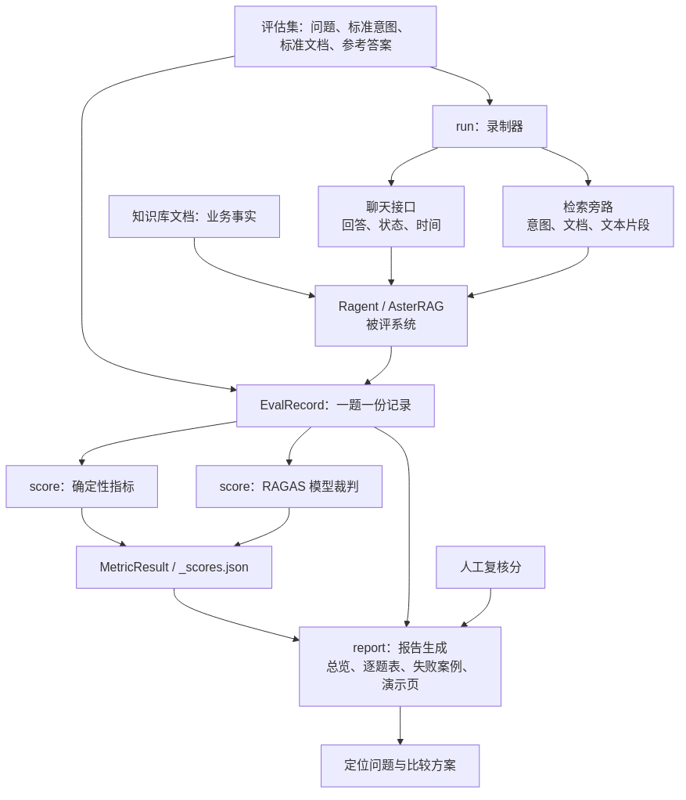

# 第 26 章：评测全景——怎样知道 RAG 好在哪里、差在哪里

前五章讲的是“怎样找到证据，让 Agent 用好证据”。从这一章开始，我们换到系统外面，回答另一个问题：**如果我调整了检索或生成，怎样判断改得有没有价值？**

评测不是给项目做一张“合格证”，而是建立一套观察语言：哪里找得不全，哪里排得不好，哪里回答漏了条件，哪里用户等得太久。本篇讲作者评测项目的工作机制，不要求你运行项目；文中的假设回答与数字用于教学演算，不是实测成绩。

## 26.1 从一个很小的问题开始

官方评估集有一道题，编号 S2-01：

> 小米 14 Pro 的屏幕尺寸和刷新率是多少？

题目指向商品文档 `PROD_PHONE_004`。评估集参考答案和该文档中的两个核心事实一致：屏幕尺寸 **6.73 英寸**，刷新率 **动态 1–120Hz**。

假设系统回答：“屏幕是 6.73 英寸。”你已经知道它没有完全答好。但为什么？

- 可能只检索到了尺寸所在的片段，没拿到刷新率。
- 可能两个事实都在材料里，生成模型却漏掉第二个。
- 也可能资料里有多个型号，系统把普通版和 Pro 版混在一起。

只记录最后一句答案，会把这些问题压成同一个“答得不完整”。**评测要记录中间结果，就是为了把同一个表面症状拆成不同原因。**

## 26.2 先看总体架构：系统做题，评测器收卷，裁判判卷



[查看图源](../assets/diagrams/evaluation-overview.mmd)

这张图要分三块读。

第一块是**被评系统**。它负责接收问题、理解意图、检索知识、组织回答。前面章节中的 HNSW、BM25、LightRAG、Rerank，都在这一侧发挥作用。

第二块是**录制器**。它像一个批量提问的客户端，把题目送过去，收集回答及检索证据。作者这里采用两个请求：聊天接口拿回答，检索旁路拿检索结果；第 28 章详细解释两者关系。

第三块是**评分与报告**。确定性指标比较标签和文档编号，RAGAS 阅读文本做语义判断。最后把结果汇成报告，供人分析。

不要把被评模型和裁判模型混在一起。前者是客服，后者是阅卷老师；换老师可能改变分数，但不会改变已经收回来的答卷。

## 26.3 一道题需要四种信息，不是只有问答对

对于 S2-01，可以把评测材料缩成四格：

| 信息 | 在本题中的含义 | 用来判断什么 |
|---|---|---|
| 问题 Q | 用户问尺寸和刷新率 | 有没有答在点上 |
| 参考 R | 6.73 英寸、动态 1–120Hz | 回答对不对、完整不完整 |
| 检索材料 C | 系统实际返回的文本片段 | 有用知识找到了没有 |
| 回答 A | 系统实际写出的答复 | 有没有忠于材料、是否完成回答 |

Q 和 R 在出题时准备；C 和 A 在录制时获得。

比较关系决定了指标意义：

```text
标准文档 ↔ 检索文档       看找没找对
参考答案 R ↔ 检索材料 C  看证据够不够
检索材料 C ↔ 系统回答 A  看有没有无依据的说法
参考答案 R ↔ 系统回答 A  看事实和完整性
用户问题 Q ↔ 系统回答 A  看有没有答偏
```

这也是为什么一个“总准确率”不够用：它把不同关系折叠了，解释能力很弱。

## 26.4 项目最重要的设计：录制与评分分离

如果每换一种评分规则，就重新向 RAG 提问一次，会发生什么？

模型可能换一种说法，检索也可能受到查询改写或知识库状态影响。此时两次分数不同，你很难分清是答卷变了，还是评分方式变了。

作者将流程拆成三个阶段：

```text
run     让系统做题 → 保存答卷与检索记录
score   读取已有记录 → 计算各项分数
report  读取记录和分数 → 排版、分组、人工复核与问题展示
```

录制后，一行 JSONL 保存一题。JSONL 不神秘：就是每一行都是一份独立 JSON 记录，适合逐题保存、逐题查看。

对应的三个名字也不需要死记：

- `EvalSample`：题目和评分标准。
- `EvalRecord`：题目加上系统的实际表现。
- `MetricResult`：某个指标的总体分、分组分和逐题分。

这里“固定答卷后可以重复评分”，并不代表每次裁判分数完全一样。确定性公式对同一输入给同一结果；模型裁判仍可能有判断波动。它固定的是被评系统的表现，把裁判波动单独留给我们研究。

## 26.5 为什么自建指标与 RAGAS 要同时存在

假设返回的第一份文档是 `PROD_PHONE_004`。用编号相等比较，就能判断它命中了标准文档，不值得再花模型调用去猜。

但命中文档不代表片段恰好包含刷新率，也不代表回答用了这个事实。判断“这段话能否支持那句话”，纯编号比较做不到，才需要语义裁判。

两类指标各有职责：

| 层次 | 典型问题 | 项目采用的办法 |
|---|---|---|
| 路由 | 参数咨询有没有识别成参数咨询 | 意图标签精确比较 |
| 文档检索 | 必需文档命中多少、排在多前 | Hit、Recall、MRR |
| 行为 | 该检索时是否空召回，不该检索时是否仍召回 | 文档列表与 requires_rag 比较 |
| 时间 | 用户多久看到正式回答，整段多久结束 | SSE 计时与统计 |
| 文本质量 | 证据充分性、忠实性、正确性、切题性 | RAGAS 五项指标 |

因此不要把 RAGAS 理解为“一个大模型给答案打个总分”。它是多种评判方法的集合，其中一些方法内部还会拆事实、反向生成问题、调用 Embedding、再用公式聚合。

## 26.6 一道题怎样走完这张图

沿 S2-01 走一遍：

1. 读取题目，知道预期是参数咨询，需要知识检索，目标文档是 `PROD_PHONE_004`。
2. 请求聊天接口，收集回答片段、首个正式回答片段到达时间和结束状态。
3. 请求检索旁路，取得意图、文档编号以及文本片段。
4. 把标准和观测合成一条记录。
5. 先比较文档和标签，再让 RAGAS 比较 Q、R、C、A。
6. 报告把这题的各项分数放在同一行；如果触发失败规则，还会进入失败案例文件。
7. 人回看材料：若刷新率没进入检索结果，沿检索链排查；若材料完整但回答漏项，沿生成链分析。

你最后得到的不是一句“项目不错”，而是一个有依据的改进方向。

## 26.7 它和 Agent 的关系

第 25 章说，Agent 可以把知识查询作为工具。现在这套评测主要研究的是 RAG 问答能力。它很适合回答“这个知识能力是否可靠”，但不会自然回答“Agent 是否在正确时间选择了正确工具”。

```text
Agent 决策与多步行动      ← 还需要工具轨迹、任务目标等评估
          ↓ 调知识工具
RAG 检索与回答质量       ← 当前评测教程的主体
```

先把底层知识能力评明白，再讨论外层决策，逻辑与项目架构是一致的。第 31 章会给出 Agent 评测的扩展思路。

## 26.8 这一章应该能口述什么

> 这套评测把做题、判卷和报告分开。用标准意图、文档和参考答案定义预期，用聊天回答和检索旁路记录实际表现，再分别计算路由、检索、行为、时间和语义质量指标。这样不仅知道答得好不好，还能沿数据链定位问题。

下一章先不急着算分。我们要解决更靠前的问题：怎样出一套题，让这些分数有意义？

源码入口：[数据模型](https://gitcode.net/nageoffer/ragenteval/-/blob/9d69c63cdca0bf730d8900c3076e0480e541360c/eval/common/schemas.py)、[评分编排](https://gitcode.net/nageoffer/ragenteval/-/blob/9d69c63cdca0bf730d8900c3076e0480e541360c/eval/rag/pipeline/score.py)。精确口径集中于[附录 E](../appendices/evaluation-implementation-notes.md)。

[上一章：Agent 使用 RAG](25-agentic-rag-interview-focus.md) · [下一章：评估集](27-evaluation-dataset.md) · [首页](../README.md)
