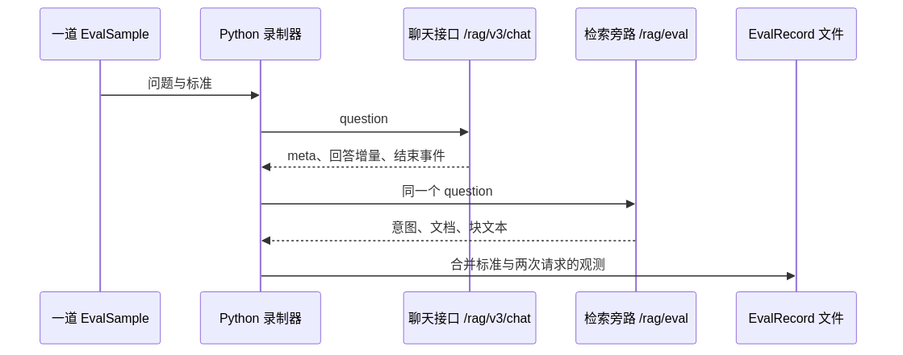

# 第 28 章：录制过程——把一次问答变成可分析的记录

评估集定义“应当怎样”，录制器收集“实际上怎样”。它本身不判断答案正确，也不负责实现检索算法。它的工作是把分散在接口里的观测，装进同一道题的记录。

## 28.1 为什么不能只调聊天接口

对用户来说，看到答案就够了。对评测来说，答案背后的材料同样重要。

聊天输出通常按阅读体验设计：一段段文字、任务信息、结束事件。检索评估需要的却是结构化对象：有序文档列表、块 ID、块文本、意图预测。

作者采用两个接口获取这两类信息：



[查看图源](../assets/diagrams/evaluation-recording.mmd)

单题内是先完成聊天请求，再发检索请求。即使多题并发，每一题内部仍沿这个顺序执行。

## 28.2 先沿聊天流看一遍

对 S2-01，下面是一段**教学时序**，不是实际抓包：

```text
t=0       发送问题
t=0.1s    收到 meta：会话和任务信息
t=1.0s    收到 think：若服务有输出思考片段
t=2.0s    收到 response：“屏幕尺寸为”
t=2.2s    收到 response：“6.73 英寸，刷新率为”
t=2.5s    收到 response：“动态 1–120Hz。”
t=2.6s    收到完成事件并结束
```

录制器做三件关键的事。

第一，把 response 类型的增量按接收顺序拼接成完整回答。用户看到的是逐段出现，评分器拿到的是完整字符串。

第二，单独记录第一段非空正式回答到达的时间。因此本例首字时间是 2.0 秒，不是 meta 到达的 0.1 秒，也不是思考片段到达的 1.0 秒。

第三，从结束事件判断 success、refused、cancelled 等状态。HTTP 请求成功只是网络层成功；流是否正常结束、答案是否正确，是不同层次的问题。

SSE 的事件不一定与底层网络数据块一一对应。录制器需要把零散字节拼成完整事件再处理，就像不能把快递包装的分箱位置当成书的章节边界。理解到这里即可，不必背事件切分代码。

## 28.3 再沿检索旁路看一遍

在本教程冻结的产品源码里，旁路执行的是：

```text
问题
  → 在空历史下改写与拆分
  → 解析子问题意图
  → 调用检索引擎
  → 摊平并去重检索块
  → 返回文档编号、块编号、块文本、意图等
```

它复用了问题处理和检索能力，但不生成面向用户的最终答案。因此能把“模型如何表达”与“检索拿到了什么”分开观察。

这使我们可以回答：S2-01 有没有识别为参数咨询？有没有返回 `PROD_PHONE_004`？返回的具体片段里有尺寸与刷新率，还是只有充电参数？

这里的材料是旁路检索引擎的结果，不应自动当成聊天生成前最终预算裁剪后的完整 prompt。理解评测，必须知道观测发生在管线的哪个位置。

## 28.4 两个请求不是同一次请求的两个视图

这是整个录制设计最值得理解的权衡。

录制器向两个接口分别发送相同 question，没有把聊天的 conversationId 或 taskId 传给旁路，让它读取上一次请求保存的证据。旁路会重新执行改写、意图和检索。

所以记录中的关系是：

```text
同一道题
  ├─ 一次聊天执行：回答 A
  └─ 另一次检索执行：材料 C
```

不是：

```text
一次聊天执行
  ├─ 当次生成真正使用的材料 C
  └─ 严格由这份 C 生成的回答 A
```

这样做的好处是接入直接：保留面向用户的聊天协议，用单独接口提供结构化检索信息。代价是多做了一次查询处理与检索，而且两次执行有可能因为改写波动、资料变化等拿到不同材料。

这不妨碍理解整套评测如何运作，但会影响忠实性分数的解释。如果回答中某个事实在旁路材料里找不到，应先考虑两次证据是否一致，再判断是否是生成模型凭空补充。

面试追问“还能怎样改进”时，你可以提出：在聊天链路实际交给生成模型的地方保存证据快照，用 trace/task 标识取回，评测器直接使用这份快照。这是进一步的设计，不是当前旁路已经做到的事。

## 28.5 为什么既保存文档列表，又保存块列表

假设旁路返回四个块：

| 块顺序 | 所属文档 | 块里的内容（教学示意） |
|---:|---|---|
| 1 | PROD_PHONE_004 | 屏幕尺寸 |
| 2 | PROD_PHONE_004 | 刷新率 |
| 3 | PROD_PHONE_003 | 另一款手机的屏幕 |
| 4 | PROD_PHONE_004 | 配件说明 |

文档级评估不应该把同一份文档的三个块当成三个不同文档。服务端按块出现顺序还原文档身份，再保留首次出现，得到：

```text
文档列表：[PROD_PHONE_004, PROD_PHONE_003]
块文本列表：[尺寸块, 刷新率块, 另一型号块, 配件块]
块对应文档：[PROD_PHONE_004, PROD_PHONE_004, PROD_PHONE_003, PROD_PHONE_004]
```

第一行用于文档 Hit/Recall/MRR。第二行用于语义判分。第三行保留“这段材料来自哪份文档”的关系。

因此文档 Top-3 不是块 Top-3。把这两者混用，会直接改变 K 的含义。

## 28.6 合成记录时，哪些东西原样保留，哪些东西要转换

标准字段从题目带过来；回答与时间从聊天结果拿；检索信息从旁路拿。录制器再把系统文档 ID 映射到业务文档编号，方便与题目比较。

你可以把 EvalRecord 想成一张左右对照的答卷：

| 预期 | 观测 |
|---|---|
| 用户问题 | 实际发送的问题 |
| 标准意图 | 预测意图 |
| 必需与补充文档 | 检索文档与文本片段 |
| 参考答案 | 完整回答 |
| 是否需要检索 | 检索是否返回文档 |
| — | 首字、整流时间、结束状态、错误 |

query_id 把这些字段绑在一起。后续逐题表、分组指标和失败案例都需要这个稳定标识。多题并发时记录可能按完成顺序落盘，仍能靠 query_id 找到同一道题。

录制器不把题目所有辅助字段原封不动搬过去，也不依据每题的 eval_metrics 字段动态挑评分器。真正参与计算的字段与评分逻辑由代码定义。读者掌握对照关系就够，完整字段表在附录 E。

## 28.7 时间到底覆盖哪段流程

聊天函数计时得到 first_token_ms 和 latency_ms，之后才进行旁路请求。因而它记录的聊天总耗时不包含后续旁路时间，更不包含后续 RAGAS 判卷时间。

```text
|------- 聊天请求 -------|--- 旁路请求 ---| ... |--- RAGAS 判卷 ---|
|-- 首个正式回答 --|
|------ latency_ms ------|
```

这几个量分别回答不同问题：

- first_token_ms：用户等多久才看见答案开始。
- latency_ms：这次聊天流从开始到退出用了多久。
- 评测整轮耗时：还包括旁路、题间等待、其它样本和判卷，不能当作客服响应延迟。

当一题没有正式回答时，没有真正的首字时间；当前延迟评分模块会用总耗时回退。第 29 章会解释这对均值有什么影响。

## 28.8 重评什么情况下有效，什么情况下需要新答卷

可以复用记录的场景：调整报告样式、更换裁判模型、增加基于已有字段的评分、人工复核。因为这些动作研究的是同一份系统表现。

需要重新获得表现记录的场景：调整 HNSW 搜索参数、开启 BM25、改变图检索方式、更换 Reranker、修改生成提示词或被评模型。因为系统回答或材料可能变化，旧答卷不再代表新方案。

简记为：**改阅卷方式可以重评；改做题方式需要新答卷。**

## 28.9 本章串回主线

S2-01 现在已经从题目变成完整观测：回答了什么、旁路找到了什么、等了多久。接下来先不用模型裁判，第 29 章从文档排名直接手算 Hit、Recall 与 MRR。

源码入口：[录制器](https://gitcode.net/nageoffer/ragenteval/-/blob/9d69c63cdca0bf730d8900c3076e0480e541360c/eval/rag/pipeline/runner.py)。产品旁路与版本细节见[附录 E](../appendices/evaluation-implementation-notes.md)。

[上一章：评估集](27-evaluation-dataset.md) · [下一章：确定性指标](29-evaluation-deterministic-metrics.md) · [首页](../README.md)
