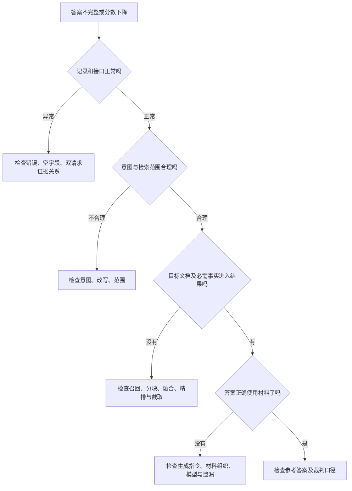

# 第 31 章：从分数到判断——报告、改进与 Agent 面试追问

现在你已经能说出每个指标怎么算。但真正有价值的能力是：看见一组分数后，知道接下来应该看哪一道题、哪一段材料、哪个处理环节。

本章把前五章汇成闭环：**观察 → 提出原因假设 → 回到样本 → 设计对比 → 解释结果。**

## 31.1 报告的四种产物，各自解决一个问题

项目在 score 阶段保存 `_scores.json`，report 再结合录制结果生成：

| 产物 | 最适合回答的问题 |
|---|---|
| report.md | 整体表现怎样，哪类意图比较弱？ |
| per_sample.csv | 哪道题的哪个指标异常，人工如何复核？ |
| failures.jsonl | 哪些题触发了失败筛选，应优先看什么？ |
| slides.html | 如何把同一组结果直观讲给别人听？ |

报告不是新的评测。改演示主题不会重新向 RAG 提问，也不会重新让模型判卷。它是对已有表现和评分的组织。

## 31.2 一条诊断路线：先看观测，再看路由，再看证据，最后看生成

假设 S2-01 没有正确回答刷新率。按照以下顺序分析，会比直接“换更强模型”清晰得多。



[查看图源](../assets/diagrams/evaluation-diagnosis.mmd)

第一步确认记录可用，不是重新验证整个项目正确性，而是弄清这个分数有没有对应的观测。旁路请求失败造成的空列表，与正常检索但没有找到资料，改进方向不同。

第二步看意图与范围。参数题是否被送到了正确的知识范围？查询改写是否保留了 Pro 型号？

第三步看证据。没找到目标文档，优先分析召回；找到目标文档却没有目标参数，检查块内容；候选里有参数、最终材料没保留，检查融合、精排和后处理。

第四步看生成。材料里两个事实都清楚，回答却只给一个，应研究生成对问题需求的覆盖，而不是继续无限增大 TopK。

最后看标准和裁判。当人工阅读认为答案合适，但分数很低时，确认 reference 是否真的是完整答案，裁判是否误解表格或型号，以及旁路材料是否对应当次生成。

这是一套原因假设的组织方法。总分本身不会自动给出唯一根因，最后还要回到具体记录。

## 31.3 失败案例文件不是“所有失败的真相”

当前报告会把以下情况收入失败案例：Hit@5 未命中、Correctness 低于 0.5、Faithfulness 低于 0.5、需要检索却空召回、不需要检索却召回。

这些条件更像工作清单的筛选规则。0.5 是当前代码的筛选阈值，不是行业统一的合格线，也不是项目实测得出的结论。

比如一题漏了关键条件但裁判给 0.6，就不会因该项进入这个文件；某些网络错误也不一定触发这几个质量规则。因此读总览时还要看状态分布，深入时要能通过 query_id 回到完整 EvalRecord，而不是只看 200 字的答案预览。

## 31.4 人工复核怎样介入，而不抹掉机器分

项目会在逐题 CSV 的 RAGAS 指标旁设置人工列。人工填写后，重新生成报告时采用：

```text
人工列有值 → 用人工值生成报告指标
人工列为空 → 使用原 RAGAS 值
```

举一个教学例子：三题原始 Faithfulness 是 [0.8,0.2,1.0]，总体为 2/3。人工检查第二题发现裁判漏读表格，给它 0.8，那么复核口径的总体变为 (0.8+0.8+1.0)/3≈0.867。

这不是“让报告好看”的调分，而是另一份评判来源。项目保留原 `_scores.json`，CSV 保留原始指标列和人工列，报告用复核后的指标。这样可以分清哪部分来自模型，哪部分来自人工。

零分也是有效人工值；空白才表示没有覆盖。不能把不满意的结果简单删成空值。

如果由你组织复核，最好让复核人先依据题目与证据独立判断，再讨论分歧；还可以补充理由和复核者信息。后两项是管理评估质量的建议，不是当前 CSV 自动提供的完整审计流程。

## 31.5 看总体分，也要看哪类题改善了

全量题库主要是 SUPPORT。如果总分上升，可能主要由数量较多的容易参数题贡献；少量复杂政策或跨文档题仍可能变差。

作者通过一级、二级意图分组，把总平均拆开。假设一个方案的总体 Recall 变好，但对比选购类下降，就要回到多文档题看是否只保留了其中一款产品。

这不是否定总分，而是明确它的权重：总平均让每道有效样本等权，并不保证每种业务类型等权。报告结论最好同时说整体、重点场景和失败样本，而不是只挑最高的一项。

## 31.6 A/B 与消融：怎样知道改进来自哪里

项目 diff 工具比较两份 `_scores.json` 的总体和部分分组指标，计算 B−A，根据预设阈值标记退化。

它提供对照表，不会自动保证实验可比。设计一组有解释力的对比，需要控制：题目及参考版本、知识库快照、被评模型、裁判模型与评分设置、上下文预算，以及与时间有关的并发条件。

**A/B** 是比较两个方案；**消融** 是拿掉或单独加入某个组件，观察其贡献。比如 baseline 是向量检索，B 只增加 BM25，才比较容易解释变化是否与关键词通道有关。一次同时更换模型、分块和 Reranker，即使分数提升，也难说是哪项起作用。

对于 LLM 裁判的小幅变化，还要考虑判断波动与有效样本集合是否相同。工具中的“无显著退化”是阈值判断的文案，不代表统计学显著性检验；它没有替你计算置信区间。

另外，diff 默认读取原始评分文件，不自动读取报告阶段的人工覆盖。对外比较时，要明确使用机器分还是复核分，不能拿两种口径混着比较。

## 31.7 如果重点研究 HNSW、BM25 和 LightRAG，应该怎样评

下面是建立在前面检索原理上的**评估设计建议**，不是已经执行的实验。

### HNSW：区分索引损失与语义表示问题

先明确想研究的是索引近似程度还是业务效果。调整搜索宽度，观察延迟与业务文档 Recall 的权衡；若要单独测 ANN 召回，需要额外建立精确向量近邻基线。

如果精确向量搜索本来就不把正确资料排近，继续扩大 HNSW 搜索范围也未必解决问题，应研究 Embedding、分块或查询表示。

### BM25：在精确词面问题上看是否补回资料

挑选型号、错误码、专业名词等词面敏感问题，固定其余流程，比较向量单路与增加关键词通道后的文档覆盖、排名及答案质量。

如果 Recall 上升而 Context Precision 下降，说明补回了一些资料，也引入了噪声；接着看融合和精排是否把噪声压下去。不能只展示 Recall 上升便认为整个系统一定更好。

### LightRAG：让题目真正需要连接关系

图检索适合研究跨实体、跨关系的资料组织能力。题目应需要连接多个事实，而不是只让模型摘一个屏幕参数。

可以沿第 23 章的林辰—星河项目—负责人—审批制度案例，设计同义表达、跨文档关联和相似人名干扰。但这些是新设计的题，不是说官方现有题库已经标注了图路径。

最终答案正确仍不足以证明“图推理做对了”：模型可能从一个原文片段直接获得答案。若要评图路径，需要增加实体、关系和路径观测；当前 EvalRecord 主要保存文档、块和文本，不提供完整图遍历判定。

这三类评估共同体现一条原则：**指标要对应改动的机制，题目要真的触发那种机制。**

## 31.8 如果面试官继续问 Agent 怎么评

当前代码主体是 RAG 评测，agent 目录为预留结构；CLI 也只注册 rag 流程。RAG 评分可以作为知识工具质量的一部分，但外层 Agent 还多了一条决策轨迹：

```text
用户目标
  → 选择工具与参数
  → 执行工具
  → 阅读观察
  → 决定继续、澄清或结束
  → 形成最终结果
```

基于这条轨迹，评测可以再增加四类问题：

| 层次 | 要观察什么 | 教学例子 |
|---|---|---|
| 决策 | 工具选择、参数、是否需要澄清 | 问参数时是否查知识，问实时订单时是否选业务工具 |
| 执行 | 调用是否成功，返回结果是否被使用 | 工具报错后有没有重试、换策略或说明限制 |
| 任务结果 | 最终目标是否真正达成 | 声称创建工单时，是否有真实创建结果 |
| 效率与约束 | 多余调用、总耗时、越界动作 | 是否无意义地重复搜同一题，是否越过授权操作 |

为此，需要把工具名、参数、结果、调用顺序、最终状态以及任务验收条件加入评测数据；涉及外部状态变更时，还需要检查实际结果。仅保存最终回答文本是不够的。

也不宜把一条唯一工具顺序硬编码成所有题的答案。同一任务可能有多种有效路径；可以要求必需动作和约束，对最终状态做验收，再把冗余步骤作为效率指标。对于必须有先后约束的任务，则明确验证依赖顺序。

以上是你可以解释的扩展方案，不是本轮新增了 Agent 执行器或工具评分代码。

## 31.9 八个高频追问，应该抓住哪些要点

**为什么不用一个准确率？** 检索、生成与路由会造成相同表面错误，需要拆开观察。

**Hit 高为什么答案还差？** 只命中整份文档不代表块里包含目标事实，也不保证生成使用完整。

**Faithfulness 和 Correctness 有什么区别？** 前者相对检索材料，后者相对参考答案；忠实复述错误或不完整材料不等于完成正确回答。

**为什么需要模型裁判？** 文档编号能精确比较，自然语言中的事实支持、遗漏和切题性需要语义判断；模型判关系，公式汇分。

**裁判可靠吗？** 它是有噪声的评判器，可通过固定答卷、重复判分、检查参考质量与人工复核改善解释，不应视为绝对真理。

**为何拆 run 和 score？** 固定被评系统的表现，避免更换评分方式时答卷也变化，并可复用记录。

**怎么证明图检索或 Agent 有价值？** 设计会触发相关机制的题，固定其它变量做对比，并补充图路径或工具轨迹观测；不能从一个最终总分反推所有组件贡献。

**你取得了多少提升？** 本教程没有运行评测，不提供提升数字。可以准确讲已有评测框架、自己的源码研究和对比设计；实测结论需要对应的运行记录。

## 31.10 用两分钟讲完整套评测

> 这个项目的官方评测器是独立的 Python 工具链。它把过程拆成录制、评分和报告：题目带标准意图、文档和参考答案；录制器分别拿到聊天回答与旁路检索信息，保存成逐题记录。评分分两层：确定性指标看意图、文档命中与覆盖、排名、行为和延迟；RAGAS 看事实覆盖、材料排序、回答忠实性、正确性和切题性。
>
> 设计上的重点是录制与评分分离，可以在固定答卷上更换裁判或人工复核。看报告时，我会从可用记录出发，先检查路由与检索，再看事实是否进入材料、生成是否完整使用，最后核对参考与裁判口径。当前旁路是独立重查，不是聊天证据快照；更精确的评估可以保存实际生成上下文。若扩展到 Agent，还要加入工具选择、执行轨迹与任务完成状态，而不能只评最终文本。

到这里，前面的“知识怎样建、资料怎样查、Agent 怎样用”，已经接上了“效果怎样解释、改进怎样比较”。这才是一条完整的 Agent / RAG 面试主线。

源码入口：[报告与复核](https://gitcode.net/nageoffer/ragenteval/-/blob/9d69c63cdca0bf730d8900c3076e0480e541360c/eval/rag/report/markdown.py)、[A/B 对比](https://gitcode.net/nageoffer/ragenteval/-/blob/9d69c63cdca0bf730d8900c3076e0480e541360c/eval/rag/report/diff.py)、[CLI](https://gitcode.net/nageoffer/ragenteval/-/blob/9d69c63cdca0bf730d8900c3076e0480e541360c/eval/common/cli.py)。

[上一章：RAGAS](30-evaluation-ragas-judge.md) · [下一章：Trace、日志与指标](32-trace-logs-and-evaluation.md) · [实现备查](../appendices/evaluation-implementation-notes.md) · [首页](../README.md)
