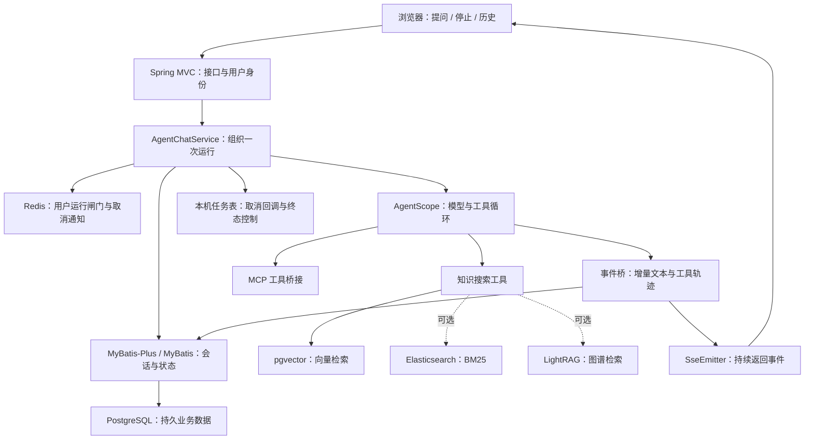

# 第 35 章：先看一次问答，后端到底在忙什么

> 后端面试篇 · 第一部分：项目应用。接在 Agent/RAG 主线之后读，不要求运行项目。

## 35.1 不从技术名词出发，从一个人提问出发

林辰登录知识助手，问：“去上海出差，住宿费怎么报销？”模型可能需要查制度，也可能继续调用工具。你熟悉的 Agent 循环解决的是：下一步做什么、调用哪个工具、什么时候回答。

但用户还会做这些事：连续点两次发送、在回答途中点停止、刷新页面查看历史、删除刚才的会话。同一时刻，其他用户也在提问。模型本身不负责处理这些事情。

因此本项目的后端不是给模型套一个 HTTP 接口，而是给一次 Agent 运行提供完整的生命周期：识别是谁发来的请求，隔离每个用户的状态，保存历史，协调并发，把增量内容送到浏览器，在成功、失败或取消时回收资源。

箭头表示主要调用或数据流，不表示每条线都是网络请求。Spring Service 调用同进程的 AgentScope、Mapper 和知识工具，主要是 Java 方法调用；访问 PostgreSQL、Redis、ES、模型供应商或远程 MCP 服务才跨越相应的连接边界。ES 和图谱是可选检索能力，冻结配置默认未启用。

## 35.2 用六步走完请求

**第一步：取得可信身份。** 后端从登录态取得用户信息，放进 `UserContext`。本轮入口立刻取出 `userId`。它不是相信前端随意传来的“我是哪个用户”。之后查询会话、注册任务和构造 Agent 运行上下文，都围绕这个身份展开。

**第二步：给运行分配编号并占用闸门。** 没有会话编号就创建会话编号，每次运行另建 `taskId`，再尝试取得该用户的 Redis 运行槽。取得失败，本轮不会继续执行 Agent。这个步骤在发送 META 和写入用户消息之前，避免拒绝的提问也开启完整会话运行。

**第三步：建立历史和收尾设施。** 服务发送包含会话、任务编号的 META，创建或更新会话，写入用户消息。随后创建本轮独立的运行句柄、事件桥，把取消回调登记到本机任务表。用户问题先保存，助手答案还没产生，因此稍后失败时可以出现“有问题、无正常答案”的历史，这不是要求两条消息必须成对插入的事务。

**第四步：运行 Agent。** Provider 提供与工具目录匹配的 Agent 实例，运行上下文显式带上用户与会话编号。Agent 决定是否调用知识工具；知识工具再使用检索链。Spring Boot 负责组装和承载它，AgentScope 负责模型—工具循环，这两者不互相替代。

**第五步：一边执行，一边展示。** 事件桥接收文本、思考、工具开始/结束等事件，维护本轮缓冲区，转换成前端协议，经 SSE 发送。用户看见第一段文字时，整个 Java 方法链和数据库状态未必已经完成。

**第六步：争取唯一的收尾资格。** 正常结束、取消和异常可能几乎同时发生。运行句柄用 CAS 选出一个收尾者；该路径处理业务结束动作，然后注销任务、释放 Redis 闸门、清理本机会话缓存，并按配置安排长期记忆提取。第 39 章会具体解释“唯一收尾”为什么不等于“数据库一定写成功”。

## 35.3 三个编号，绝不能混着说

| 标识 | 它回答的问题 | 一个例子 |
|---|---|---|
| userId | 谁拥有数据和运行资格 | 林辰这个用户 |
| conversationId | 属于哪段持续对话 | “上海出差报销”会话，可包含多轮 |
| taskId | 当前正在执行的是哪一轮任务 | 本次回答的停止目标，下一轮换一个 |

还有消息 `id`，用于标识一条用户消息或助手消息；助手通过 `replyToMessageId` 指向它回答的用户消息。这使“第几轮问题”和“回答是否完整”可以从数据关系判断，而不是靠把消息机械地两两分组。

Trace 的编号是观测关联标识，不自动替代这些业务主键。一次会话多轮运行，每轮又可能多次模型或工具调用；建立映射后才能解释“哪个请求卡在什么阶段”。

## 35.4 哪些东西重启以后还在

把存储理解为不同寿命的数据归宿，比背“Redis 缓存、PG 数据库”更有用。

| 数据 | 当前归宿 | 为什么放这里 |
|---|---|---|
| 会话标题、用户问题、助手内容和展示轨迹 | PostgreSQL 业务表 | 页面刷新和后续查询需要保留 |
| AgentScope 工作状态 | PostgreSQL 的 JSONB 状态表 | 按用户、会话、状态键加载框架状态 |
| 用户长期记忆 | PostgreSQL 记忆表 | 跨会话保留并管理失效事实 |
| 用户是否正在运行、任务属主、取消标记 | Redis | 多个 Java 进程需要协调，状态带 TTL |
| 上游订阅句柄、取消函数、当前输出缓冲区 | 当前 JVM | 这是正在执行的 Java 对象，无法靠另一个节点读 Redis 就接管 |
| 检索结构 | pgvector；可选 ES/LightRAG | 为知识搜索组织向量、词项或关系 |

所以 Redis 在这个 Agent 主链上的突出价值是**运行协调**，不能只回答“提高查询速度”。也不要把 PostgreSQL 中的长期记忆讲成 Redis 对话缓存。

重启会丢失本机活跃对象，旧 SSE 连接也不能凭数据库记录原样复活。持久化历史可以支持之后查看或重新发起请求；这与把运行程序恢复到某个机器指令位置是两件事。

## 35.5 后端为什么还要懂检索与评测边界

一次检索可能去不同后端拿候选，再融合和精排。Java 线程池承担并发调度，连接超时决定能等多久，作用域过滤决定能查哪些库。查询慢不一定是 HNSW 算法参数，也可能是线程池拥堵、数据库连接等待或某个外部服务不响应。

评测器则是系统外部的 Python 工程，通过接口收集结果并评分，不是 Spring Boot 容器里的一个 Bean。排查时应把“产品请求耗时”“评测器排队与网络时间”“裁判模型评分时间”分开。后端层的可靠结束、状态和关联编号，是解释评测失败与坏案例的基础。

## 35.6 面试时可以怎样开场

“后端围绕 Agent 一轮运行来组织。Spring Boot 装配接口、业务服务和 AgentScope；PostgreSQL 保存业务会话、框架状态和长期记忆；Redis 负责同用户并发闸门及跨节点取消；SSE 把模型和工具事件持续推给前端。每轮有独立运行句柄负责取消和统一收尾，检索工具复用底层向量与可选混合检索能力。”

随后选一个你能讲透的例子展开，比如“停止怎么传到真正执行任务的节点”，而不是主动罗列一串未准备的中间件。

本章对应面经主题：Agent 中 Redis/数据库的用途、会话记录设计、SSE 高并发。来源与记录编号见[后端对照附录](../appendices/backend-source-and-interview-map.md)。

源码定位：`AgentChatController.streamChat`、`AgentChatServiceImpl.streamChat/startRun`、`AgentRunHandle`、`AgentConversationServiceImpl`。精确路径统一在附录。

[下一章：Spring Boot 怎样组装服务](36-backend-spring-in-project.md) · [返回首页](../README.md)
