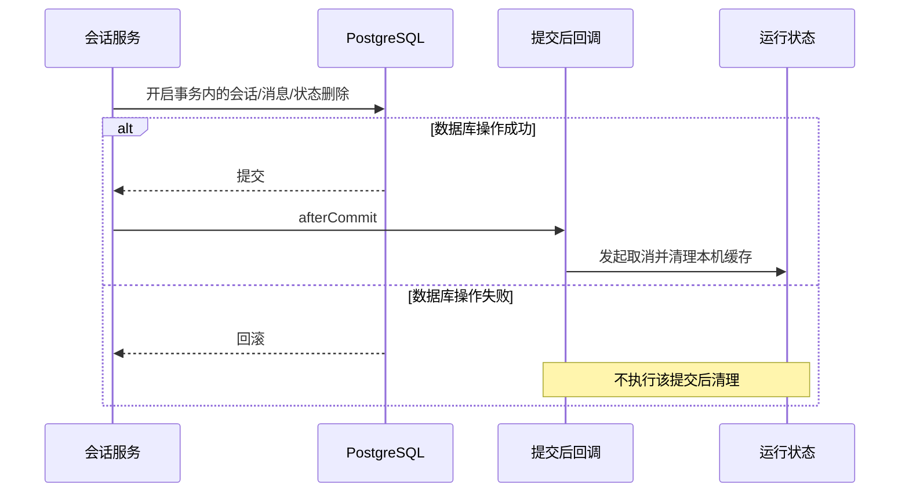

# 第 37 章：会话、Agent 状态和知识，怎样真正落到数据库

> 第一部分 · 项目应用。面经入口：会话表设计、SQL 注入、慢 SQL、事务、ES 与数据库同步。

## 37.1 为什么不能只用一张聊天记录表

林辰的一段会话有标题和最近活动时间，里面有很多用户/助手消息。Agent 还需要自己的工作状态，长期记忆又可能跨越多个会话。把这些数据全部塞进一个大 JSON，确实能“存下”，但会话列表、历史展示、状态更新和跨会话记忆的操作边界会混在一起。

当前项目分开保存：

| 表 | 保存什么 | 典型访问方式 |
|---|---|---|
| `t_agent_conversation` | 会话标题、属主、最近时间 | 按用户列出会话，按用户与会话定位 |
| `t_agent_message` | 一条消息的正文、思考、轨迹块、状态与回复关系 | 查看历史、加载近期有效问答 |
| `t_agent_state` | AgentScope 编码的工作状态 JSONB | 按用户、会话、状态键读写 |
| `t_agent_memory` | 用户长期事实、失效时间 | 读取该用户仍有效的记忆 |

“业务消息”服务于用户展示和产品查询，“框架状态”服务于 Agent 连续运行。两者都在 PostgreSQL，不代表能互相替代。展示用 blocks 可能截断工具结果，不能拿它冒充完整框架上下文；框架 payload 又是不透明编码，不适合直接做前端历史协议。

## 37.2 发出问题以后，数据库按什么顺序变化

先看会话创建。`touchConversation` 用 `conversationId + userId` 查找：已有则更新最近活动时间；没有则清理该身份组合下的残留状态和消息，再插入新会话。标题从首个问题生成并截取长度。

“先查后插”本身防不住并发：两个请求可能都查到不存在。因此表上还有 `WHERE deleted=0` 的部分唯一索引，保证有效会话的 `(conversation_id, user_id)` 唯一。插入遇到重复键时，服务重新查询同一身份组合，使用已经创建的会话。最终约束在数据库，应用分支负责把竞争结果转成可处理的业务结果。

然后插入用户消息，得到消息编号 U1。回答结束时插入助手消息 A1，`reply_to_message_id=U1`，对应 Java 字段 `replyToMessageId`。如果用户中途停止且已有内容或轨迹，助手消息保存为 `INTERRUPTED`。这使页面可以展示“这轮被打断了”，而不是把半截回答误认为正常终答。

注意另一个真实行为：终答持久化失败时，事件桥记录错误并返回空消息编号，仍可能继续发完成事件。因此“浏览器见到回答”与“刷新后一定查得到回答”是两个不同的结果。面试讲落库流程时，说明这两种结果如何区分，比说“用事务保证一致”更准确。

## 37.3 加载历史，不是简单 LIMIT 20

查看完整历史与给模型提供近期有效上下文，是两个不同需求。

完整历史查询按用户和会话筛选，按消息 id 升序返回。加载近期 N 轮时，服务反过来按 id 倒序扫描 `4N+1` 条，再建立“用户消息 → 可用助手答案”的配对，收集最多 N 轮，最后翻转成时间正序。

为什么要多扫？假设最近消息是：

```text
U1：住宿费标准是什么？
A1：正常回答，回复 U1
U2：那晚餐呢？
A2：INTERRUPTED，回复 U2
U3：交通费怎么报？
A3：正常回答，回复 U3
```

加载有效两轮时，应得到 U1/A1 和 U3/A3，而不是因为列表尾部有四条就机械选择 U2/A2/U3/A3。代码要求助手有回复对象、有正文且不是 `INTERRUPTED`。扫描窗口只是给无效轮次留余量；如果最近很多轮都无效，仍可能凑不满 N 轮。

会话列表还有一个值得讲的查询设计：先取用户的会话集合，再用一次 `GROUP BY conversation_id` 统计这些会话里用户消息数量，组成轮次数映射，而不是每个会话单独执行一次 count。这避免了 N+1 查询。但当前 `selectList` 并不是自动分页；会话量长期增长时，分页与统计范围是后续优化点。

## 37.4 MyBatis-Plus 与手写 SQL 各用在哪里

业务表大量使用 Mapper 通用方法和 Lambda 条件，如按 `userId`、`conversationId` 查询。实体上的 `@TableLogic` 表示逻辑删除：通过相应 MyBatis-Plus 路径删除时，会转成标记操作，常规生成查询也会考虑未删除条件。

框架状态使用更明确的 SQL：`AgentStateMapper.upsert` 执行 `INSERT ... ON CONFLICT (user_id, session_id, state_key) DO UPDATE`，把 payload 转成 JSONB。复合主键使每种状态键只有一份当前值；冲突时替换 payload。它是同一状态记录的更新策略，不是把 JSON 中不同线程修改的字段自动合并。

向量表又使用 `JdbcTemplate.batchUpdate` 和参数占位符批量插入。每行有 chunk id、集合名、文本、metadata JSONB 和 embedding。这里不是所有数据访问都强行经过 MyBatis-Plus：业务 CRUD 用 Mapper，向量类型转换和批处理用 JDBC，分别表达适合的 SQL。

预编译参数绑定和业务授权也不能混为一谈。`#{userId}` 或 JDBC `?` 防止输入被当成 SQL 结构解释；查询加上可信 userId 才限制能访问谁的数据。安全参数绑定不自动解决越权。[MyBatis 参数绑定说明](https://mybatis.org/mybatis-3/zh_CN/sqlmap-xml.html)

## 37.5 项目有索引，但得说出“它帮助哪一种查询”

| 已声明索引 | 对应需求 | 应该怎样解释 |
|---|---|---|
| 会话 `(user_id, last_time)` | 找某用户最近活跃会话 | 先限定用户，再利用时间有序性 |
| 消息 `(conversation_id, user_id, create_time)` | 定位一段会话内消息 | 前两列缩小范围；不能直接宣称覆盖 `ORDER BY id` |
| 状态主键 `(user_id, session_id, state_key)` | 读取一种会话状态 | 唯一性和等值定位合在一起 |
| 有效记忆 `(user_id) WHERE invalid_at IS NULL` | 只读仍有效的用户记忆 | 失效数据不进入这份部分索引 |
| 向量表 collection B-tree、metadata GIN、embedding HNSW | 范围、JSON 条件、向量近邻 | 三种不同访问问题，不是一种“万能索引” |

HNSW 的建图和查询原理见第 21 章。这里应当能补上后端视角：建索引会占空间，写数据时还要维护结构；SQL 条件、算子、排序与数据分布决定优化器如何访问。建了 HNSW，不等于每条 SQL 都走 HNSW；metadata 的普通 GIN 索引也不自动加速所有 `metadata->>'字段' = 值` 表达式。

若面试官问“消息查询能不能优化”，可以从实际条件和排序提出候选索引，例如面向活跃消息的 `(conversation_id,user_id,id)` 部分索引，再比较查询与写入成本。这是**设计推演**，不是已改过索引或实测提速。

## 37.6 删除会话：最值得讲的事务例子

会话还在回答时，林辰点击删除。只有“把会话表标成删除”是不够的：消息还在、Agent 状态还在、正在运行的流也可能稍后把答案写回来。

当前 `delete` 方法有 `@Transactional(rollbackFor = Exception.class)`，依次删除该用户会话、消息和同库 Agent State，再注册提交后动作：取消相关在途任务、清理本机 Agent 状态缓存。



为什么放提交后？如果先清空运行缓存，数据库删除随后回滚，数据库会话还在，运行时却已经被改变。提交后至少保证清理以“删除已提交”为前提。

但 `afterCommit` 不是跨系统事务。数据库提交后进程仍可能崩溃，取消消息仍可能丢失，在途 Agent 与删除仍有竞争。正确口述是“同库删除具备事务边界，提交后协调运行态”，不是“加注解以后 PG、Redis、模型、前端全都强一致”。如果要更强的删除保障，可以设计会话代际/墓碑校验和持久化清理任务，阻止旧运行回写；本篇只作为推演。

批量删除的外层方法也有事务，内部调用同类 `delete` 不经过新代理，但其数据库操作仍处于外层已开启的事务中。这是理解自调用最好的项目例子：**内层注解没有单独拦截，不等于外层事务消失。**

## 37.7 PG 写成功，ES 或图谱失败怎么办

向量写入外包了一层关键词同步装饰器：先委托真实向量存储写入，成功后再维护 ES；同步异常记录日志，不回滚向量。图谱装饰器也是 best-effort，但按整文档同步；单块更新/删除没有同等粒度的图谱同步。

这意味着某份新制度可能已经能被向量通道检索，而关键词通道暂时还没有它。将这种失败“捕获并继续”只是主链降级策略，**不自动构成最终一致性机制**：如果没有重试、对账、重建，落后的索引不一定自己追上。

面经中的“ES 与 MySQL 怎么同步”可以回接为：“本项目事实库是 PostgreSQL，当前派生索引是应用层 best-effort 同步。若提高一致性，我会在同库事务中记录待同步变更，外部消费者按版本、幂等键重试，再做对账。PostgreSQL 应讨论 WAL/逻辑解码，而不是把 MySQL binlog 原样套过来。”

## 37.8 读完应该能回答

你应当能够讲出：为什么分业务消息与框架状态；为什么先查后插还需要唯一约束；为什么历史按回复关系筛选；为什么 SQL 参数安全不等于权限安全；为什么删会话事务要与运行清理分开；为什么多索引不能只说“保证一致”。

面经重点记录：309、327、463、726、1103、1449。源码：`AgentConversationServiceImpl`、`AgentMessageDO`、`AgentStateMapper`、`PgAgentStateStore`、`PgVectorStoreService`、两层同步装饰器和 `schema_pg.sql`。[路径与题源](../appendices/backend-source-and-interview-map.md)

[上一章](36-backend-spring-in-project.md) · [下一章：Redis 的两条协调流程](38-backend-redis-in-project.md) · [返回首页](../README.md)
