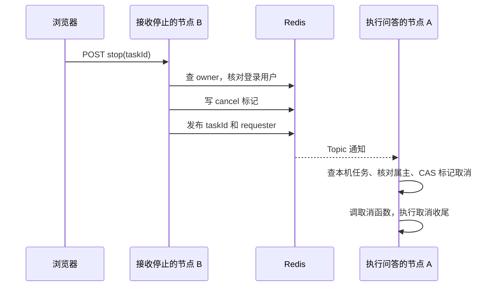

# 第 38 章：Redis 怎样挡住重复运行，又怎样停止远处的任务

> 第一部分 · 项目应用。面经入口：Agent 中 Redis 的用途、分布式锁、锁过期、Lua、故障切换。

## 38.1 先理解两个实际问题

第一个问题：林辰连续发送两次，或者在两个浏览器标签页同时提问。两轮 Agent 都可能读取同一用户的状态、消耗模型额度并写入历史。需要一个跨进程生效的运行资格判断。

第二个问题：提问落在 Java 节点 A，点停止却被负载均衡送到节点 B。真正运行的订阅对象在 A 的内存里，B 不可能直接调用 A 内存中的 Java 函数。需要把取消意图传过去。

这两条链才是本章重点。登录态或其他缓存用途可以作为补充，但先不要用“Redis 能缓存，所以提高性能”替代具体过程。

## 38.2 用户运行闸门：占住一个带身份的槽位

`AgentRunGate.acquire` 使用 Redisson 的 `RBucket<String>`，键是 `ragent:agent:running:` 加 userId，值拼接 taskId 和 conversationId。

概念上，它表达的是：

```text
如果这个用户的运行槽不存在：
    原子地写入“任务 T1 属于会话 C1”，同时设置有效期
    返回本次运行专属的释放动作
否则：
    拒绝再启动一轮
```

代码调用 `setIfAbsent(slotValue, ttl)`，不是先 GET 判断，再分开 SET。假设 A、B 同时检查空槽，分开的 GET/SET 会让两者都以为自己成功；原子的条件写入让竞争集中到 Redis 的一次操作。

键里只有 userId，意味着限制粒度是**同一用户同时一轮**，不是同一会话一轮。不同用户可以各占各的槽，同一个用户换个会话也不能绕过这个资格判断。它是运行互斥，不是按秒计数的 QPS 限流，也不是公平排队。

## 38.3 为什么释放不能直接 DEL

考虑这条时间线：

```text
t1：任务 A 取得槽位，值为 A|C1
t2：A 长时间停顿，槽位 TTL 到期
t3：任务 B 取得同一个用户槽，值为 B|C2
t4：A 恢复执行，进入 finally，准备释放
```

如果 A 直接 DEL，它会删掉 B 的资格，第三个任务又能进入。当前释放使用 `compareAndSet(slotValue, null)`：只有槽位内容仍是 A 自己的值时，才原子清除。B 的值与 A 不同，因此旧任务释放不会删除新持有者。

这也说明 taskId 的作用不只是日志好看，而是表达“这次占用由谁拥有”。注意“先 GET 比较，再 DEL”仍不安全，因为比较与删除之间还可能发生过期和重建；比较与删除必须作为不可被其他命令插入的条件操作。[Redis 锁的官方说明](https://redis.io/docs/latest/develop/clients/patterns/distributed-locks/)

## 38.4 TTL 解决什么，又不解决什么

项目 TTL 取 Agent SSE 超时的两倍。冻结 YAML 中 SSE 为 900000 毫秒，即 15 分钟，因此运行槽是 30 分钟。这是配置推导，不是一次真实运行的耗时。

TTL 让进程突然退出而没来得及释放时，用户不会永久被旧槽挡住。代价是：过期只改变 Redis 中的资格，不会自动终止旧机器上的 Java 代码。因此超过租期还在工作的旧任务，理论上可能与新任务重叠。

这里没有调用 Redisson `RLock`，也没有接入它的 watchdog 续期。不能因为看到 Redisson 就回答“自动续期保证锁永不过期”。如果要讨论续期，应同时说明续期失败怎么办、怎样确认仍是原 owner、下游如何拒绝已经失去资格的旧写入。

如果业务要求严格防止旧任务写入，可设计单调递增的 fencing token，让接收写入的一方拒绝旧版本；这比仅仅延长 TTL 更接近问题本质。但这是新增设计，不是当前 AgentRunGate 已实现的能力。

## 38.5 跨节点取消：Redis 存意图，本机存执行能力

`StreamTaskManager` 同时维护两种状态：

| 位置 | 内容 | 用途 |
|---|---|---|
| 当前 JVM 的 Guava Cache | taskId 对应取消标志、取消函数、最终收尾函数、属主 | 真正停止本机订阅并执行收尾 |
| Redis owner 键 | 任务属于哪个用户 | 停止请求鉴权 |
| Redis cancel 键 | 谁发起取消，带 TTL | 覆盖先取消、后注册的时序 |
| Redis Topic | taskId 与请求者通知 | 把取消意图广播给各节点 |

本机缓存设置 30 分钟过期、最多 10000 条，这是代码中的容量和生命周期设置，不是支持 10000 并发的压测成绩。Redis owner/cancel 键也有 30 分钟 TTL。时间相同，不代表它们是同一份状态。

正常停止过程如下：



B 不把“前端传来的 userId”当可信属主，而是使用服务端登录身份。A 收到消息后还会核对请求者与任务属主。没有找到本地任务的节点直接忽略，只有持有该任务对象的节点能实际调用它。

## 38.6 为什么既要通知，又要留下取消标记

看一个更细的竞态：META 已把 taskId 发给前端，但服务端还没注册好任务时，用户立刻点停止。

如果只发布通知，此时 A 找不到任务就忽略；几毫秒后任务注册完成，却不知道用户已经取消。当前设计先写 Redis 取消标记，再发通知。`register` 在安装属主和最终收尾回调后检查这个标记，补上“取消早到了”的情况。

还有第二个窗口：任务已经注册，但真正的上游取消函数还没绑定。取消先把本机标志置为 true；`bindHandle` 发现已经取消，就立即执行后来才装上的取消函数。可以把它理解为：**事件可能先到，状态必须记住，后来的能力再兑现状态。**

owner 键尚不存在时，停止请求可以留下带请求者的标记，但后续注册会按实际 owner 校验，不能凭这个空窗任意取消别人的任务。

## 38.7 有 Redis 标记，是不是保证取消不会丢

不是。当前 Redis 标记在注册时被检查，本机 `isCancelled` 主要读取内存标志，没有持续轮询 Redis。若任务早已注册，后来取消广播恰好因订阅断线丢失，不能靠“Redis 里还有键”就断言运行方一定看见。

Redis Pub/Sub 是至多一次交付，断开的订阅者不能事后读取错过的历史；这与有持久记录和消费进度的日志型消息设施不同。[Redis Pub/Sub 语义](https://redis.io/docs/latest/develop/pubsub/)

当前实现解决的是跨节点通知和启动阶段的取消竞态，不是持久任务系统。若要求取消最终可达，可以设计安全点检查取消状态、持久任务状态加重试，或使用带确认的事件通道。每种方案都要继续回答重复消息如何幂等、已经结束的任务如何处理。

## 38.8 和三道八股接起来

**为什么不能 synchronized？** 它能协调一个 JVM 内共享锁的线程；A、B 两个节点没有同一个 Java 锁对象。运行闸门需要共享的 Redis 状态，本机缓冲区保护则适合 Java 锁，二者不互斥。

**为什么不用 Redis 保存完整任务对象？** 取消函数捕获的是进程内订阅、Emitter 和运行句柄。序列化文字信息不等于把这些活跃对象转移给另一台机器。Redis 保存任务身份和意图，本机保存执行能力。

**停止是不是撤销所有操作？** 不是。可以尝试停止后续执行和输出，但已发出的 token、已完成的外部工具动作不会自动撤回。对有副作用的工具还要单独设计业务幂等、状态查询和补偿。

本章面经重点：461/462、1094、1115/1116、1140、1474。源码：`AgentRunGate`、`StreamTaskManager`、`AgentChatServiceImpl`、`AgentRunHandle`。[路径与题源](../appendices/backend-source-and-interview-map.md)

[上一章](37-backend-persistence-in-project.md) · [下一章：SSE 与并发收尾](39-backend-streaming-in-project.md) · [返回首页](../README.md)
