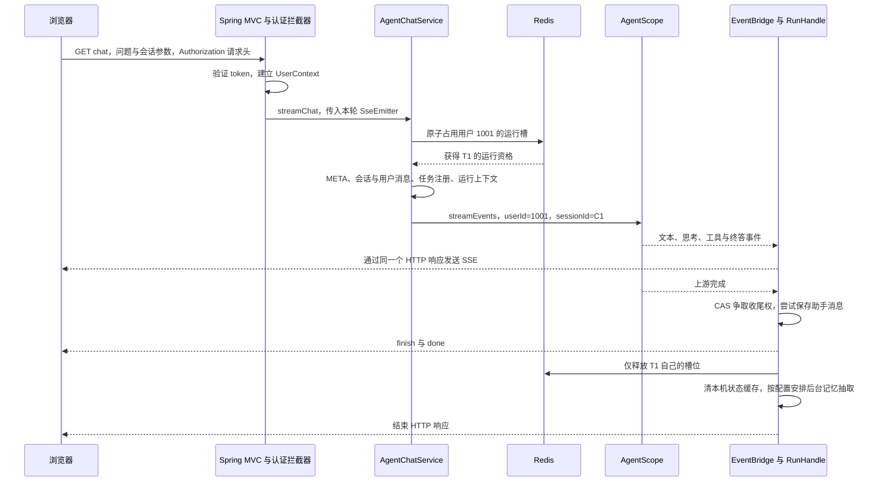

# 第 45 章：把一次 Agent 请求讲明白——身份、运行槽、收尾、SSE 与启动装配

> 学习问答增补，整理于 2026-09-11。以本次 ChatGPT 学习对话的五组回答为线索，补入 token 传递与并发追问，按源码重新组织，不是聊天记录原样归档。

正文实现事实仍以 AsterRAG `98894c2c42c015a3c874c6b3c986ac863c85b731` 为准。聊天涉及的较新上游能力单列在 [45.6 版本对照](#version-diff)，不改变全书源码锁。本章是静态源码讲解，不代表已运行登录、模型、数据库、SSE 或故障实验。逐项源码入口见[本章核对记录](../evidence/request-study-source-review.md)。

| 想弄懂的问题 | 从这里读 | 对应原章节 |
|---|---|---|
| 登录以后请求还要带 token 吗？UserContext 存什么？ | [45.1 身份](#identity) | [36：Spring 与上下文](36-backend-spring-in-project.md) |
| Redis 运行槽是什么？为什么不同会话也互斥？ | [45.2 运行槽](#gate) | [38：Redis 协调](38-backend-redis-in-project.md) |
| CAS 怎么选收尾者？为什么不保证数据库成功？ | [45.3 运行句柄](#finalization) | [39：并发收尾](39-backend-streaming-in-project.md) |
| SSE 怎样把模型和工具的过程送到页面？ | [45.4 SSE](#sse) | [18：前端](18-frontend-state-and-evidence.md)、[39](39-backend-streaming-in-project.md) |
| Spring Boot 与 Maven 分别负责什么？ | [45.5 构建和运行](#boot-maven) | [2：模块与进程](02-modules-and-runtime.md)、[36](36-backend-spring-in-project.md) |

## 45.0 先沿一个具体请求走一遍

林辰已经登录，准备在会话 C1 里问“解释 Java 的锁”。服务器为这轮生成任务 T1。以下 C1、T1、1001 都是教学用符号，不是实际运行记录。



图展示正常路径。取消和异常会走其他收尾体；启动失败也有自己的释放路径。图中的“尝试保存”不能读成“数据库已经提交成功”。

<a id="identity"></a>

## 45.1 “从登录态取得用户信息，放进 UserContext”是什么意思

### 45.1.1 先分清三个保存位置

| 信息 | 谁保存 | 生命周期与用途 |
|---|---|---|
| 登录 token | 前端 `storage`，使用 localStorage；登录状态也进入前端 Store | 登录后供后续请求读取，直到清理、失效等；前端存在 token 不等于服务器仍认可它 |
| token 对应的登录身份 | 后端 Sa-Token 登录系统 | 跨多个请求识别登录用户，以服务器登录态为准 |
| `LoginUser` 用户信息 | 后端 `UserContext`，底层为 `TransmittableThreadLocal` | 当前处理线程的用户上下文，并可在受支持的异步传递方式中传播；不是长期登录仓库 |

`AuthServiceImpl.login` 验证登录信息后，调用 `StpUtil.login(loginId)`，再通过 `StpUtil.getTokenValue()` 把 token 放进登录响应。前端 `authStore` 调用 `storage.setToken` 保存它。后续请求仍然要把凭据发送给服务器。

因此不能理解成“登录时 token 存进 UserContext，以后请求可以不带”。实际顺序是：**每次受保护请求先带 token，后端认证通过后，才为这次处理准备 UserContext。**

### 45.1.2 token 到底放在请求的哪里

项目的 Agent 前端取 `storage.getToken()`，设置 `headers: token ? { Authorization: token } : undefined`。服务端 YAML 的 `sa-token.token-name` 也配置为 `Authorization`。这里传原 token，不能自行假定必须加 `Bearer ` 前缀。

HTTP 示意如下，中文问题在真实 URL 中由前端编码；此处省略部署前缀：

```http
GET /agent/v1/chat?question=你好&conversationId=C1 HTTP/1.1
Authorization: <登录接口返回的token>
Accept: text/event-stream
```

- `question`、`conversationId` 是查询参数，说明想做什么、操作哪个会话。
- `Authorization` 是请求头，携带用于认证的凭据。
- Controller 的 Java 参数列表没有 token，是因为认证拦截器先读取和验证了凭据；不是网络请求没有传它。

使用项目页面时，用户只需输入问题，前端代码负责带 token。若另写请求客户端，也要按服务端约定携带凭据。其他应用可以使用 Cookie 等机制，但不能据此把本项目的请求头省掉。

### 45.1.3 后端如何把 token 变成可信 userId

正常的首次业务请求沿以下顺序处理：

```text
Authorization 中的 token
  → SaTokenConfig 中的登录拦截器调用 checkLogin
  → UserContextInterceptor 调用 getLoginIdAsString
  → UserMapper.selectById 查询用户
  → 构造 LoginUser，放入 UserContext
  → AgentChatServiceImpl.streamChat 调用 UserContext.getUserId
```

登录拦截器顺序为 0，用户上下文拦截器为 20；其间还可能经过顺序为 10 的演示只读拦截器。`/auth/**`、`/error` 被排除，OPTIONS 和 Servlet ASYNC 派发有专门分支。所以不能把“每次请求认证”扩写成“每个异步回调都重新验证 token”。

`UserContextInterceptor.afterCompletion` 调用 `clear()`，最终从线程上下文移除用户。SSE 的初次处理和后续异步派发涉及不同线程生命周期；仅凭这个回调，不能保证所有异步线程的清理时机都已经验证。Agent 入口显式捕获 userId 并传下去，避免把整轮执行完全寄托在线程上下文上。

### 45.1.4 为什么不直接让前端传 userId

前端可以修改 URL。如果服务器直接相信 `userId=2002`，用户就能把“我想访问哪个资源”伪装成“我是谁”。token 也由前端携带，但服务器会验证它对应的登录身份；用户不能仅靠改一个 userId 字符串获得另一个人的权限。

认证之后还要做资源授权：

| 后续动作 | 身份怎样参与 |
|---|---|
| 查会话 | 同时限制 `conversationId` 与 `userId` |
| 注册 T1 | `taskManager.register(taskId, userId, finalizer)` 记下属主 |
| 停止 T1 | `cancelByUser` 从 UserContext 取请求者，与任务 owner 核对；owner 尚未登记的竞态另有检查 |
| 启动 AgentScope | `RuntimeContext.builder().userId(userId).sessionId(conversationId)` |
| 读取框架会话状态 | 按用户与会话隔离；不是从 userId 直接获得所有人的历史 |
| 用户长期记忆 | 用户是共享记忆的所有者，抽取进度等仍含会话维度 |

假设 C1 属于林辰 1001，周敏 2002 即使知道 C1，查询条件也会是 `conversation_id=C1 AND user_id=2002`，不能查出林辰的行。这里只说明带属主的查找，不表示两个用户必然各有一个同名 C1。

冻结版的这处 RuntimeContext 构造仅显式填入 userId 和 sessionId。taskId、回复所对应的用户消息 ID 由 RunHandle/EventBridge 等持有，不能把这些字段都画成该版本已经放入 RuntimeContext。

源码定位：[身份与前端请求](../evidence/request-study-source-review.md#identity-sources)。

<a id="gate"></a>

## 45.2 “Redis 运行槽”和“重新考虑用户级并发”是什么意思

### 45.2.1 运行槽是一条应用记录

它表示用户当前占用的 Agent 运行资格，与 Redis Cluster 的哈希槽不是一回事。`AgentRunGate` 的键和值可表示为：

```text
key   = ragent:agent:running:1001
value = T1|C1
```

`acquire` 用 `RBucket<String>.setIfAbsent(slotValue, ttl)` 原子占位。若槽位已有值，直接拒绝；若成功，返回一个释放动作，交给 RunHandle 后续调用。不是先 GET 看空，再另发 SET，因为两次操作之间可能被其他请求插入。

键中只有 userId，因此 1001 在 C1 运行时，再到 C2 提问仍会竞争同一个槽。另一用户 2002 使用另一条键，可以同时运行。这是跨实例的用户维度互斥策略，不是系统只能服务一个用户，也不是 QPS 限流或等待队列。

若节点 A 接到第一次提问、节点 B 接到第二次，本地 Java Map 无法天然共享运行记录；共享 Redis 可以让两台节点争同一个资格。真实取消函数仍留在运行任务的 JVM 内，不是放入 Redis 就能在任意机器执行。

### 45.2.2 为什么扩大到整个用户，而不只锁一个会话

同一会话并行运行两个循环，可能同时读到同一份旧状态，随后互相覆盖更新或打乱消息对应关系。禁止这种并行是常见的保护方式；也可以另行设计版本控制、队列或分支会话，并非逻辑上只能用锁。

不同会话的框架状态可以隔离，但仍有用户级共享信息：运行任务记录、用户长期记忆、资源额度等。将一用户限制为一条主流，会减少同时进行的模型/工具调用，简化部分生命周期协调。这些是依据结构提出的工程解释，不是源码证明的作者完整选型动机，也不是 AgentScope 的强制限制。

### 45.2.3 “用户级逻辑要考虑并发”的具体例子

假设将来允许 1001 同时运行 C1/T1 和 C2/T2：

1. **记录任务不能相互覆盖。** 只存“1001 当前任务=T1”，再用 T2 覆写，就丢了 T1 的记录。需要能表示多个任务，例如每会话一个键或一个按会话索引的结构；不一定非要 Hash/Set。
2. **完成任务只能清自己的记录。** T1 结束不能清空 1001 的所有运行记录，否则 T2 还在运行却失去资格记录。删除 C1 时也要准确找到 C1 的任务。
3. **共享额度不能先读后写。** 假设最多运行两条，已有一条。两个请求都读到数量 1，各自判断可以启动，最终会出现三条。检查与占位必须协调成原子操作。
4. **共享记忆需要处理旧快照。** C1、C2 可以各自读到旧用户记忆，再给出不同更新。谁提交、旧判断是否仍有效、如何合并，需要独立的一致性规则。

以上是并发改造的教学推演，不表示冻结版存在一套未展示的“最多两条”功能。当前停止协议本来就按 taskId 组织，也支持多个不同用户的任务，不能说一旦放开同用户并行就必须把全部 stop 代码推倒重写。

尤其要注意：**用户运行闸门不等于把长期记忆抽取也完全串行化。** 冻结版先执行释放闸门的 hook，再清理本机状态缓存，之后安排 `scheduleMemoryExtraction`。它在 `boundedElastic` 上异步运行，可能与用户下一轮或其他会话的抽取重叠。`AgentMemoryPipeline` 另有 claim、revision、watermark 与提交检查，因此不能解释成“有用户锁，记忆层就不需要并发控制”。

### 45.2.4 TTL 和释放时的 CAS 各解决什么

进程崩溃时可能来不及调用释放函数，TTL 使旧资格最终过期。冻结配置的 SSE 超时为 900000 毫秒，槽位 TTL 是它的两倍，即 30 分钟；这是配置计算，不是任务实测耗时。此处用 RBucket，没有 RLock watchdog 自动续期。

再看过期后的时序：

```text
T1 占位：1001 → T1|C1
T1 长时间停顿，槽位过期
T2 占位：1001 → T2|C2
T1 恢复，执行旧的释放动作
```

T1 若直接 DEL，就会删掉 T2 的槽。实际释放调用 `compareAndSet(slotValue, null)`，只有 Redis 当前值仍等于 T1 当初写入的值，才清除它。比较和清除必须原子完成。

但 Redis TTL 到期不会自动杀掉旧 JVM 里的 T1。旧任务超租期还在执行时，可能与新任务重叠；安全释放避免误删新槽，不是严格防止旧任务继续写入的 fencing 机制。

源码定位：[运行槽与共享记忆](../evidence/request-study-source-review.md#gate-sources)。

<a id="finalization"></a>

## 45.3 AgentRunHandle 是什么，“唯一收尾”又保证了什么

### 45.3.1 它是一轮运行的管理对象

句柄可以理解成“拿着它，就能管理这次运行”。Service 为每轮创建一个 `AgentRunHandle`，让它持有 taskId、SSE sender、上游订阅、中断动作和释放钩子。它不负责模型推理，也不是数据库中的完整任务记录。

```text
AgentRunHandle（T1）
  ├─ sender：向本轮响应发送与关闭
  ├─ disposable：取消对上游事件流的订阅
  ├─ interruptAction：请求 Agent 中断
  ├─ settled：是否已有路径拿到收尾权
  └─ releaseHooks：归还槽位、清状态缓存、安排后续工作
```

正常上游通过 `onComplete` 进入 complete；用户停止等外部取消通过 finalizer 进入 cancel；上游异常通过 onError 进入 fail。一个合规的上游订阅不会正常地同时发送 onComplete 和 onError；竞争主要来自这些上游信号与外部取消、连接生命周期之间的交叠。

### 45.3.2 CAS 不是另外创建一个“收尾线程”

三条出口最终竞争同一个 `settled.compareAndSet(false, true)`。CAS 把“比较当前值”和“满足条件后修改”作为一次原子操作。

```text
初始 settled=false

线程 A：cancel   → CAS(false,true) 成功 → 执行取消收尾体
线程 B：complete → CAS(false,true) 失败 → 返回
后续  ：fail     → CAS(false,true) 失败 → 返回
```

谁成功把 false 改成 true，谁就获得本轮收尾权。它限制的是同一个进程内、同一个 RunHandle 的收尾体至多执行一次，不是整个分布式系统 exactly-once，也不是外部工具只执行一次。

冻结版 `settle` 的核心顺序可以按下面的简化伪代码阅读：

```java
if (!settled.compareAndSet(false, true)) {
    return false;
}
try {
    body.run();
} catch (Exception e) {
    // 记录收尾异常
} finally {
    taskManager.unregister(taskId);
    runReleaseHooks();
}
return true;
```

### 45.3.3 赢得收尾权之后，各条路径做什么

| 冻结版路径 | 业务动作 | 通道结束 |
|---|---|---|
| complete | 汇总正文；无增量时可用最终结果补发；尝试保存 NORMAL 助手消息；发送 finish、done | `sender.complete()` |
| cancel | 有正文或轨迹时尝试保存 INTERRUPTED；发送 cancel、done | `sender.complete()` |
| fail | `onError` 的收尾体记录异常；本版没有在这里保存中断消息或发送 finish/done | `sender.fail(error)` |

三条路径都经公共注销与释放。聊天回答描述的“异常也保存中断消息并发送 finish/done”属于较新上游，详见版本对照，不能直接套进这一版表格。

释放钩子按登记次序调用：归还 Redis 槽位 → 驱逐本机 Agent 会话状态缓存 → 按配置安排后台记忆抽取。驱逐的是可重新加载的本机缓存，不是删除 PostgreSQL 中的历史消息或长期记忆。

RunHandle 在锁内取得钩子快照，在锁外执行，每个 hook 的普通异常分别记录。晚于释放才登记的 hook 会立即补跑，避免登记/释放竞争使它遗漏。订阅与中断动作使用 volatile 发布；这些机制各有作用，不能用一个 CAS 代替所有共享状态保护。

### 45.3.4 唯一执行者不等于数据库一定写成功

假设 complete 已赢得 CAS，此时 PostgreSQL 写入失败：

```text
settled 已从 false 变成 true
  → persistAssistantMessage
  → addAssistantMessage 写库抛异常
  → 事件桥在 persistAssistantMessage 内捕获异常，记录日志并返回 null
  → complete 的收尾体仍可发送 messageId=null 的 finish，再发送 done
  → 公共释放和关闭继续执行
```

这是冻结源码更具体的失败路径：并不一定要等异常冒泡到 `settle` 才被处理。`settle` 的 catch 是更外层的保护。后来再来的 cancel/fail 已抢不到 CAS，也不会自动替它重试写库。

所以 `settled=true`、客户端收到 finish/done、HTTP 响应结束，都不能单独证明助手消息已经成功持久化。数据库事务也不能保证故障时每次写入都成功；它主要约束提交或回滚的行为。要提高可靠性，需要另行设计幂等写入、重试、持久任务状态或补偿，并明确哪些已实现。

### 45.3.5 为什么写库失败后还要尝试释放

如果仅因保存失败就保留运行槽，用户会继续被“当前会话处理中”挡住。代码把业务收尾与生命周期清理分开，让普通业务异常后仍有机会归还资源。

但 finally 不是“任何故障都能清理成功”的承诺：进程强制退出时它可能不执行；Redis 操作也可能失败。`unregister` 对 Redis 标记使用 `deleteAsync`，方法返回不等于远端删除已完成。当前 `finally` 先调用 unregister，再跑 hooks，若前一步同步抛异常，也不能据结构图断言后一步必达。这里描述的是代码正常与普通业务异常下的安排，严格故障保证需要单独验证。

源码定位：[句柄与事件桥](../evidence/request-study-source-review.md#finalization-sources)。

<a id="sse"></a>

## 45.4 SSE 怎样把 Agent 的过程实时送到前端

### 45.4.1 一次请求，持续读取同一个响应

普通接口通常准备好结果后一次返回。Agent 可能经历“模型 → 工具 → 模型”的多次等待；SSE 让后端在一个尚未结束的 HTTP 响应里不断发送事件，前端就能逐步显示文字与工具状态。

这里延长的是本次 HTTP 响应的生命周期，不意味着普通 JSON 请求结束后 TCP 连接一定关闭，也不要求每个事件另建 TCP 连接。

Controller 创建 `SseEmitter`，调用 `streamChat`，最后返回 Emitter。`new SseEmitter()` 只是创建 Java 对象，不能等同于网络已经建立好、前端已经收到首帧。return 前的启动步骤仍会同步执行；Spring MVC 随后接管异步响应。发送早于接管时涉及框架缓冲，所以“调用 sendEvent”与“浏览器看见事件”也有时间差。

### 45.4.2 三层职责要分开

```text
AgentScope：执行模型与工具循环，产生 AgentEvent
    ↓
AgentStreamEventBridge：翻译事件、维护正文和工具轨迹、协调业务终态
    ↓
SseEmitterSender / Spring SseEmitter：序列化并向 HTTP 响应发送
    ↓
fetch 响应字节 → SSE 解析器 → 前端 Store → React 页面
```

Bridge 例如将 `TEXT_BLOCK_DELTA` 转成 `message`，将思考增量转成 `type=think` 的 message，将工具开始和结果结束转成 tool。`SseEmitterSender` 再调用 `SseEmitter.event().name(...).data(...)`。它的 `closed` 控制连接层发送和关闭，RunHandle 的 `settled` 控制业务收尾入口，两者不能互相替代。

### 45.4.3 第一帧为什么是 meta，后面有哪些帧

获得运行资格后，启动流程首先尝试发送包含 conversationId、taskId 的 meta，再建立/访问会话、保存用户问题和注册任务。前端收到 meta 就能把本轮 UI 与任务关联起来，停止时使用 taskId。meta 不证明后面的写库、任务注册或 Agent 启动已经全部成功。

冻结版正式枚举有七种事件：

| event | 表达的内容 |
|---|---|
| meta | 会话与本轮任务标识 |
| message | 回答或思考增量，type 为 response/think |
| tool | 工具开始/结束、结果与成功标志 |
| hint | 运行提示，例如达到迭代上限后继续汇总 |
| finish | 回复的终态载荷，包含 messageId、title、status |
| cancel | 取消后的终态载荷 |
| done | 本项目约定的流结束事件 |

以下只展示 meta、文字与正常结尾的协议样例；ID 是教学符号，省略了中间工具帧：

```text
event: meta
data: {"conversationId":"C1","taskId":"T1"}

event: message
data: {"type":"response","delta":"Java"}

event: message
data: {"type":"response","delta":"有多种锁机制。"}

event: finish
data: {"messageId":"M2","title":"Java 的锁","status":"NORMAL"}

event: done
data: [DONE]

```

空行分隔事件。前端把两段 delta 拼起来得到“Java有多种锁机制。”。一个模型 token 不一定对应一个字或一个 SSE 帧；这里描述的是文本增量。

`finish` 是业务回复的终态信息；`done` 是应用自己定义的 SSE 事件名，SSE 标准不会自动替程序发它；`emitter.complete()` 结束响应。三个动作都不能单独证明持久化成功。

### 45.4.4 前端怎样解析，为什么 read 不等于一帧

项目通过 fetch 获取 `response.body`，再用 `getReader()` 读取字节、`TextDecoder` 解码、buffer 暂存未完成的行。遇到 `event:` 记录事件名，遇到 `data:` 收集内容，遇到空行派发到 onMeta/onMessage/onTool 等处理器。

网络分块与业务事件没有一一对应关系：一次 read 可能只到达半个中文字符、半行 JSON，也可能同时到达多帧。因此需要持续解码和缓冲，不能把每次 reader.read 的结果直接 JSON.parse。

这里使用 fetch 而不是原生 EventSource，冻结版已经能显式附加 Authorization 请求头。较新上游还利用同一套客户端支持带 JSON body 的 POST 确认流，不能把后来的用途反推成冻结版已经具备该接口。

### 45.4.5 点击停止为什么还要发一个请求

SSE 的事件方向是服务器到浏览器。用户点击停止时，前端另发 `POST /agent/v1/stop?taskId=T1`，服务器校验登录用户与任务属主，再通过任务管理器定位取消能力。

```text
请求 A：GET chat → 响应保持打开，不断接收事件
请求 B：POST stop → 提交取消意图
                   → 本机/跨节点取消
                   → 让请求 A 对应的运行进入取消收尾
```

连接断开本身也不等于 Agent 自动停了。Service 把 Emitter 的 timeout/error/completion 回调接到取消协议，且只对尚未 settled、尚未回收的运行发起取消。正常 complete 后再触发 completion，并不会无条件再取消一遍。

服务端发现断连也可能有延迟；取消订阅、请求 Agent interrupt、外部工具停止是不同环节。已经完成的工具写操作不会因浏览器关闭而自动撤销。

### 45.4.6 为什么“断线重试”必须核对版本和副作用

假设工具已经修改一条订单，但结果返回途中断线。客户端没收到结果，不能判断服务端没做；直接重发整轮可能再次执行工具。这个风险与请求使用 GET 还是 POST 并不等价。

冻结版客户端函数叫 `streamWithRetry`，默认 retryCount 为 2；实际 Agent Store 调用时传入 **retryCount: 1**，因此可重试异常最多再发一次。主动 abort 和识别出的业务拒绝不会走普通重试。正常 EOF 没有收到 done 时，本版也没有较新版本的 `terminated` 检查。

较新上游改为 `streamOnce`、检查缺少 done 的意外结束，并提供工具确认后的新 POST 流。这些是下一节明确记录的版本变化。安全的重连/恢复还应区分“重放已存事件”和“重新执行一轮”，不能仅凭有 SSE 就声称支持断点续传。

源码定位：[SSE 后端与前端](../evidence/request-study-source-review.md#sse-sources)。

<a id="boot-maven"></a>

## 45.5 本项目为什么使用 Spring Boot，Maven 又负责什么

### 45.5.1 先按责任划分

| 工具或框架 | 在这个项目里回答的问题 |
|---|---|
| Maven | 依赖哪些库、采用哪些版本、先构建哪些模块、怎样编译/测试/打包 |
| Spring Framework / MVC | 怎样创建与注入对象、提供事务等基础能力、把 HTTP 请求交给 Controller 并处理响应 |
| Spring Boot | 如何引导启动并结合依赖、配置与 starter 装配应用，简化服务配置与可执行打包 |
| AgentScope | 进入 Agent 业务后，怎样执行模型—工具循环和管理框架状态 |

Spring Boot 与 Maven 不是二选一。Boot 的 Maven 插件参与构建；Maven 的插件也可以启动开发应用。因此“构建前用 Maven、运行后用 Boot”适合作为入门主线，但不是绝对的时间隔离规则。

### 45.5.2 为什么这种后端适合使用 Spring Boot

AsterRAG 除了模型调用，还需要 HTTP/SSE、登录、数据库、Redis、配置、Mapper 和后台任务。Spring Boot 与 Spring 生态可以把这些能力接入统一的 Java 应用，让业务代码集中在 Agent、RAG、工具、会话和记忆上。这是结构上的工程解释，不是对作者未公开动机的引述。

不用 Spring Boot 仍有其他成熟框架和服务器可选，不代表只能从 Java Socket 开始手写全部协议。也不能把所有第三方组件说成 Boot 自带：例如 Sa-Token、Redisson、MyBatis-Plus 各有自己的实现，通过依赖和配置整合进来。仅在 POM 中列出一个依赖，也不证明它默认已运行。

### 45.5.3 Maven 怎么准备各模块和依赖

根 `pom.xml` 的 packaging 为 pom，聚合七个模块：framework、infra-ai、system、rag、agent、bootstrap、mcp-server。大部分 Java 子模块会产生各自 JAR；根聚合 POM 不会自动变成包含一切业务的可执行 JAR。

例如代码 import `RedissonClient`：Maven 根据 POM 解析 Redisson 及其传递依赖，解析版本，并把相应 JAR 提供给编译/运行 classpath。它可以使用本地缓存，不是每次都重新联网下载全部依赖。`import` 声明本身不会下载库。

冻结根 POM 声明 Java 17、Spring Boot 4.1.0、AgentScope 2.0.2 等版本。`dependencyManagement` 给被引用依赖管理版本，**不会让每个子模块自动引入全部被管理的依赖**；`dependencies` 才是实际依赖声明。类似地，父 POM 的 `pluginManagement` 给插件提供配置，需要实际启用才会执行。

### 45.5.4 compile、test、package 和 repackage 有什么关系

| 阶段或目标 | 本项目相关机制 | 能说明什么 |
|---|---|---|
| compile | `maven-compiler-plugin`，release 为 Java 17 | 将 Java 源码编译为 class，不代表对外开始服务 |
| test | `maven-surefire-plugin` | 按配置发现和执行测试；通过哪些测试取决于实际命令和环境 |
| package | 生命周期前序阶段后进行打包 | 默认会经过编译和测试阶段，但可以被配置或跳过选项改变 |
| Boot repackage | `spring-boot-maven-plugin` | 将启动模块打成适于直接运行的 Boot JAR |

根 POM 在 pluginManagement 中配置 repackage，`bootstrap/pom.xml` 在 build/plugins 中启用该插件。不能只看到父 POM 就说每个模块都变成可执行 Boot JAR。

bootstrap 直接依赖 rag、agent，再通过模块依赖取得相关服务代码。主应用从这些 JAR 组装；mcp-server 是另一启动边界。因此“七个 Maven 模块”既不等于“七个微服务”，也不等于“整个仓库永远只有一个进程”。本节只讲构建规则，没有执行 Maven 构建或启动产品。

### 45.5.5 启动后谁创建 Service，谁处理 HTTP

`bootstrap` 中的 `RagentApplication.main` 调用 `SpringApplication.run`。启动类有 `@SpringBootApplication`、`@EnableScheduling`、`@MapperScan` 等注解，应用按配置创建容器和 Web 基础设施。

`AgentChatServiceImpl` 的依赖用 final 字段声明，Lombok 生成构造器，Spring 在创建 Service 时注入匹配的 Bean。Mapper 接口则通过扫描注册 MyBatis 代理。默认单例决定共享实例数，不保证所有字段天然线程安全。

每轮请求的 Emitter、RunHandle 和 EventBridge 在业务代码中单独创建，保存各轮数据；Provider 等长期对象由容器管理。两层安排使对象不必每次从数据库客户端重新 new 一遍，又能把本轮输出隔离开。

运行期 HTTP 处理的主线是：

```text
嵌入式 Web 服务器收到请求
  → Spring MVC DispatcherServlet
  → HandlerMapping 定位 Controller，经过拦截器等处理
  → HandlerAdapter 调用方法、完成参数绑定
  → AgentChatController.chat
  → 已注入的 AgentChatService
  → 本轮 Agent / SSE
```

Maven 不负责逐个分发线上请求。冻结配置默认端口是 **9090**，context-path 是 **/api/ragent**；不考虑反向代理或配置覆盖时，完整接口形如 `http://localhost:9090/api/ragent/agent/v1/chat`。聊天里的 8080 只是泛化示意，不是本项目默认值。

源码定位：[构建与启动](../evidence/request-study-source-review.md#build-sources)。

<a id="version-diff"></a>

## 45.6 聊天回答与教程冻结版有哪些差异

2026-09-11 核对了上游 `nageoffer/ragent` 的固定提交 **ca93991abe4ffd838e48d600d7ada24e010a884f**。它只用于下表的版本对照，不替换 AsterRAG 主基线；这里只核对所列文件，没有做全版本迁移审计。

| 聊天中涉及的说法 | AsterRAG 冻结版 | 本次上游对照提交 |
|---|---|---|
| 正式 SSE 事件包含 block、confirm | 枚举没有这两项；保留轨迹块不等于已发送 block 事件 | 枚举新增 BLOCK、CONFIRM |
| 用户确认后 POST `/agent/v1/chat/confirm` 返回新 SSE | Controller 没有确认端点 | Controller 有确认端点，前端支持 POST JSON body |
| 失败只发一次，不自动重试 | streamWithRetry；Store 显式设置 retryCount=1 | streamOnce，注释明确考虑重复副作用 |
| HTTP 结束但缺少 done 会报未完成 | 未做 terminated 检查 | 解析器检查 terminated；主动 abort 例外 |
| 异常也保存 INTERRUPTED 并发送 finish/done | onError 记录异常后走 sender.fail | onError 增加中断提示、尝试落库并发 finish/done |

上游确认流程可以按下面的概念时序理解：

```text
首次 GET 对话流
  → Agent 发现需要确认的工具调用
  → 保存待确认消息，发送 confirm + done，结束这一条响应
用户作出决定
  → 新的 POST /agent/v1/chat/confirm
  → 后端校验并处理决定，返回新的 SSE 响应
```

它不是浏览器沿原 SSE 反向发消息，也不是旧 HTTP 响应一直挂着等用户点击。确认/拒绝后的具体恢复规则超出本章核对范围，不能据端点存在断言任意外部写操作都可靠且恰好执行一次。

原回答中以下概括也作了修正：

- “CAS exactly-once”：改成单个 RunHandle 的收尾体至多执行一次。
- “数据库异常一定进入 settle 的 catch”：区分事件桥内部 catch/返回 null 与外层收尾 catch。
- “用户运行槽消除所有用户级并发”：说明先释放运行槽再启动异步记忆抽取。
- “关页立即停止一切”：说明断连发现、取消传播、上游中断与外部副作用各有边界。
- “不用 Boot 就只能手写 Socket”：改成 Boot 与其他框架之间的工程选型。
- “根 POM 配了插件，所有模块就自动 repackage”：补充 pluginManagement 与子模块启用的区别。

固定链接与方法位置见[版本核对记录](../evidence/request-study-source-review.md#upstream-diff)。

## 45.7 用八个问题检查自己是否理解

1. Controller 参数里没 token，为何请求还要带 Authorization？——认证层先用 token 确定身份，业务方法使用后端建立的上下文。
2. UserContext 与前端 localStorage 是同一份东西吗？——不是；前者是后端线程用户上下文，后者用于前端保存登录凭据等数据。
3. C1 运行时 C2 为何被挡？——运行槽键只有 userId，两个会话竞争同一用户槽。
4. T1 超时后为何不能直接 DEL？——槽可能已被 T2 取得，旧任务只能原子释放自己的值。
5. settled=true 为何不能证明消息落库？——它只说明收尾权被取得；写库可能失败，甚至失败后仍发 finish/done。
6. stop 与 SSE 是什么关系？——stop 是新的请求，将取消意图送到旧流所对应的任务。
7. 新上游的 confirm 为什么又有一条流？——确认结果经新 POST 提交，继续执行的事件由该请求的新响应返回。
8. JAR 已打包为什么接口还不能访问？——需要应用真正启动并完成装配、监听；Maven package 本身不代表服务运行。

[回到后端请求地图](35-backend-request-map.md) · [本章源码与版本核对](../evidence/request-study-source-review.md) · [返回首页](../README.md)
