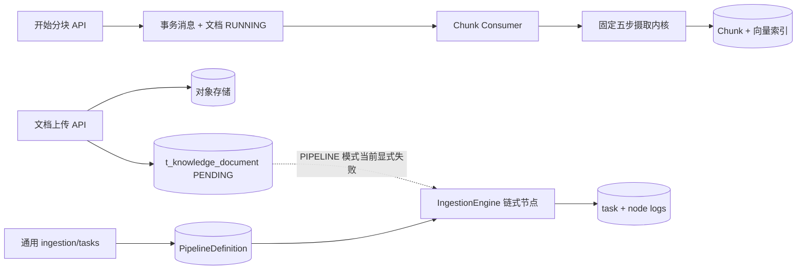

# AsterRAG P1 三条主调用链

> 产品源码：`sources/AsterRAG`  
> 冻结提交：`98894c2c42c015a3c874c6b3c986ac863c85b731`  
> 普查日期：2026-09-01  
> 证据等级：`verified-source`。本文件证明的是静态源码中的责任、顺序和分支；测试是否通过、外部依赖是否可用、真实链路是否跑通，必须看后续测试与运行证据。

## 0. 先给结论：不是“一条万能 Pipeline”

AsterRAG 当前有三条需要分别理解的主链：

1. **知识文档入库链**：上传只保存原文件和文档元数据；显式点击/调用“开始分块”后，RocketMQ 消费者才调用固定五步 `DefaultIngestionKernel`，最终替换该文档的 Chunk/索引。
2. **确定性 RAG 问答链**：固定顺序执行记忆、改写、意图、引导、检索、后处理、Prompt、LLM 和 RAG SSE 收尾。
3. **ReAct Agent 链**：由 AgentScope 决定每轮是否调用知识检索、MCP 或记忆工具，再由独立 Agent SSE 桥接层完成落库和释放。

此外还有一个独立的 **通用可配置入库子系统**：`/ingestion/tasks` 根据数据库里的 `PipelineDefinition` 同步执行 `IngestionEngine`。它不能和当前知识文档入库主链画成同一条线，因为 `KnowledgeDocumentServiceImpl.runChunkTask` 对 `ProcessMode.PIPELINE` 明确抛出“重构中，暂不可用”。



## 1. 知识文档写路径：上传和可检索是两个阶段

### 1.1 阶段 A：上传只建立原始资料与元数据

入口：

```text
POST /api/ragent/knowledge-base/{kb-id}/docs/upload
  KnowledgeDocumentController.upload
    -> KnowledgeDocumentServiceImpl.upload
       -> 校验知识库、来源、调度和摄取配置
       -> resolveStoredFile(...)
          -> FileStorageService 保存原文件
       -> ParserRegistry.canParse(mimeType)
          -> 不支持：删除刚保存的对象并抛 ClientException
       -> KnowledgeDocumentMapper.insert(... status=PENDING ...)
       -> 返回 KnowledgeDocumentVO
```

这一步的真实输出是：

- 对象存储里有原文件；
- `t_knowledge_document` 有一条 `PENDING` 文档记录；
- 记录包含文件 URL、展示类型、MIME、大小、来源、调度和摄取配置；
- **没有**自动调用 `startChunk`，因此没有证据证明 Chunk、Embedding 或索引已经生成。

失败窗口与责任：

- 摄取配置校验被刻意放在第一个副作用之前，避免无文档引用的孤儿对象。
- 原文件保存后，如果当前 MIME 没有解析器，Service 会调用 `fileStorageService.deleteByUrl` 再拒绝。
- 数据库插入若在文件已保存之后失败，是否由更外层补偿仍需结合对象存储实现和异常测试确认；不能仅凭方法结束就宣称全局原子。

源码锚点：

- `rag/.../knowledge/controller/KnowledgeDocumentController.java#upload`
- `rag/.../knowledge/service/impl/KnowledgeDocumentServiceImpl.java#upload`
- `rag/.../core/parser/registry/ParserRegistry.java#canParse`

### 1.2 阶段 B：显式触发后，事务消息把状态切换与异步执行接起来

入口：

```text
POST /api/ragent/knowledge-base/docs/{doc-id}/chunk
  KnowledgeDocumentController.startChunk
    -> KnowledgeDocumentServiceImpl.startChunk
       -> MessageQueueProducer.sendInTransaction(...)
          local transaction callback:
            - 条件更新 t_knowledge_document.status = RUNNING
            - 已经 RUNNING：拒绝重复启动
            - 回填 event.kbId
            - KnowledgeDocumentScheduleService.upsertSchedule
          -> RocketMQ 投递 KnowledgeDocumentChunkEvent
             -> KnowledgeDocumentChunkConsumer.onMessage
                -> 恢复操作者 UserContext
                -> KnowledgeDocumentService.executeChunk(docId)
                   -> KnowledgeDocumentServiceImpl.runChunkTask
```

关键边界：

- `@IdempotentSubmit` 不是这条异步链的全部幂等保证；`startChunk` 还通过条件更新阻止同一文档同时进入第二次 `RUNNING`。
- 事务回调只覆盖本地状态切换和调度记录，真正解析/Embedding/索引发生在 MQ 消费端。
- Consumer 的 `finally` 只负责清理 `UserContext`；业务成功或失败状态由 `runChunkTask` 收敛。

源码锚点：

- `KnowledgeDocumentServiceImpl#startChunk`
- `KnowledgeDocumentChunkConsumer#onMessage`
- `MessageQueueProducer#sendInTransaction`

### 1.3 固定五步摄取内核才是当前文档主链

`KnowledgeDocumentServiceImpl.runChunkTask` 先写一条 `t_knowledge_document_chunk_log` 的 `RUNNING` 记录，再进入内核：

```text
DefaultIngestionKernel.run(doc, bytes, spec, target)
  1. identity: MimeTypeDetector.detect(bytes, filename)
  2. parse: ParserRegistry.require(mime, profile)
            -> DocumentParser.parseStructured
            -> List<Block>
  3. chunk: ChunkingService.chunk(blocks, budget)
            -> List<Chunk>; 空列表直接失败
  4. embed: ChunkEmbeddingService.embed(chunks, target)
            -> List<EmbeddedChunk>; 模型与维度来自 VectorTarget
  5. index: ChunkIndexWriter.replaceDocument(target, doc, embedded)
            -> 替换该文档的索引落点
  -> IngestionOutcome(mime, parserType, blockCount, chunks, timings)
```

内核明确不负责文档任务状态和摄取日志；调用方负责最终收尾：

| 结果 | 文档状态 | Chunk 日志 | 其他持久化 |
|---|---|---|---|
| 成功 | `SUCCESS`，回填 `chunkCount` 和真实 MIME | `SUCCESS`，记录 parse/chunk/embed/index/total 耗时 | `ChunkIndexWriter.replaceDocument` 已完成 Chunk/索引替换 |
| 失败 | `FAILED` | `FAILED`，记录错误和已走阶段的耗时 | 已发生的外部副作用是否完全回滚取决于失败位置和各写入器事务边界，后续必须实测 |

这里的五步是源码注释所说的“全文唯一一条摄取执行序列”，教程应按这条线讲主循环，不能用通用 `IngestionEngine` 代替。

### 1.4 通用可配置 Pipeline：独立入口、独立任务表、同步执行

```text
POST /api/ragent/ingestion/tasks
  IngestionTaskController.create
    -> IngestionTaskServiceImpl.execute

POST /api/ragent/ingestion/tasks/upload?pipelineId=...
  IngestionTaskController.upload
    -> IngestionTaskServiceImpl.upload

两者汇合到 executeInternal:
  -> resolvePipelineId（必须解析出 pipelineId）
  -> IngestionPipelineService.getDefinition(pipelineId)
  -> INSERT t_ingestion_task status=RUNNING
  -> 构造 IngestionContext
  -> IngestionEngine.execute(PipelineDefinition, context)   [同步]
     -> 建立 nodeId -> NodeConfig
     -> 检测断链和环
     -> 找唯一根节点；0 个或多个都失败
     -> 按 nextNodeId 链式执行
     -> 可选条件不满足则记录 skip 并按 NodeResult 语义决定是否继续
     -> 节点失败将 context 标为 FAILED 并停止
     -> 全链未失败则 COMPLETED
  -> 保存 t_ingestion_task_node 日志
  -> 更新 t_ingestion_task 终态、Chunk 数、错误和元数据
```

当前 Spring 中注册的节点类型包括 `FetcherNode`、`ParserNode`、`EnhancerNode`、`ChunkerNode`、`EnricherNode` 和 `IndexerNode`。顺序来自数据库定义里的 `nextNodeId`，不是固定的“默认六步”。冻结源码的 `init_data_pg.sql` 未发现一条可当作默认 Pipeline 的种子数据，所以调用者必须先创建并传入定义。

尤其要写清：

```text
KnowledgeDocumentServiceImpl.runChunkTask
  if (ProcessMode.PIPELINE == processMode)
    throw ClientException("管道模式重构中，暂不可用，请改用直接分块...")
```

因此，“系统有可配置入库 Pipeline”是源码事实；“知识库文档当前默认通过该 Pipeline 入库”不是事实。

## 2. 确定性 RAG 读路径：固定顺序、显式短路、独立收尾

### 2.1 接入、排队和 Trace 外壳

```text
GET /api/ragent/rag/v3/chat?question=...
  RAGChatController.chat
    -> 创建 SseEmitter
    -> RAGChatServiceImpl.streamChat
       -> 生成 conversationId / taskId
       -> StreamCallbackFactory.createChatEventHandler
          -> StreamChatEventHandler 初始化时发送 META 并注册 task
       -> ChatQueueLimiter.enqueue
          -> FairDistributedRateLimiter.acquire
          -> 获取许可后交给 chatEntryExecutor
             -> StreamChatTraceRunner.run
                -> startRun(RUNNING)
                -> 用 ForwardingStreamCallback 包装完成/失败
                -> StreamChatPipeline.execute
```

`RAGChatController` 的 `@IdempotentSubmit` 只覆盖 Controller 返回 emitter 之前的同步提交窗口；覆盖整条流生命周期的并发保护由 `ChatQueueLimiter`/分布式限流器承担。

排队拒绝/超时不是简单 HTTP 错误：

```text
ChatQueueLimiter.handleReject
  -> 尝试保存 USER 消息
  -> 保存 REJECTED assistant 消息
  -> META -> REJECT -> FINISH(REJECTED) -> DONE
```

即使拒绝消息落库失败，代码仍尽力发送 `DONE`，避免前端永久等待。

### 2.2 `StreamChatPipeline` 的确定顺序与短路

```text
1. loadMemory
   - ConversationMemoryService.load
   - 先追加本轮 USER 消息，并把 messageId 交给 callback
2. rewriteQuery
   - QueryRewriteService.rewriteWithSplit
3. resolveIntents
   - IntentResolver.resolve
4. handleGuidance
   - 歧义时直接输出提示并 onComplete，后面不检索
5. handleSystemOnly
   - 全部为系统意图时直接流式调用系统回答，不检索
6. RetrievalEngine.retrieve
7. handleEmptyRetrieval
   - 空结果时输出固定提示并 onComplete，不做裸 LLM 回答
8. streamRagResponse
   - 合并意图
   - SourcesAssembler 分配唯一来源编号
   - CitationContextEnricher 富化/清理内部标记
   - GroundingChunksAssembler 生成落库证据
   - RAGPromptService 组装消息
   - LLMService.streamChat
   - StreamTaskManager.bindHandle 绑定模型取消动作
```

这条链不是任意 DAG，也不是 Agent 的思考循环；它通过固定私有阶段和 boolean 短路维护确定性。

### 2.3 检索内部：子问题并行、多通道并行、稳定后处理

`RetrievalEngine.retrieve` 按子问题建立并行任务，并把 KB 意图和 MCP 意图分开处理。KB 检索调用 `MultiChannelRetrievalEngine`；确定性 RAG 分支还可按参数提取三态决定是否执行 MCP：成功才调用，需要澄清则注入澄清文本，失败则注入错误文本。

每个 KB 子问题内部：

```text
RetrievalScopeResolver
  -> 计算全局或定向知识库范围
  -> 启用 SearchChannel 按枚举序稳定派发、并行执行
     -> 单通道异常：返回空结果
     -> 单通道超过 timeout-ms：放弃该通道结果，其余通道继续
  -> 后处理器按 getOrder 升序执行
     1  DeduplicationPostProcessor
     5  FusionPostProcessor
     10 RerankPostProcessor
     15 EvidenceGatePostProcessor
     20 MetadataEnrichmentPostProcessor
```

没有任何启用通道时，Engine 警告并返回空结果，随后主 Pipeline 走“未检索到”短路；源码明确把“静默退化成裸 LLM”视为配置事故。

### 2.4 RAG SSE 与持久化终态

`StreamChatEventHandler` 分别累积 thinking、answer、sources 和 grounding chunks：

| 出口 | assistant 消息 | SSE | task | Trace |
|---|---|---|---|---|
| 正常完成 | 尝试保存 `NORMAL`；落库异常只记录日志 | `FINISH` → `DONE` → complete | unregister | trace callback 结束为 `SUCCESS` |
| 用户取消 | 有正文时尝试保存 `INTERRUPTED` | `CANCEL` → `DONE` → complete | 取消由 task manager 驱动 | 当前 Trace wrapper 把 callback 的终结语义视为准；取消是否被记作成功需用测试/运行证据确认 |
| 流失败 | 此 Handler 不保存 assistant 失败消息 | fail emitter | unregister | trace callback 结束为 `ERROR` |
| 排队拒绝 | 保存 `REJECTED` assistant | `META` → `REJECT` → `FINISH` → `DONE` | 未进入正常 task 流 | 未进入 `StreamChatTraceRunner` |

`StreamChatTraceRunner` 在开始时写 `t_rag_trace_run`，首次正文到达时记录 user-first-packet 节点，并用 callback 的成功/失败终态更新 Run。同步阶段异常也转发到 trace-aware `onError`，避免 Run 永远停在 `RUNNING`。

## 3. ReAct Agent 路径：动态工具循环与三路统一释放

### 3.1 入口和启动期顺序

`AgentChatController` 只有 `ragent.engine.type=agent` 时才装配；随仓库 `application.yaml` 正好选择该值。

```text
GET /api/ragent/agent/v1/chat?question=...
  AgentChatController.chat
    -> AgentChatServiceImpl.streamChat
       -> 生成 conversationId / taskId
       -> AgentRunGate.acquire(userId, taskId, conversationId)
          - Redis 每用户一个运行位
          - 抢不到：在任何 META/会话/消息副作用前拒绝
       -> startRun
          1. 发送 META
          2. touchConversation
          3. 长期记忆开启时 ensureExtractionBaseline
          4. 保存 USER 消息
          5. 建立 AgentRunHandle
          6. 按序登记 release hooks：
             a. 释放闸门
             b. 驱逐本节点 Agent State 内存缓存
             c. 异步安排长期记忆抽取
          7. 绑定 emitter timeout/error/completion 到取消
          8. ReActAgentProvider.getAgent
          9. 建立 AgentStreamEventBridge 并注册 task
          10. ReActAgent.streamEvents(question, RuntimeContext(userId, sessionId))
          11. subscribe(event, error, complete)
          12. 绑定 disposable + agent.interrupt
```

如果启动期在 RunHandle 挂好收尾路之前失败，`streamChat` 的 `finally` 会就地释放闸门并注销 task；不能只讨论流开始后的正常收尾。

### 3.2 ReAct 实例、状态和工具目录

`ReActAgentProvider` 用“人设文本 + 工具目录指纹”缓存一个 Agent 实例；任一变化时下一次请求懒重建。构建参数包括：

- Agent 模型、`maxIters`、`maxRetries`；
- `PgAgentStateStore`；
- `AgentUserMemoryMiddleware`，随后是 `AgentContextCompactionMiddleware`；
- 由同一份 `ResolvedCatalog` 构建的 Toolkit。

`PgAgentStateStore` 把 AgentScope 自有 State 编解码为不透明 JSON，按 `userId + sessionId + key` 写入 `t_agent_state`。它与业务可展示的 `t_agent_message` 不是同一个对象，也不能从这段适配代码反推出 AgentScope 在每个异常时点的内部 save 顺序。

`AgentToolCatalog` 的真实工具边界：

- 固定注册 `KnowledgeSearchTool(search_knowledge)`；
- 长期记忆开启且描述槽位非空时注册 `MemoryFlushTool`；
- 意图树配置与当前 MCP 注册表取交集后，以 `McpToolBridge` 注册可用 MCP 工具；
- 指纹同时包含描述、展示名、Schema/definition，控制 Agent 懒重建。

`KnowledgeSearchTool` 是 Agent 进入 RAG 知识检索的唯一窄口：

```text
Agent chooses search_knowledge(query)
  -> KnowledgeSearchTool
     -> 读取当前会话最近 2 轮用于指代消解
     -> KnowledgeSearchFacade.search
        -> 改写拆分
        -> 意图解析后仅保留 KB 意图
        -> 歧义引导短路
        -> RetrievalEngine.retrieve
        -> 无 KB 证据时返回固定 EMPTY_RESULT
        -> 清除内部 docId 标记
        -> KB_ANSWER Prompt
        -> LLMService.chat 同步合成工具结果
  -> 工具文本返回 ReAct 循环
```

这说明 Agent **复用**检索、改写、意图和模型基础设施，但不复用 `/rag/v3/chat` 的整个 StreamChatPipeline 或 RAG SSE Handler。

### 3.3 Agent 事件桥和三条终态

`AgentStreamEventBridge` 把 AgentScope 事件映射为业务 SSE：

- 文本/思考增量 → `message`；
- 工具开始、结果增量、工具结束 → `tool`，同时积累可回放 Block；
- Hint/达到迭代上限 → `hint`；
- `AGENT_RESULT` → 作为无流式正文时的终答兜底。

三条出口统一进入 `AgentRunHandle` 的一次性 CAS：

| 出口 | assistant 业务消息 | SSE | 统一 finally |
|---|---|---|---|
| `onComplete` | 保存 `NORMAL`，正文以流式增量为准，空时回落 AgentResult | `FINISH` → `DONE` → complete | unregister task；释放闸门；驱逐本节点 State 缓存；安排长期记忆抽取 |
| `finishCancelledStream` | 有正文、思考或 Block 时保存 `INTERRUPTED` | `CANCEL` → `DONE` → complete | 同上 |
| `onError` | 当前业务桥不保存 assistant 失败消息 | fail emitter | 同上 |

`AgentRunHandle` 保证 complete/cancel/fail 只能有一个胜者；收尾体即使抛异常也会进入 finally；单个 release hook 失败不会阻止后面的 hook。

需要保留的未决边界：

- 应用源码证明三条出口都释放业务闸门、驱逐进程缓存并安排长期记忆抽取。
- 应用源码没有独立证明 AgentScope 内部 State 在正常、打断、异常的每一个时点都已经成功持久化；这需要 AgentScope 依赖源码、现有测试和真实运行证据共同确认。
- `ReActAgentProvider.evictStateCache` 只作用于当前节点，多节点部署还需要额外广播或其他一致性方案，源码注释也明确指出这一点。

## 4. 三条链在哪里共享、在哪里绝不能混用

| 能力 | 文档入库 | 确定性 RAG | ReAct Agent |
|---|---|---|---|
| HTTP 入口 | KnowledgeDocument / IngestionTask Controller | `/rag/v3/chat` | `/agent/v1/chat`，条件装配 |
| 编排模型 | 固定五步内核；另有独立可配置链式 Engine | 固定阶段 + 显式短路 | AgentScope ReAct 动态循环 |
| 主要共享 | Parser、Chunk、Embedding、索引写入 | AI Infra、检索、数据库、Redis、MCP Client | AI Infra；经 KnowledgeSearchFacade 复用 RAG 检索；MCP 执行器桥接 |
| 流协议 | 无客户端 SSE | RAG SSE enum/handler | Agent SSE enum/bridge |
| 持久状态 | 文档、Chunk、向量、分块日志；通用任务/节点日志 | RAG 会话/消息/摘要、Trace | Agent 会话/消息、AgentScope State、压缩、长期记忆 |
| 取消/失败 owner | MQ 消费端 Service 收敛文档状态 | StreamTaskManager + EventHandler + TraceRunner | AgentRunHandle + EventBridge |

总体架构图可以在检索引擎、模型基础设施和 PostgreSQL 处画共享节点，但不能：

- 把 `IngestionEngine` 画成当前知识文档默认入口；
- 把 `KnowledgeSearchFacade` 画成完整 RAG SSE Pipeline；
- 把 RAG 与 Agent 的 `message/finish/cancel/done` 当作同一 DTO 协议；
- 把上传成功、分块成功、向量写入成功和真实可召回画成一个状态。

## 5. P1 证据缺口

这些问题不阻止画出源码级调用链，但会限制教程中的运行性断言：

1. 本阶段尚未在远程开发环境执行测试；所有 test anchor 当时只是“存在”，不是“通过”。
2. 尚未启动 PostgreSQL、Redis、对象存储、RocketMQ 和模型供应商，不能宣称默认配置可直接端到端运行。
3. 固定入库内核缺少直接聚焦测试，P3 必须补真实最小入库证据。
4. RAG 取消时 Trace 最终状态、AgentScope 在异常/取消时的 State save 顺序，仍要靠测试/运行证据关闭。
5. 前端两套 SSE 消费协议尚需逐事件对照。
