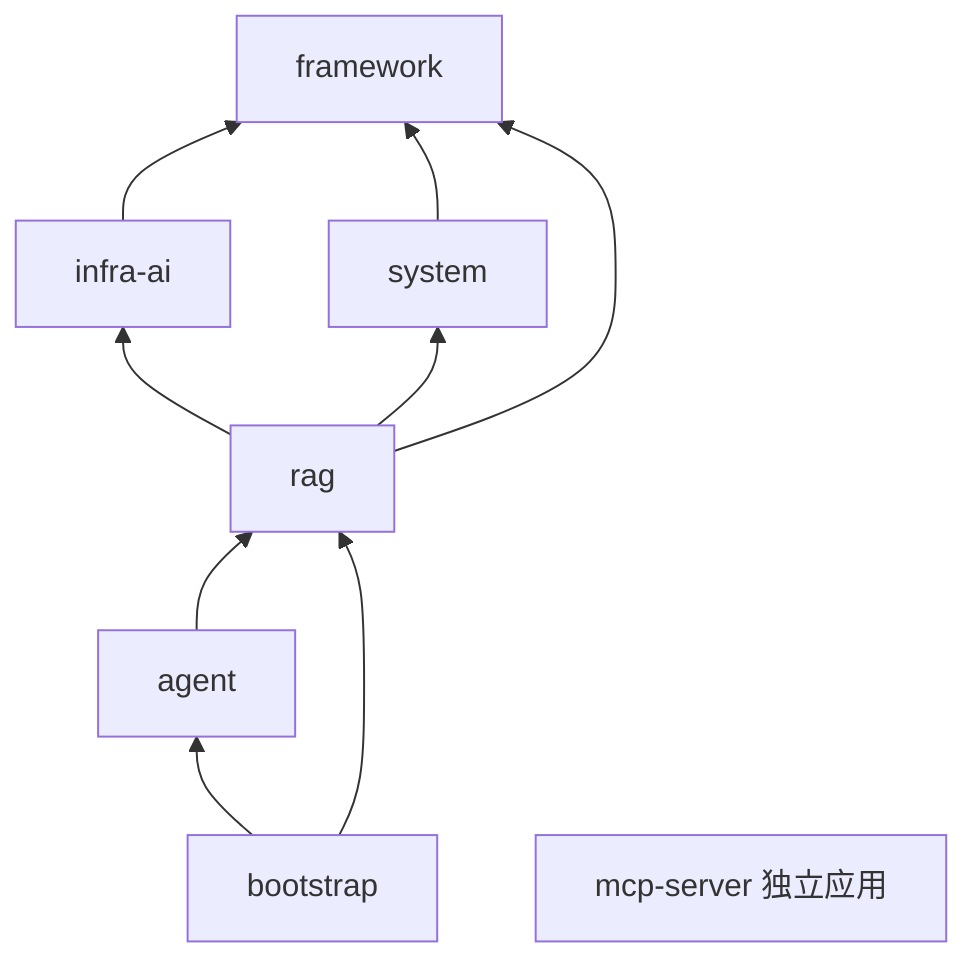

# AsterRAG P1 源码普查

> 产品源码：`sources/AsterRAG`  
> 冻结提交：`98894c2c42c015a3c874c6b3c986ac863c85b731`  
> 普查日期：2026-09-01  
> 证据等级：`verified-source`；本文件只证明静态源码事实，不证明外部依赖已经启动或端到端链路已经跑通。

## 1. 仓库规模快照

| 区域 | 主 Java 文件 | 测试 Java 文件 | 说明 |
|---|---:|---:|---|
| `framework` | 43 | 5 | 横切基础能力 |
| `infra-ai` | 51 | 3 | 模型、Embedding、Rerank、VLM 客户端与路由 |
| `system` | 41 | 0 | 用户、认证、示例问题、业务审计 |
| `rag` | 453 | 56 | 知识库、入库、RAG 编排与后台管理主域 |
| `agent` | 67 | 11 | ReAct Agent、工具、状态和记忆 |
| `bootstrap` | 1 | 0 | 应用启动装配 |
| `mcp-server` | 8 | 2 | 独立 MCP Server 与示例工具 |
| **合计** | **664** | **77** | 不含前端、生成物和依赖目录 |

补充观察：

- `frontend/src` 中有 131 个源码文件。
- 冻结源码中扫描到 24 个精确标注为 `@RestController` 的控制器，另有全局异常处理器。
- 扫描到 19 个 `@ConfigurationProperties` 类。
- `resources/database/schema_pg.sql` 定义 31 张表。
- 77 个 Java 测试文件中共有 367 处 `@Test`；其中 11 个文件使用 `@SpringBootTest`，另有 2 个文件名明确为 `*LiveTest.java`。

这些计数是源码普查结果，不等于测试通过数、覆盖率或生产可用性。

## 2. Maven 模块与依赖方向

根 `pom.xml` 声明 7 个模块，Java 17，Spring Boot 4.1.0。

| 模块 | 直接内部依赖 | 源码证明的主要责任 | 明确非责任 |
|---|---|---|---|
| `framework` | 无 | 统一响应/异常、认证上下文、幂等、MQ 适配、Trace 上下文、SSE 发送和任务管理等 | 不拥有知识库或 Agent 业务编排 |
| `infra-ai` | `framework` | Chat/Embedding/Rerank/VLM 客户端、模型候选、路由、首包解析和健康状态 | 不决定检索、意图或会话业务流程 |
| `system` | `framework` | 认证用户、示例问题、业务变更日志 | 不执行 RAG 或 Agent 主循环 |
| `rag` | `framework`、`system`、`infra-ai` | 知识库、文档、Chunk、入库 Pipeline、确定性 RAG、Trace、设置和后台 API | 不负责独立 MCP Server 进程 |
| `agent` | `rag` | ReAct Runtime、工具目录、Agent 会话/State/压缩/长期记忆和 Agent SSE | 不复制检索引擎；通过 `rag` 的窄门面复用知识检索 |
| `bootstrap` | `rag`、`agent` | `RagentApplication` 和最终 Spring Boot 装配 | POM 注释明确业务代码禁止进入 |
| `mcp-server` | 无内部模块依赖 | 独立 `McpServerApplication` 和示例 MCP 执行器 | 不是主应用内嵌的 Controller 模块 |

重要边界：这是模块化单体加一个独立 MCP Server，不应仅凭 Maven 模块数量称为 7 个微服务。

## 3. 主要包地图

| 模块 | 一级包 | 教程中的位置 |
|---|---|---|
| `framework` | `framework` | 第 17 章横切护栏 |
| `infra-ai` | `infra` | 第 13 章模型路由与流式调用 |
| `system` | `user`、`sample`、`audit` | 第 17～18 章认证、审计和控制台 |
| `rag` | `core`、`ingestion`、`knowledge`、`rag`、`admin` | 第 4～13、17～19 章主线 |
| `agent` | `agent` | 第 14～16 章 |
| `mcp-server` | `mcp` | 第 15、19 章 |

`rag` 模块内部还应按责任继续拆开：

- `knowledge`：知识库、文档、Chunk、远程刷新、对象存储和相关 MQ/调度。
- `ingestion`：Pipeline 定义、任务、节点、策略和执行引擎。
- `rag.core`：记忆、改写、意图、引导、检索、后处理、Prompt、来源与 MCP Client。
- `rag.service/pipeline`：确定性问答编排。
- `rag.trace` 与 `rag.aop`：Trace 记录和切面。
- `admin` 与 Controller：管理读写入口，不等于核心引擎本身。

## 4. 启动与默认运行档位

### 4.1 主应用

- 入口：`bootstrap/src/main/java/com/nageoffer/ai/ragent/RagentApplication.java`。
- 默认端口：`9090`。
- Servlet context path：`/api/ragent`。
- 根 Maven 版本：Java 17、Spring Boot 4.1.0。

### 4.2 独立 MCP Server

- 入口：`mcp-server/src/main/java/com/nageoffer/ai/ragent/mcp/McpServerApplication.java`。
- 它是独立启动边界；主应用通过 `rag.mcp.servers` 配置连接远端工具。

### 4.3 “类默认值”和“随仓库 YAML 默认值”必须分开

`OrchestrationProperties.type` 的 Java 字段兜底值是 `workflow`，但随仓库提交的 `application.yaml` 明确配置 `ragent.engine.type: agent`。因此，用该 YAML 正常启动时装配 Agent 档；删除/覆盖该键时才可能回到类兜底。

同样，Milvus 实现使用 `matchIfMissing=true`，但随仓库 YAML 配置 `rag.vector.type: pg`，所以当前随仓库默认配置选择 pgvector。不能只看 `@ConditionalOnProperty(matchIfMissing=true)` 就宣称默认是 Milvus。

## 5. 默认配置矩阵

| 能力 | 随仓库 YAML | 源码装配/读取条件 | 普查结论 |
|---|---|---|---|
| 执行架构 | `ragent.engine.type=agent` | `@ConditionalOnAgentEngine` 要求值为 `agent` | Agent Controller/Service/Memory 默认参与装配 |
| 对象存储 | `rag.storage.type=s3` | S3 `matchIfMissing=true`，OSS 要求 `oss` | 随仓库默认走 S3 兼容端点 |
| 向量后端 | `rag.vector.type=pg` | PG 要求 `pg`；Milvus 要求 `milvus` 且缺省兜底 | 随仓库默认走 PostgreSQL/pgvector |
| 向量通道 | `enabled=true` | `VectorSearchChannel.isEnabled()` | 默认参与问答召回 |
| 关键词后端/通道 | `type=none` / `enabled=false` | ES Bean 要求 `type=es` | 默认不装配、不参与召回 |
| 图谱后端/通道 | `type=none` / `enabled=false` | LightRAG Bean 要求 `type=lightrag` | 默认不装配、不参与召回 |
| 联网检索 | `enabled=false` | 还需要 API key | 默认不参与召回 |
| 查询改写 | `enabled=true` | 由改写服务读取 | 默认开启 |
| Rerank | `enabled=true` | 由 Rerank 配置和模型候选读取 | 默认开启，但真实供应商仍需凭据 |
| 行内引用 | `enabled=true` | 来源上下文富化读取 | 默认开启；来源面板不完全依赖此开关 |
| Trace | `enabled=true` | Trace runner/support 读取 | 默认记录，仍需数据库可用 |
| RAG 全局并发保护 | `enabled=true`、最大并发 10 | Redis 公平队列/信号量 | 默认需要 Redis 才能按设计运行 |
| 评测 Controller | `ragent.eval.enabled=true` | Controller 条件装配 | 默认暴露评测入口；不等于评测已执行 |

### 5.1 检索漏斗默认值

- 每通道召回预算：20。
- RRF 后送入 Rerank 的候选上限：40。
- 最终进入 LLM 的 Top-K：10。
- 单通道超时：15 秒；超时按空结果降级，其余通道可继续。
- 证据门默认最低 Rerank 分数：0.2。

`SearchChannelProperties.afterPropertiesSet()` 在启动时校验召回预算和候选池不得小于最终 Top-K，并校验作用域、补充比例与证据阈值。教程应把这些写成“配置不变式”，不是经验建议。

## 6. Controller/API 清单

所有路径都还要拼接全局 context path `/api/ragent`。

### 6.1 Agent（仅 Agent 档装配）

| Controller | 关键路径 | 责任 |
|---|---|---|
| `AgentChatController` | `GET /agent/v1/chat`、`POST /agent/v1/stop` | Agent SSE 与停止 |
| `AgentConversationController` | `/agent/v1/conversations...` | Agent 会话/消息查询、改名、删除 |
| `AgentMetaController` | `GET /agent/v1/meta` | 当前 Agent 元信息 |

### 6.2 确定性 RAG 与管理入口

| Controller | 关键路径 | 责任 |
|---|---|---|
| `RAGChatController` | `GET /rag/v3/chat`、`POST /rag/v3/stop` | Workflow/RAG SSE 与停止 |
| `ConversationController` | `/conversations...` | RAG 会话和消息 |
| `MessageFeedbackController` | `/conversations/messages/{messageId}/feedback` | 点赞/点踩反馈 |
| `RecommendedQuestionController` | `/conversations/messages/{messageId}/recommended-questions` | 推荐追问 |
| `RagTraceController` | `/rag/traces/runs...` | Trace Run/Node 查询 |
| `RAGSettingsController` | `GET /rag/settings` | 当前非敏感配置投影 |
| `EvalController` | `GET /rag/eval` | 条件装配的评测入口 |
| `AgentProfileController` | `/agents...` | 人设和 Prompt 配置（不是 Agent 运行入口） |
| `IntentTreeController` | `/intent-tree...` | 意图树管理 |
| `QueryTermMappingController` | `/mappings...` | 查询词映射管理 |
| `GraphController` | `/admin/kg...` | 图谱查询/可视化入口 |
| `DashboardController` | `/admin/dashboard...` | 管理看板聚合 |

### 6.3 知识与入库

| Controller | 关键路径 | 责任 |
|---|---|---|
| `KnowledgeBaseController` | `/knowledge-base...` | 知识库 CRUD |
| `KnowledgeDocumentController` | `/knowledge-base/.../docs...` | 文档上传、触发分块、预览、文件和日志 |
| `KnowledgeChunkController` | `/knowledge-base/docs/{doc-id}/chunks...` | Chunk 查询和人工维护 |
| `IngestionPipelineController` | `/ingestion/pipelines...` | Pipeline 定义管理 |
| `IngestionTaskController` | `/ingestion/tasks...` | 通用入库任务创建、上传和节点查询 |

### 6.4 系统支撑

| Controller | 关键路径 | 责任 |
|---|---|---|
| `AuthController` | `/auth/login`、`/auth/logout` | 登录登出 |
| `UserController` | `/user/me`、`/users...` | 当前用户和用户管理 |
| `SampleQuestionController` | `/sample-questions...` | 示例问题 |
| `BizChangeLogController` | `/biz-change-logs...` | 业务变更审计查询 |

API 方法级清单应在各章只保留与调用链相关的入口；普通 CRUD 不逐个展开。

## 7. 数据库对象清单

`schema_pg.sql` 共定义 31 张表，可按所有权分组：

| 领域 | 表 |
|---|---|
| 用户与通用产品 | `t_user`、`t_sample_question`、`t_biz_change_log` |
| 确定性 RAG 会话 | `t_conversation`、`t_conversation_summary`、`t_message`、`t_message_feedback` |
| 知识库与文档 | `t_knowledge_base`、`t_knowledge_document`、`t_knowledge_chunk`、`t_knowledge_document_chunk_log` |
| 远程刷新 | `t_knowledge_document_schedule`、`t_knowledge_document_schedule_exec` |
| 意图与查询 | `t_intent_node`、`t_query_term_mapping` |
| RAG Trace | `t_rag_trace_run`、`t_rag_trace_node` |
| Agent 配置 | `t_agent_profile`、`t_agent_prompt` |
| Agent 运行状态 | `t_agent_conversation`、`t_agent_message`、`t_agent_state`、`t_agent_context_compaction` |
| Agent 长期记忆 | `t_agent_memory`、`t_agent_memory_extraction`、`t_agent_memory_control` |
| 入库 Pipeline | `t_ingestion_pipeline`、`t_ingestion_pipeline_node`、`t_ingestion_task`、`t_ingestion_task_node` |
| pgvector | `t_knowledge_vector` |

这张分组表只说明持久化所有权。后续仍需逐链确认写入顺序、唯一约束、外键/逻辑关系、删除和恢复语义。

## 8. 前端入口普查

前端存在两套独立流式 hook 和 store：

- `useStreamResponse.ts` + `chatStore.ts` 请求 `/rag/v3/chat`。
- `useAgentStream.ts` + `agentChatStore.ts` 请求 `/agent/v1/chat`。

因此，RAG 与 Agent 虽然都使用 SSE，但不能在教程中先验地当作同一事件协议；Q-006 需要继续核对两套事件类型和收尾行为。

页面覆盖：登录、RAG Chat、Agent Chat、文档预览，以及 Dashboard、知识库/文档/Chunk、入库、意图树、查询映射、知识图谱、Agent 人设/Prompt、Trace、用户、设置和审计等管理页面。

## 9. 测试普查结论

- CI 的后端命令是 `./mvnw -B test -Dsurefire.excludes='**/*Tests.java'`，其目标是排除上游以 `*Tests` 命名、依赖 Redis/PostgreSQL/Milvus/真实供应商的 Spring 集成类。
- CI 还执行前端 `npm ci`、`npm run lint` 和 `npm run build`。
- `@SpringBootTest`、`*Tests.java` 和 `*LiveTest.java` 是风险信号，但不能仅凭命名完成所有测试分类；最终矩阵见 `test-matrix.md`。
- 本普查阶段尚未声称这些测试在远程开发环境通过。

## 10. P1 初步架构结论

1. 当前 AsterRAG 已明显超出作者公开教程中的 4 模块描述，教程必须以 7 模块依赖图为准。
2. 随仓库默认档位是 Agent；确定性 RAG Pipeline 仍以独立 HTTP/SSE 入口存在。Agent 只通过 `KnowledgeSearchFacade` 复用其中的改写、意图、检索和同步答案合成能力，并不复用整个 `StreamChatPipeline` 或 RAG SSE Handler。
3. 随仓库默认检索仅启用向量通道，使用 PostgreSQL/pgvector；关键词、图谱和联网搜索是有实现但默认关闭的可选通道。
4. 数据持久化至少分成 RAG 会话、知识库/入库、Trace、Agent State/Memory 和向量五类，不能把 PostgreSQL 简化成“存聊天记录”。
5. 静态普查已经建立模块、入口、配置和数据地图，但尚不能证明运行成功；下一步必须追踪三条主调用链并把每个箭头绑定到符号和测试。
